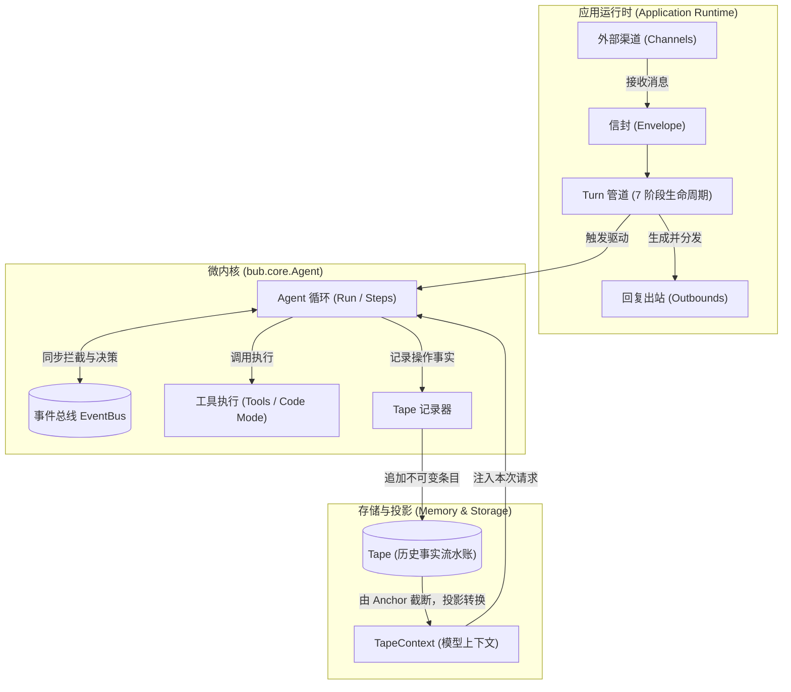

# Concepts 核心概念章节修订纲要

本纲要用于指导 Bub 文档中 **Concepts（核心概念）** 模块的重构与优化。

---

## 一、 设计原则与定位

1. **侧栏保持概念本质**：侧栏直接展示纯粹、凝练的概念名词（内核、Turn、Tape、事件、扩展点），页面标题再承担具体描述性说明。
2. **心智模型优先于实现细节**：聚焦架构哲学（Mental Model）与设计边界（Design Philosophy），解释清楚“是什么”、“为什么这样设计”以及“它解决了传统 Agent 的什么痛点”，避免过早陷入 API 参数细节。
3. **建立全景贯穿感**：各概念之间通过一条统一的数据与控制流串联，形成完整体系。

---

## 二、 侧栏结构与页面规划

| 序号 | 侧栏展示 (Sidebar Label) | 页面标题 (Document Title) | 路径与 Slug | 概念定位 |
| :--- | :--- | :--- | :--- | :--- |
| 0 | **概览** | 概览：Bub 的设计哲学与职责边界 | `docs/concepts/index.mdx` | 全景心智模型与各概念串联 |
| 1 | **内核** *(新增)* | 内核：微内核架构与纯粹组装契约 | `docs/concepts/kernel.mdx` | `bub.core` 哲学、无配置/显式组装 |
| 2 | **Turn** | Turn：消息处理流程与确定性管道 | `docs/concepts/turn.mdx` | Turn / Run / Step 层次与 7 阶段状态机 |
| 3 | **Tape** | Tape：持久存储、不可变事实与上下文投影 | `docs/concepts/tape.mdx` | 事实流 (Write) 与上下文 (Read) 的正交解耦 |
| 4 | **事件** | 事件：可观测与同步决策拦截总线 | `docs/concepts/events.mdx` | 具备裁决权（Decision）的 EventBus |
| 5 | **扩展点** | 扩展点：能力切入边界与单一职责原则 | `docs/concepts/extension-points.mdx` | 架构扩展机制分类与决策树 |

---

## 三、 全景心智流转模型

以下流转图作为统领所有概念的核心心智图，贯穿于《概览》与《内核》章节：

---

## 四、 各章节修订大纲与核心内容

### 0. 概览 (`index.mdx`)
- **修订方向**：在现有已润色的背景故事（自我进化智能体、阿西莫夫三定律、机器人中立契约）基础上，强化概念之间的串联感。
- **核心要点**：
  1. **工程化使命**：大模型交互本身具备不确定性，框架的核心使命是在外围建立**确定性的约束、存储、安全审计与流程控制**。
  2. **全景心智地图**：展示上述 Mermaid 架构全景图，明确标定内核、Turn、Tape、事件、扩展点各自处在消息处理与执行的哪个环节。
  3. **导航卡片扩展**：卡片网格补充新增的《内核》页面，形成 5 大支柱概览。

---

### 1. 内核 (`kernel.mdx`) —— *【新增页面】*
- **概念本质**：`bub.core` 的**微内核哲学（Microkernel Design）**。
- **解决痛点**：为什么不能把所有开关、渠道、配置一股脑塞进 Agent 类里？
- **核心要点**：
  1. **零环境污染与显式依赖注入**：
     - `bub.core.Agent` 内部**没有任何 `os.environ` 依赖、没有全局配置项、没有隐藏的全局单例**。
     - 一切能力（Model、Store、Tools、Context、Sidecars）纯粹依靠构造函数显式组装。
  2. **双层架构的边界划分**：
     - **内核层 (`bub.core`)**：只关心最纯粹的单次循环（LLM 调用、工具调度、事件派发、Tape 读写）。可作为极简 Python 库嵌入已有 Web 服务或异步队列。
     - **应用层 (`bub.framework` / `builtin`)**：处理生产级完整应用的外部复杂度（配置加载、渠道网关、会话解析路由、插件自动发现）。
  3. **中立性协议**：内核不假定特定的模型供应商或数据库存储，纯粹依赖协议（Protocol）与适配器。

---

### 2. Turn (`turn.mdx`)
- **概念本质**：消息交互的**确定性状态机与生命周期管道**。
- **解决痛点**：多轮会话中，状态何时加载/保存？出错时如何避免状态悬空？回复怎样可靠路由？
- **核心要点**：
  1. **三层执行颗粒度边界**：
     - `Turn`：外部一次消息交互的完整生命周期（接收 -> 保存 -> 发送）。
     - `Run`：当前 Turn 内部启动的模型与工具迭代循环（直到模型满意或达到上限）。
     - `Step`：一次具体的模型推理与随后的所有并发工具调用。
  2. **7 阶段确定性管道**：
     - 规范阶段流转：`resolve_session` -> `load_state` -> `build_prompt` -> `run_model` -> `save_state` -> `render_outbound` -> `dispatch_outbound`。
     - 强调异常保障机制：模型阶段进入 `finally` 确保 `save_state` 执行，保障即使 LLM 出错或超时，会话状态也不会悬空。
  3. **TurnState 的瞬态契约**：明确它是单次管道共享的内存字典，生命周期不跨 Turn。

---

### 3. Tape (`tape.mdx`)
- **概念本质**：**不可变事实追加流 (Write) 与 上下文投影 (Read) 的正交解耦**。
- **解决痛点**：传统框架将会话等同于 `messages: list[Message]` 数组，导致上下文超长时只能盲目截断或粗暴 summary，丧失审计回溯能力。
- **核心要点**：
  1. **事件溯源（Event Sourcing）视角下的 Tape**：
     - Tape 是 Write Model：按时间戳线性追加所有客观事实（对话、工具调用入参、执行返回值、业务事件）。
     - 正常运行只追加不篡改，保障系统的确定性、可调试性与合规审计。
  2. **上下文投影（Projection via TapeContext）**：
     - TapeContext 是 Read Model：从全量 Tape 条目中，按规则过滤转换出当前模型推理所必需的视界。
  3. **Anchor（锚点）与认知交接（Handoff）**：
     - Anchor 不是简单的物理清空，而是**阶段性认知里程碑**（例如从“信息收集”走向“订单确认”）。
     - 剖析显式 Handoff 与超长自动 Handoff 的触发机制。

---

### 4. 事件 (`events.mdx`)
- **概念本质**：**从只读可观测，演进为具备裁决权（Decision）的同步总线**。
- **解决痛点**：如何在不污染业务工具代码的前提下，统一实现权限检查、人工介入（Human-in-the-loop）、数据脱敏与调用替换？
- **核心要点**：
  1. **三类数据流的区别**：清楚界定 `AgentEvent`（生命周期与控制）、`StreamEvent`（前端流式输出）与 `TapeEntry`（持久化记录）。
  2. **同步阻塞与决策系统 (`ToolCallDecision`)**：
     - 为什么事件总线是同步等待的？因为必须保证“策略控制先于动作执行”。
     - 阐释三种裁决手段：`deny()`（拒绝调用并反馈给模型）、`replace()`（Mock 或直接返回替代结果）、改写参数（替换 `event.call`）。
  3. **控制反转（IoC）哲学**：业务工具只需老老实实写执行逻辑，风控、权限、预算等跨切面逻辑交由事件监听器负责。

---

### 5. 扩展点 (`extension-points.mdx`)
- **概念本质**：Bub 系统的**能力切入分类体系与单一职责原则**。
- **解决痛点**：开发者面对新需求时，不知道该写成 Tool、Skill、Hook、Event 还是 Channel。
- **核心要点**：
  1. **正交的五大扩展维度**：
     - **动作层 (Action)**：工具（Tools，负责可执行代码）。
     - **认知与流程层 (Instruction)**：技能（Skills，提供可被模型阅读的任务说明书）。
     - **策略与约束层 (Policy)**：事件总线（Events，负责拦截改写）。
     - **生命周期层 (Lifecycle)**：插件与 Turn Hooks（注入阶段逻辑）。
     - **通信与传输层 (Transport)**：渠道（Channels，连接各类 IM 和外部协议）。
  2. **决策树（选择心智）**：
     - “我要调外部系统或数据库” 👉 工具。
     - “我要教模型某个复杂业务 SOP” 👉 技能。
     - “我要在模型调用敏感操作前校验权限” 👉 事件处理器。
     - “我要改变消息进入模型的组装方式” 👉 Turn Hook。
     - “我要对接钉钉、飞书或 Telegram” 👉 渠道。
  3. **黄金法则：单一所有权（One Owner）**：
     - 避免在工具里硬编码风控规则，避免在技能里塞大段待执行脚本，保持扩展正交。

---

## 五、 后续实施与执行路线

1. **配置调整**：
   - 更新 `website/astro.config.mjs` 中的 `sidebar` 配置，在 `Concepts` 分组下加入 `docs/concepts/kernel`。
2. **新增页面**：
   - 编写 `src/content/docs/zh-cn/docs/concepts/kernel.mdx`（中文）。
   - 编写 `src/content/docs/docs/concepts/kernel.mdx`（英文）。
3. **润色与强化现有各篇**：
   - 更新 `index.mdx`：加入全景架构图与内核导航卡片。
   - 润色 `turn.mdx`：强化管道防腐层与确定性状态流转。
   - 润色 `tape.mdx`：深化 Event Sourcing / 投影解耦哲学。
   - 润色 `events.mdx`：突出同步决策拦截与控制反转。
   - 润色 `extension-points.mdx`：梳理决策树并强化单一所有权。
4. **验证与校验**：
   - 运行 `pnpm build` 或 `make docs-test`，确保两套语言的链接、Mermaid 图表及路由无死链。
