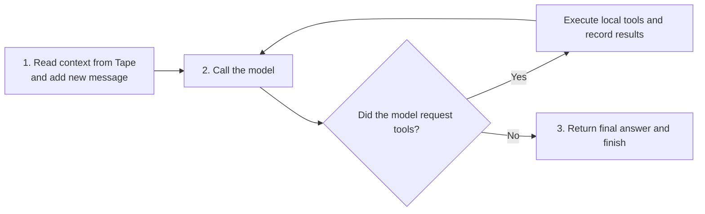

A model on its own can only take text in and produce text out. To let it inspect files, call APIs, and work through multi-step tasks, an Agent connects a **model**, **tools**, and **conversation history** (the Tape) inside a loop: the model decides the next move from the current context, tools carry out the actions, the Tape records what happened, and the loop keeps advancing until the model has a final answer.

## How the loop runs {#loop}

In Bub, each pass through the Agent loop follows three steps:

1. **Read context and call the model**: select relevant history via `TapeContext`, append the new user message, and send the request to the model.
2. **Execute tools on demand**: if the model requests tool calls, Bub validates arguments, runs the corresponding Python functions, and feeds the results back into the next model call.
3. **Answer and finish**: once the model has enough information and replies directly without requesting tools, the run finishes.

To make this loop easy to observe and control in code, Bub distinguishes two execution units:

| Concept | Meaning | Ends when |
| --- | --- | --- |
| **Run** | One complete Agent execution (one `agent.run()` call), yielding a stream of `StreamEvent` items | The model answers directly without calling tools, or the caller closes the stream |
| **Step** | One pass inside a Run: a single model call plus all tool calls requested by that response | All tool calls requested in that step finish |

In short, **one Run is made up of one or more Steps**. If the model can answer right away, the Run takes 1 Step; if it calls tools twice before answering, the Run takes 3 Steps.

Keep three key boundaries in mind when working with the loop:

- **Consuming the stream drives the Run**: calling `agent.run()` only sets up the execution context. Model and tool calls advance only as you iterate the returned stream with `async for`. Breaking out of the loop and closing the stream cleanly stops the Run.
- **Context is built from the Tape on each Step, not kept in a private list**: a Run does not maintain its own `messages` array in memory. Before each Step, it builds the model messages from the Tape via `TapeContext` (see [Tape and model context](/docs/concepts/tape/)).
- **A Run is not a Turn**: a Run is the core model-and-tool loop; a Turn is the app layer's 7-stage pipeline for handling an inbound message. Direct commands such as `,help` can finish inside a Turn without starting a model Run at all (see [Turn](/docs/concepts/turn/)).

## Core layer vs. app layer {#layers}

`bub.core.Agent` is Bub's microkernel. It focuses strictly on the model–tool–event–Tape loop: **it does not read YAML config files or `BUB_*` environment variables, and it knows nothing about channels or plugin discovery**.

The app layer (`BubFramework` and `BubAgent`) wraps that same core loop with configuration, plugins, hooks, skills, channels, and session routing.

That separation lets you choose how much of Bub to adopt:

- **Embed in a Python service**: use the core [SDK](/docs/sdk/) and pass the model, tools, and store explicitly.
- **Use the message pipeline, config, or plugins**: run the Bub CLI directly, or [reuse the Bub app layer in your service](/docs/integrations/reuse-app/).
