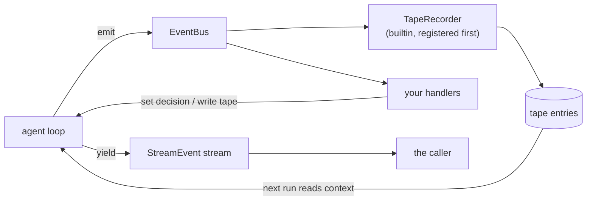

import { Aside } from '@astrojs/starlight/components';

Agent events let you see a run and let you decide before a model or tool call happens. Every agent creates an `EventBus` and registers a `TapeRecorder`. You add handlers through `agent.events`.

Events are the only cross-cutting seam in Bub. Logging, permissions, budgets, auditing, and UI progress can all be written as handlers alone, without touching the loop or the tools.

## Three kinds of information {#three-kinds}

"Event" means three different things in Bub, and mixing them up is the easiest way to write a bug. Separate them first:

| Type | Purpose | How to read it | Who reads it |
| --- | --- | --- | --- |
| `AgentEvent` | Run lifecycle, and call interception. | `agent.events.on(...)` | host code and plugins |
| `StreamEvent` | Output for the caller, such as text and tool progress. | iterate the stream from `agent.run()` | code that calls the agent |
| `TapeEntry` | The stored conversation and some run records. | query the [tape](/docs/concepts/tape/) | the model, on later runs |

How the three relate:



Mind the direction of the arrows. `StreamEvent` is a **one-way exit**: you can consume it, but you cannot change the run through it. To change the run, use an `AgentEvent` handler. Conversely, a `TapeEntry` is **after the fact**; writing one does not affect the step in progress.

The loop controls execution, calls event handlers at fixed points, and only then moves on. TapeRecorder saves selected round-trips and lifecycle records. For anything else you want kept, write your own handler.

## Handlers {#handlers}

The examples below use the `agent` from the [SDK guide](/docs/sdk/):

```python
from bub.core.events import StepFinished, ToolCallFinished


@agent.events.on(ToolCallFinished)
async def report_tool(event: ToolCallFinished) -> None:
    print(event.call.tool, event.result.duration_ms, "ms")


def report_step(event: StepFinished) -> None:
    print("step", event.step, event.status)


agent.events.on(StepFinished, report_step)
```

The two registration forms are equivalent: the decorator suits a new function, and passing it directly suits an existing one. To remove it, call `agent.events.off(StepFinished, report_step)`.

A handler registered on a base class also receives subclass events. Every agent event derives from `AgentEvent`, so a handler registered for `AgentEvent` receives all of them — useful for uniform logging or timing, but watch the volume.

### Delivery rules {#delivery}

Four rules decide what a handler may assume about ordering:

1. **Registration order.** Within one dispatch, matching handlers run in the order they were registered.
2. **Async handlers finish first.** The bus awaits one async handler before calling the next.
3. **Return values are ignored.** Whatever a handler returns, the bus discards. To influence the run, mutate fields on the event.
4. **Exceptions propagate.** A handler exception is raised out of `emit()`, and can fail the whole run.

Rule 4 catches people. A handler that only observes should catch its own errors:

```python
@agent.events.on(ToolCallFinished)
async def audit_tool(event: ToolCallFinished) -> None:
    try:
        await send_to_audit_log(event.call.tool, event.result)
    except Exception:
        logger.warning("audit failed tool={}", event.call.tool)
```

Another edge: **ordering applies to one dispatch only.** Concurrent tool calls or two runs may emit events at the same time. State shared between handlers is still yours to coordinate.

## Call control {#call-control}

To stop a call, assign the event's `decision` field. This is the only place in the event system where you can rewrite the loop's behavior.

```python
from bub.core.events import ToolCallDecision, ToolCallStarted


@agent.events.on(ToolCallStarted)
def require_refund_permission(event: ToolCallStarted) -> None:
    if event.call.tool == "refund_order" and not event.state.get("refunds_allowed"):
        event.decision = ToolCallDecision.deny("Refunds require approval.")
```

Three verdicts, three different effects:

| Verdict | Did the tool run? | What the model sees | Afterwards |
| --- | --- | --- | --- |
| `deny(message)` | no | a tool error | this dispatch stops |
| `replace(result)` | no | the result you supply | this dispatch stops |
| change `event.call` | yes, with new arguments | the real result | dispatch continues |

`deny()` skips the tool and produces a tool error. `replace(result)` skips the tool and supplies the result directly. Both stop this `ToolCallStarted` from propagating. The executor still emits `ToolCallFinished` for the outcome. In the model loop the error goes back to the model as a tool result; in a direct command call the error is raised to the caller.

To change arguments and continue, replace `event.call` with `dataclasses.replace(event.call, arguments=...)`. Note that this is a replacement, not a mutation: the event objects are frozen.

To end before the model call, set `event.decision = LLMCallDecision.finish(text)` on `LLMCallStarted`. That stops later handlers and skips the provider call entirely. A skipped provider call emits no `LLMCallFinished` — **your timing and billing code must not assume the two events come in pairs**.

### Event reference {#event-reference}

These are all the agent events. Signatures and full fields are in the [Python API reference](/docs/reference/python-api/).

| Event | When | What you can do |
| --- | --- | --- |
| `RunStarted` | A model run starts. | Read the prompt, model, and metadata. |
| `RunFinished` | The run's stream closes. | Read status, step count, elapsed time, and the error. |
| `StepStarted` | A model step starts. | Read progress. |
| `StepFinished` | A model step ends. | Read progress. With `status == "continue"`, set `next_prompt` to add a user message for the next step. |
| `MessagesPending` | A step builds its model request, or a step ends without tool calls. | Append user messages to `messages`, ordered before the next prompt. Messages added at the end of a step make the run continue. |
| `LLMCallStarted` | Before the provider call. | Replace `request`, or set `LLMCallDecision.finish(text)`. |
| `LLMCallFinished` | The provider call completes or raises. | Read the accumulated result. Cancellations and consumer closes are not reported. |
| `ToolCallStarted` | Before a tool runs. | Replace `call`, deny the call, or replace the result. |
| `ToolCallFinished` | A tool succeeded, failed, was denied, or was replaced. | Assign to `event.result.result` to change the result. |
| `ChatFinished` | This step's round-trip can be recorded. | Read the round-trip. |
| `CommandFinished` | A direct command completed or failed. | Read the command, status, and output. |

`MessagesPending` deserves its own note: it is the entry point for **interjecting during a run**. `StepFinished.next_prompt` sets the next step's user message, and `MessagesPending` appends messages at the last moment before the request is built. Steering is implemented on exactly these two points — something the user adds while the model is thinking does not have to wait for the next run.

A command prompt runs tools directly, emitting tool events and `CommandFinished`. See [calling tools without the model](/docs/sdk/tools/#call-a-tool-without-a-model).

Every agent event carries the run's `state`. Events derived from `TapeEvent` also carry the current tape. Tool events expose `event.call.context` when the call has one.

## Recording {#recording}

The agent registers TapeRecorder before your handlers. It records `RunStarted`, `RunFinished`, `StepStarted`, `StepFinished`, `ChatFinished`, and `CommandFinished`.

`ChatFinished` is the important one: that handler writes the messages and tool round-trips, and later model calls get their context from what it wrote. In other words, **TapeRecorder is not optional logging — it is the producer of the context**. Delete the round-trips from the tape and the next run reads nothing of what happened.

Recording is part of the normal flow. It writes to the store you configured, and to memory when you configure none. Recording is independent of tracing settings: you can turn tracing off and recording continues.

<Aside type="tip">
  To keep a custom event, add a handler that writes it to the tape. To change a request or result, use the interception events. By the time a `ChatFinished` observer runs, the default recorder has already stored this round-trip — delivery follows registration order, and it registered before you.
</Aside>

## Custom events {#custom-events}

Define a dataclass that inherits `AgentEvent`. Inherit `TapeEvent` instead when handlers need the tape.

```python
from dataclasses import dataclass

from bub.core.events import TapeEvent


@dataclass(kw_only=True)
class OrderReviewed(TapeEvent):
    order_id: str


@agent.events.on(OrderReviewed)
async def record_review(event: OrderReviewed) -> None:
    await event.tape.append_event("order.reviewed", {"order_id": event.order_id})


async def mark_reviewed() -> None:
    tape = agent.tape("customer-42")
    await agent.events.emit(
        OrderReviewed(state=tape.context.state, tape=tape, order_id="A123")
    )
```

A custom event inherits three capabilities: the same delivery rules, access to the run's state and tape, and the ability to be intercepted.

`emit()` returns the event once the handlers have run. A custom mutable event can carry a result back to the emitter. To stop delivery as soon as the outcome is settled, override its `stopped` property — that is how the builtin `ToolCallStarted` lets `deny` and `replace` terminate early.

Tools can emit events through `context.events`, using that same run state.

## App plugins {#app-plugins}

The kernel uses events; the app uses hooks. `AgentPlugins` is the bridge.

It maps four hooks onto call events: `before_llm_call`, `after_llm_call`, `before_tool_call`, and `after_tool_call`. It maps `continue_prompt` onto `StepFinished` and the steering inbox onto `MessagesPending`. Plugins return values as each hook requires, and the adapter changes the corresponding event.

`BubAgent` uses this adapter, and a core Agent [can use it the same way](/docs/sdk/reuse-plugins/#other-hooks).

The adapter follows plugin hook ordering. When a single interception hook raises, it catches, logs, and skips — **the opposite of a handler registered directly on the EventBus**, where exceptions propagate. The difference is deliberate: plugins come from third parties, and one broken plugin should not abort a whole run.

To deny a call, return the corresponding decision. Other app hooks follow their own error rules.

For plugin examples, see [Hooks](/docs/app/hooks/). For ordering and signatures, see the [hooks reference](/docs/reference/hooks/#interception-through-pluginagenthooks). The EventBus is available in the base SDK install.

`framework.events` is a separate bus that publishes app-level events: commands, channel work, and user input, through `CommandChanged`, `WorkChanged`, and `PromptChanged` from `bub.application`. Subscribing and unsubscribing are still `on()` and `off()`. The two buses are independent: `framework.events` knows nothing about model-call details, and `agent.events` knows nothing about channels.
