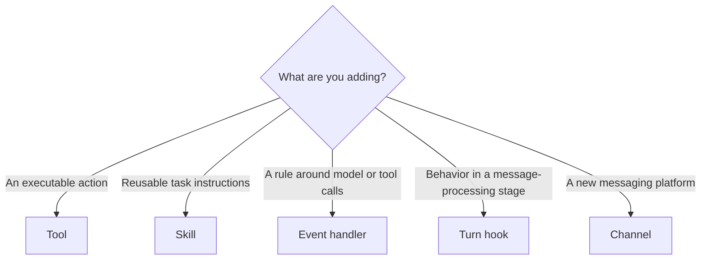

A new requirement rarely fails because Bub has no place for it. More often, the difficulty is choosing the wrong home: a policy hidden inside a tool, executable scripts buried in a skill, or transport concerns mixed into the model loop.

Start with the responsibility, not the mechanism you happen to know best. Bub's extension points are orthogonal, so a feature can compose several of them without giving any one component several unrelated jobs.

## Five orthogonal dimensions {#dimensions}

| Dimension | Extension point | Question it answers |
| --- | --- | --- |
| **Action** | [Tools](/docs/sdk/tools/) | What executable operation can the Agent perform? |
| **Instruction** | [Skills](/docs/app/skills/) | What process or expertise should the model read to perform a task well? |
| **Policy** | [Agent events](/docs/concepts/events/) | Which calls should be observed, denied, replaced, or rewritten? |
| **Lifecycle** | [Plugins and Turn hooks](/docs/app/plugins/) | What should happen while a message moves through its processing stages? |
| **Transport** | [Channels](/docs/app/gateway/) | How do messages enter and leave external systems? |

These dimensions answer different questions. A tool should not need to know which channel carried the request; a channel should not need to understand the model's tool loop; a skill should describe a process rather than become a second plugin system.

## Choose by intent {#choose}

Use this decision tree to find the first candidate:

In concrete terms:

- “I need to call an external system or database” → **Tool**.
- “I need to teach the model a complex business SOP” → **Skill**.
- “I need to check permission before a sensitive tool call” → **Event handler**.
- “I need to change how an inbound message is assembled for the model” → **Turn hook**.
- “I need to connect DingTalk, Feishu, or Telegram” → **Channel**.

Some choices sit alongside those five dimensions:

| Goal | Extension point | How to connect it |
| --- | --- | --- |
| Delegate an independent subtask to another Agent | [Subagent](/docs/app/subagents/) | Use the built-in `subagent` tool with the required session, model, tool, and skill limits |
| Change how Tape history becomes model messages | [TapeContext](/docs/concepts/tape/#context) | `Agent(context=...)`, or `build_tape_context()` in the app |
| Replace history storage | [Storage integration](/docs/integrations/storage/) | `Agent(store=...)`, or `provide_tape_store()` |
| Replace the model client or execution environment | Core components | Constructor arguments; use `provide_environment()` for the app environment |
| Make an extension activate when installed | [Plugin](/docs/app/plugins/) | Register it in the `bub` entry-point group |

A plugin is a distribution and lifecycle mechanism rather than a sixth kind of domain logic. It can package tools, skills, hooks, channels, and providers while leaving each responsibility in its proper extension point.

## Compose without collapsing boundaries {#compose}

Consider an order plugin. It might provide:

- tools that query and modify orders;
- a skill describing the after-sales process;
- an interception hook that checks session permissions before an order changes;
- an event handler that writes order facts to Tape.

Those pieces handle execution, instructions, policy, and records respectively. They can work together on one feature without becoming one large function.

### Explicit assembly or automatic discovery {#kernel-and-app}

The same components can be assembled in two ways. With `bub.core`, the host passes tools, storage, context, and other dependencies to `Agent` directly. With the application layer, providers such as `provide_tools`, `build_tape_context`, and `provide_tape_store` assemble equivalents, and `BubFramework.load_hooks()` discovers built-in implementations and installed plugins.

Choose according to **who owns assembly and lifecycle**:

- An existing service that already manages dependencies and resources usually benefits from explicit kernel assembly.
- An extension that should activate after installation, or be distributed to other Bub users, fits an application plugin.

See [Kernel](/docs/concepts/kernel/) for the layer boundary. You can also [reuse selected app capabilities](/docs/integrations/reuse-app/) while driving a core Agent yourself.

## Tools and skills are not interchangeable {#tools-and-skills}

A tool is a type-annotated Python function that performs an action. A skill is a directory containing `SKILL.md` and supporting files that tells the model how to approach a class of tasks.

| Dimension | Tool | Skill |
| --- | --- | --- |
| Content | Python functions and a parameter schema | Markdown instructions and supporting files |
| Purpose | Execute code and access external systems | Define processes, constraints, and operating methods |
| Loading | Available tools are provided on every model call | Names and descriptions are listed; the body expands when referenced |
| Distribution | Passed to the Agent or registered by a plugin | Placed in a workspace or distributed with a package |

Scripts in a skill do not execute merely because their files exist. Code still runs through a tool call; the skill can guide when and why the model should call it.

The same tool can be called directly by the model, called by Python generated in code mode, or invoked as a [text command](/docs/sdk/tools/#call-a-tool-without-a-model). These paths share the handler and parameter validation, although their output and error behavior can differ.

## Messages, state, and records have different lifetimes {#messages-and-state}

| Object | Responsibility | Lifetime |
| --- | --- | --- |
| `Envelope` | Carry message content, routing, and session information | One inbound or outbound message |
| `TurnState` | Share temporary data among hooks, tools, and event handlers | One Turn or Run |
| Tape | Preserve conversation, tool round-trips, and explicitly written records | Determined by storage; can span Turns and processes |

A Channel produces an `Envelope` for a new message source. Put data used only in the current Turn into `TurnState`; write long-term facts to Tape or application storage. Not every hook receives `TurnState`, so declare the parameter only where the corresponding signature provides it.

## The golden rule: one owner {#one-owner}

Before implementing an extension, give each responsibility exactly one authoritative owner:

- **A rule has one source of truth.** Domain invariants belong to the tool or domain layer; shared policy can live in an event handler or hook. Do not maintain two permission checks that can drift apart.
- **Each instruction has one job.** `AGENTS.md` supplies workspace rules; skills supply task instructions expanded on demand. Keep substantial executable behavior in tools rather than embedding it as an opaque script in instructions.
- **Context is assembled once per concern.** `TapeContext` projects history, while `build_prompt` prepares the current input. Avoid concatenating the same information in both.
- **Errors have a defined destination.** Decide whether an exception propagates, is logged and skipped, or becomes a tool result.
- **Resources have an owner that closes them.** Make connection and stream lifecycles explicit, including coordination between concurrent Runs in one session.

The goal is not to minimize the number of extension points in a feature. It is to make each one easy to understand, test, replace, and reason about independently.
