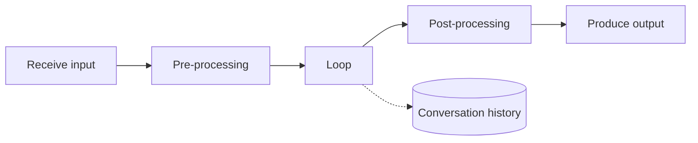

import { CardGrid, LinkCard } from '@astrojs/starlight/components';

## Background {#background}

Bub took its inspiration from self-evolving agents like OpenClaw and nanobot, so at first it piled every feature into the main package:

- Every new message channel required adding a class under `bub.channels`, plus a batch of tools or skills;
- Every new capability required one more switch.
- …

As a result, even if a user only used one or two channels and one or two capabilities, they still faced dozens of switches and configuration options, and were simply drowned in a sea of options without knowing where to start.

So Bub was rewritten — stripping out extra functionality and leaving only a carefully designed lightweight kernel and a freely composable plugin architecture.

As large models have developed and evolved, agents today are no longer the early chatbots that only did question-and-answer. They have fully become operators and executors on equal footing with people. So, like other agent tools, Bub has faced social questions since its birth: how to collaborate with people, how to hand off work, and how to stay visible during execution.

On the basis of a carefully designed architecture, it should have clear contractual boundaries like Isaac Asimov's Three Laws of Robotics: clear command boundaries, traceable history, and neutral operation, ultimately evolving from "assistant behavior" to "collaboration infrastructure."

## The journey of one interaction {#journey}

Looking across all agent designs, the core interaction flow is as follows, and Bub is no exception:

The whole flow still falls within software engineering. This means that apart from the two ends of receiving messages and producing output, every other process is an intermediate process, and most designs in the industry do their engineering in the intermediate process.

## Responsibility boundaries {#concepts}

Along this chain, Bub can be divided into the following responsibility boundaries. The boundaries have no dependency order; you can browse them as needed.

<CardGrid>
  <LinkCard
    title="Turn"
    description="Defines the complete flow. The process from receiving to responding can be divided into multiple stages."
    href="/docs/concepts/turn/"
  />
  <LinkCard
    title="Tape"
    description="Adds history and context. The conversation history is append-only, and the model can retrieve the complete record from a starting point as needed."
    href="/docs/concepts/tape/"
  />
  <LinkCard
    title="Events"
    description="Makes the run open to intervention. Every model call and tool execution has a beginning, an end, and a result."
    href="/docs/concepts/events/"
  />
  <LinkCard
    title="Extension points"
    description="Decides how new logic plugs in. Tools, skills, channels, and plugins all have a place to plug in."
    href="/docs/concepts/extension-points/"
  />
</CardGrid>
