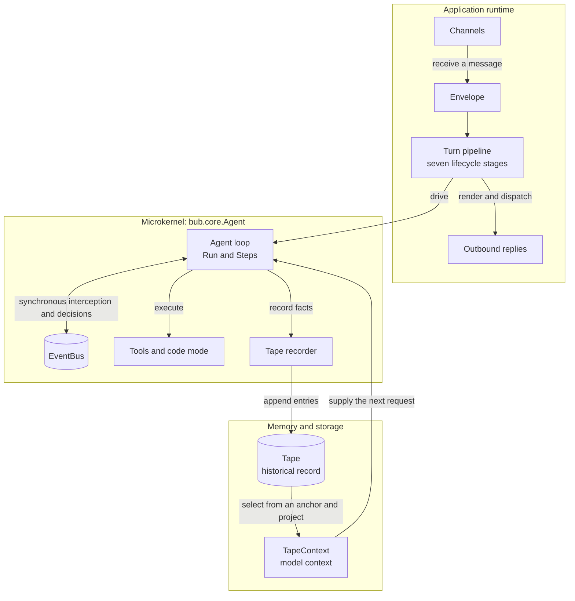

import { CardGrid, LinkCard } from '@astrojs/starlight/components';

A model can decide what to do next, but it cannot guarantee how your application behaves. Its next token is probabilistic; your session boundaries, audit trail, permission checks, and delivery rules should not be.

Bub's answer is to keep the model loop small and make everything around it explicit. The framework does not try to remove uncertainty from reasoning. It builds deterministic control, durable records, and policy boundaries around that reasoning.

## From assistant to collaboration infrastructure {#background}

Bub took inspiration from self-evolving agents such as OpenClaw and nanobot. Its first design followed a natural instinct: put every capability into the main package. A new channel meant another class and more tools; a new capability meant another switch. Soon, even a small deployment exposed a large configuration surface.

The rewrite reversed that direction. Bub now starts with a lightweight kernel and lets applications compose only what they need.

That boundary matters beyond convenience. Agents no longer just answer questions—they modify files, call services, and collaborate with people. Like a practical interpretation of Asimov's Three Laws, a collaborative agent needs explicit command boundaries, inspectable history, and neutral execution. Bub treats those as engineering contracts rather than emergent behavior.

## Follow one message {#journey}

The easiest way to understand Bub is to follow a single inbound message. Each concept owns a different part of its journey:

1. A **Channel** converts external input into an `Envelope`. The application starts a **Turn** to resolve the session, prepare the prompt, run the model, save state, and route replies.
2. The **kernel** drives a **Run**. Each **Step** makes one model call and executes the requested tools. This loop continues until the model answers directly or a configured limit stops it.
3. Before and during execution, the **EventBus** exposes lifecycle events. Handlers can observe progress or synchronously deny, replace, or rewrite a call before its side effects occur.
4. The **Tape recorder** appends conversation and tool activity to a **Tape**. This record is independent of the limited context window.
5. For the next model request, **TapeContext** projects stored entries into model messages. An **anchor** can move the starting point without erasing the earlier record.

The loop therefore has two connected flows: control moves through Turn, Run, events, and tools; knowledge moves from execution into the Tape and back into a deliberately selected context.

## Five responsibility boundaries {#concepts}

Each concept answers one architectural question. Together, they form a system you can reason about without treating the Agent as a monolith.

<CardGrid>
  <LinkCard
    title="Kernel"
    description="What is the smallest Agent loop, and which dependencies must the caller assemble explicitly?"
    href="/docs/concepts/kernel/"
  />
  <LinkCard
    title="Turn"
    description="How does one inbound message move through a deterministic lifecycle from receipt to reply?"
    href="/docs/concepts/turn/"
  />
  <LinkCard
    title="Tape"
    description="How can durable history remain complete while each model request receives a focused projection?"
    href="/docs/concepts/tape/"
  />
  <LinkCard
    title="Events"
    description="How can observability and cross-cutting policy intervene without changing business tools?"
    href="/docs/concepts/events/"
  />
  <LinkCard
    title="Extension points"
    description="Where should a new action, instruction, policy, lifecycle behavior, or transport live?"
    href="/docs/concepts/extension-points/"
  />
</CardGrid>

Start with the kernel if you want the architectural center, or follow the reading order above to trace the complete message flow.
