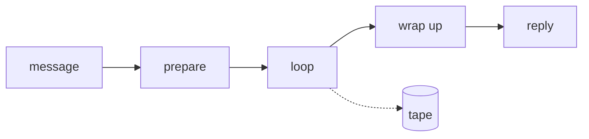

## Background {#background}

Bub used to keep everything in the main package. Every new message channel meant another class under `bub.channels` plus a batch of tools or skills, and every new capability meant another switch. The author recorded the call at the time in [Why we rewrote Bub](/posts/why-rewrite-bub/):

> If we kept going in that direction, Bub would eventually become another Nanobot, or even another OpenClaw. [...] Most users only need one or two providers and one or two channels, yet they still end up staring at a wall of settings and switches. Even if most of them are disabled by default, the complexity is still there, and users still get lost in it.

So the rewrite took the opposite direction:

> My answer is to split extra functionality out of the core and move to a model with a **carefully designed lightweight kernel** plus **freely vibe-coded feature plugins**.

The kernel has to be stable, understandable by agents, and quality-controlled by maintainers. Plugins can be written however people like, even generated on the spot by an agent. One maintenance model is strict; the other is loose.

Which raises the question: **once the pieces are split, where do the boundaries go?** This section is those boundaries. The four pages after it expand one each.

## The journey of one interaction {#journey}

Take the most common interaction: you ask something in the terminal, and Bub answers.

**Prepare** decides which session the message belongs to, restores what the previous turn left behind, and turns the message into a prompt. **Loop** takes the prompt to the model, runs any tools the model asks for, feeds the results back into the context, and asks again until the model answers without asking for tools. **Wrap up** saves the result, packages it as an outbound message, and hands it to the channel.

Of the three, only the middle one is general. It does not matter whether the message came from a terminal, Telegram, or anywhere else: the "model ⇄ tools" stretch is identical. The two stages around it both deal with where a message comes from and where the reply goes, and that is exactly the part that changes with deployment.

That is where the line falls. The loop stays in the kernel; both ends belong to the app.

## The four concepts {#concepts}

Along that line, four concepts show up in order. The order is not arbitrary: each one answers a question the previous one left open.

### Turn: gather both ends into named stages {#turn}

If both ends belong to the app, then the whole stretch from receiving a message to sending a reply should have a clear shape. That is a **turn**: one inbound message, and all the work it causes. `BubFramework` cuts it into seven stages, each with a name and a matching hook.

This follows one of the three principles the rewrite settled on: one-way dependencies. The app knows the kernel; the kernel does not know the app. The kernel reads no settings and recognizes no plugins. Hooks belong to the app: a plugin implements them, and `BubFramework` calls them. The same `core.Agent` therefore behaves identically in both layers, so what you verified through the SDK still holds inside the App.

**Three words inside a turn need separating**: a turn can contain one **run** (one `agent.run()` call), and a run can contain several **steps** (one model call plus the tools it asks for). turn ⊃ run ⊃ step.

To change how messages arrive or how replies leave, change this page. [Read Turn](/docs/concepts/turn/)

### Tape: split history from context {#tape}

The loop needs a context, so the first question is where that context comes from.

The obvious approach is to keep a message array and append to it each round. Bub does not do that. This is the second principle, **append-only context**: every record is written to a **tape** without modifying earlier entries, and the model reads a slice of that tape rather than an ever-growing array.

The benefit of splitting them is direct. History keeps everything, so you can audit it later; the context selects only the entries worth reading, so requests stay short. And because recording only appends, changing your mind never corrupts what is already stored.

The cost is a few new words. A tape **entry** is a message, tool call, tool result, event, or anchor. An **anchor** marks where the context starts, and a **handoff** writes a new anchor **without deleting** older entries — it is a switch for forgetting, not a switch for compressing. The turn's **state** is something else again: a plain dictionary shared within the run, never persisted.

To change how much the agent remembers, change this page. [Read Tape](/docs/concepts/tape/)

### Events: let the loop narrate each step {#events}

Once the loop is running, the host has one question left: how do I know what it is doing?

Bub's answer is the third principle, **event-driven**. Every model call and every tool execution emits a start, an end, and a result. The host can watch a run, and can also rewrite a call before it happens, or stop it outright.

The easiest thing to confuse here is the three kinds of "event": `AgentEvent` on the `EventBus` (you can intercept and change it), the `StreamEvent` given to the caller (read-only; it cannot change the run), and the `TapeEntry` written to the tape (readable afterwards; it does not affect the step in progress). Get the direction wrong and the behavior is wrong too.

Logging, permissions, budgets, auditing, and progress bars are all just handlers attached to the bus. None of them requires touching the loop or the tools. [Read Events](/docs/concepts/events/)

### Extension points: actions, procedures, connections {#extension-points}

Last, back to the original question: you want to add something, so where does it go?

This is where the remaining two principles land. **Tools are functions** — a type-hinted Python function is a tool, so adding an action is cheap. **Everything is a plugin** — capabilities can all be provided by plugins, and a plugin can be a tool, an event listener, a message channel, or a whole set of skills.

But precisely because it can hold anything, the responsibilities need separating: a tool performs an action, a **skill** describes a procedure (instructions only, no code execution), a **channel** connects to where people work, and a **plugin** packages the earlier ones. The message unit passed between channels is an **envelope**; interjecting during a run is **steering**.

Roles do not overlap, so you know which part to change. Conversely, Bub has no universal extension point that requires no other change — first decide whether you are adding an action, knowledge, or a connection. [Read Extension points](/docs/concepts/extension-points/)

## Summary {#summary}

The four concepts are the principles from [Core design](/docs/getting-started/#core-design), told a different way:

| Concept | The question it answers | The principle behind it |
| --- | --- | --- |
| Turn | What does the app do, in order, after a message arrives? | One-way dependencies: the app knows the kernel, not the reverse |
| Tape | Where does history live, and what does the model read? | Append-only context: write, never modify; read a slice |
| Events | How do I watch, change, or stop a call? | Event-driven: start, end, and result are all emitted |
| Extension points | What should the thing I want to add become? | Tools are functions; everything is a plugin |

Read the pages in any order, but start here: the other four expand different cuts of the same journey.
