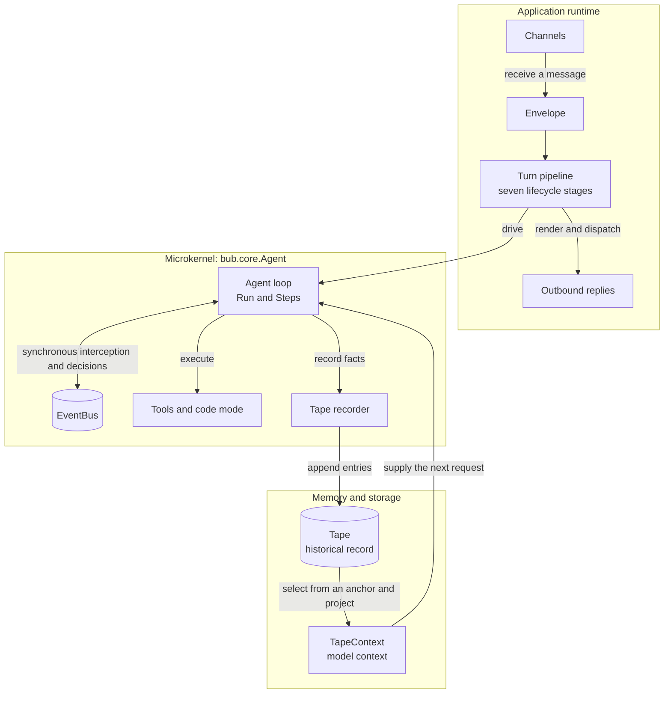

An Agent embedded in an existing service should behave like a library, not like a second application. It should not silently read a configuration file, discover plugins, open channels, or assume that a process-wide singleton owns its resources.

`bub.core.Agent` is designed around that constraint. It contains the model-and-tool loop; the caller supplies the surrounding capabilities. This is Bub's **microkernel** boundary.

## A small center with explicit edges {#mental-model}

In the complete message flow, the kernel is only the center—not the whole runtime:



The application runtime decides **when** to run and **where** messages go. The kernel decides **how one Run proceeds**. Storage preserves what happened, while `TapeContext` decides what the next model call can see.

## Why not put every switch on Agent? {#why-microkernel}

A monolithic Agent appears convenient until several hosts need different behavior. Global configuration makes tests affect one another, implicit discovery makes startup hard to predict, and hidden resource ownership makes shutdown uncertain.

Explicit assembly moves those decisions to the composition root—the place where your application already creates and manages its dependencies:

```python
from bub.core import Agent


agent = Agent(
    model=model,
    store=store,
    tools=[search_orders, update_order],
    context=context,
    sidecars=sidecars,
)
```

Every name on the right is supplied by the host. The Agent does not look up a model by a global name, scan the environment for a store, or import installed plugins. You can construct two Agents with different tools, stores, and context policies in the same process without changing global state.

`bub.core.Agent` has no `os.environ` dependency, no Bub settings loader, and no plugin-discovery step. A model client or other adapter that you pass in may have its own credential policy, but that policy belongs to the adapter rather than being hidden in the Agent loop.

## The two-layer boundary {#two-layers}

The kernel and application are complementary layers, not two different Agent engines:

| Layer | Owns | Deliberately does not assume |
| --- | --- | --- |
| `bub.core` | Run and Step execution, model calls, tool scheduling, Agent events, Tape recording and context projection | Session routing, channel lifecycle, configuration files, plugin discovery |
| `bub.framework` and `bub.builtin` | Turn orchestration, settings, session recovery, channel gateways, built-in behavior and installed plugins | That every host needs a CLI, a messaging gateway, or the built-in storage layout |

This separation lets the same loop run inside a web service, an asynchronous worker, a test, or the full Bub application. The host chooses how much infrastructure to place around it.

The package boundary follows the same idea: `pip install bub` installs the kernel dependencies; the framework, CLI, channels, hooks, and built-in application require the `app` extra.

## Protocols instead of vendor assumptions {#contracts}

The kernel coordinates contracts rather than prescribing vendors:

| Constructor input | Contract it supplies |
| --- | --- |
| `model` | A Republic chat model or a `ModelClient` adapter |
| `store` | A synchronous or asynchronous `TapeStore` implementation |
| `tools` | Executable functions exposed through a common tool contract |
| `context` | A `TapeContext` that projects stored entries into model messages |
| `sidecars` | Additional Tape-bound capabilities with their own records |

Defaults remain local and visible in code. For example, omitting `store` creates an `InMemoryTapeStore`; it does not silently select a database or make records durable. Provider neutrality likewise means that the loop depends on a model contract, not that credentials or provider-specific options disappear.

## Choose the layer you need {#choose-layer}

Use the **kernel directly** when your host already owns sessions, dependency injection, concurrency, and reply routing. You choose a Tape name, open and consume the Run, and decide what to do with its stream.

Use the **application layer** when you want those concerns supplied for you: a complete Turn pipeline, configuration, built-in session behavior, plugin discovery, and channel integration.

The choice is about ownership, not capability. Start with the smallest layer that gives your host clear control, then add the application runtime when its lifecycle services are genuinely useful. See [Extension points](/docs/concepts/extension-points/) for how tools, skills, policies, hooks, and channels fit around either layer.
