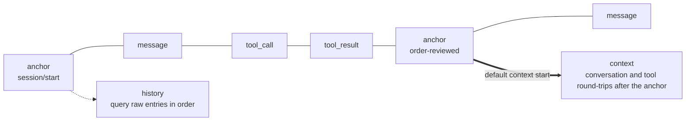

import { Aside } from '@astrojs/starlight/components';

A Tape stores the Agent's run records, and `TapeContext` selects from those records the input for the next model call. **The stored history is not the context the model sees**: history can keep growing, while each request reads only a slice of it.

`core.Agent` and `BubAgent` share this mechanism; their default stores and Tape naming schemes differ.

## History and context {#history-and-context}



- **History** consists of Tape entries, queried in write order through `query()`.
- **Context** is built by `TapeContext` filtering entries and converting them to Republic messages, through `read_messages()`.

Normal recording only appends and does not modify old entries; explicit operations such as `reset()` clear the records, so a Tape is not an immutable event log.

## Default context rules {#context}

The Agent uses `default_tape_context()` by default, selecting conversation and tool round-trips after the most recent anchor:

| Entry type | Content | Handling in the default context |
| --- | --- | --- |
| `message` | Conversation messages from the user, assistant, system, and so on | Converted to the corresponding message |
| `tool_call` | A tool call requested by the model | Converted to an assistant message carrying the tool calls |
| `tool_result` | A tool execution result | Paired with the earlier call and converted to a tool message |
| `anchor` | The context starting point and optional state | Used as a query boundary; not included in the result |
| `event`, `system`, `error` | Business events, system prompt changes, or record errors | Skipped |

Entries with `context=False` are filtered out before selection. Ordinary business `event` entries also do not enter model requests by default; to let the model read them, you must customize the selection logic.

`default_tape_context()` rebuilds tool round-trips. A directly constructed `TapeContext()` with no selector only converts `message` entries; do not mix the two.

## Dividing phases with anchors {#anchors}

`handoff()` writes an anchor and moves the default context's starting point there; the earlier records remain:

```python
async def start_next_phase() -> None:
    await agent.tape("customer-42").handoff(
        name="order-reviewed",
        state={"summary": "Order A123 has shipped; the customer needs tracking details next."},
    )
```

`handoff()` does not generate a summary automatically, nor does it inject `state` into the next request automatically. When you need to keep a summary, generate it before the handoff and then provide it explicitly through the next prompt or a custom context selector.

`Agent.session()` and `Agent.start()` create a `session/start` anchor for a new session; calling `agent.tape(name)` alone does not create one.

### Choosing another starting point {#custom-selectors}

`TapeContext.anchor` determines the query range:

| Value | Query range |
| --- | --- |
| `LAST_ANCHOR` (default) | After the most recent anchor |
| `"order-reviewed"` | After the anchor with the specified name |
| `None` | No anchor filtering |

When you want the default message conversion but a different starting point, use `dataclasses.replace()`:

```python
from dataclasses import replace

from bub.core import Agent, default_tape_context

agent = Agent(
    context=replace(default_tape_context(), anchor="order-reviewed"),
)
```

When you need a completely different projection, pass a selection function to `TapeContext(select=...)`. It receives the entries and context, and returns a list of Republic messages or an awaitable of one. A custom function replaces the default selector, so ordinary conversation, tool round-trips, and business events are yours to compose as needed.

### Context too long {#context-overflow}

When the Agent recognizes a context-length error, it performs one automatic handoff and retries the original prompt. This only moves the context's starting point; it does not generate a summary, and if the remaining request is still too large, it fails again.

To manage context against a budget on purpose, use the [`bub-context-budget` plugin](/docs/sdk/reuse-app/), which lets the model call `tape.handoff` as it approaches the limit.

## Run state versus persistent records {#state}

The `state` passed to `agent.run()` is a mutable dictionary shared for that run. It is not persisted automatically and is not restored on the next run.

| What you need to keep | Where it goes |
| --- | --- |
| A temporary value used only during this run | `state` |
| A business fact you need to query later | Write it to the Tape with `append_event()` |
| Structured state to restore on the next run | Application storage, or an anchor's `state` plus explicit loading |
| The conversation and tool round-trips | Written to the Tape by `TapeRecorder` |

`TapeRecorder` records only the conversation, tool round-trips, and selected lifecycle events; it is not a complete auditor. Custom business events need to be written explicitly, and whether they enter the model context is still decided by `TapeContext`.

## Run forks {#forks}

Each `agent.run()` records new entries on a fork of the Tape. When the stream closes, the fork merges back into the parent Tape by default; the merge runs on normal completion, exceptions, cancellation, and stopping consumption early.

```python
async with agent.run("Continue processing the order", tape="customer-42") as stream:
    async for event in stream:
        ...
```

Pass `merge_back=False` to discard this fork's records on exit. You can also manage the scope yourself with `agent.session(name, merge_back=...)` or `tape.fork_tape(merge_back=...)`.

<Aside type="caution">
  A fork isolates Tape records only; it is not a side-effect transaction. Even with `merge_back=False`, files a tool already modified, requests it sent, or external writes are not rolled back.
</Aside>

When multiple runs need to read each other's completed results, the application coordinates the execution order. `FileTapeStore` does not provide a session lock across workers; the [FastAPI example](/docs/sdk/web-service/) demonstrates locking within a single process.

## Sidecars {#sidecars}

A `TapeSidecar` stores associated data in another Tape that is paired with the main Tape. Once mounted through `Agent(sidecars=...)`, the sidecar forks, merges, and resets along with the main Tape, but its entries do not enter the main context.

The Bub app uses a spill sidecar to store large tool results. The main conversation keeps only a preview and a handle, and the Agent then reads the result in chunks through `spill.read`. The trigger threshold is configured by [`BUB_SPILL_THRESHOLD`](/docs/reference/settings/#spill-settings).

## Media recording boundaries {#media}

Model requests can contain images, audio, and video, but a Tape is not media file storage. When a Run's fork writes its records, it strips non-text content blocks from the prompt and keeps only text, avoiding copying inline media into the JSONL history.

When media must be replayed or audited later, the host saves the files to object storage or a filesystem and records a resolvable reference in the text. When a tool needs to hand media back to the current model call, use [`content_result()`](/docs/sdk/tools/#media-results).

## Choosing storage {#storage}

A plain `Agent` uses `InMemoryTapeStore` by default, and records live only in the current process. To keep them across processes, pass a file store:

```python
from pathlib import Path

from bub.core import Agent
from bub.core.store import FileTapeStore

agent = Agent(store=FileTapeStore(Path("sessions")))
```

`agent.run(..., tape="customer-42")` uses the Tape of that name. The same name continues the existing records; different names are independent of each other.

Outside a Run, you can read history through `agent.tape(name)`:

```python
async def inspect_history() -> None:
    tape = agent.tape("customer-42")
    messages = await tape.read_messages()
    entries = list(await tape.query().all())
    print(f"model messages: {len(messages)}, stored entries: {len(entries)}")
```

`read_messages()` applies the context rules, while `query()` returns raw entries. A custom backend must implement `bub.core.store.TapeStore` or `AsyncTapeStore`; for a complete replacement example, see [Storage integration](/docs/integrations/storage/).

## App storage {#app-storage}

The built-in app provides `FuzzyFileTapeStore` through `provide_tape_store`, with the default directory `~/.bub/tapes/`. The Tape name is generated from the workspace path and the session ID together, so sessions with the same name in different workspaces do not share history.

`BubAgent` chooses its store in the following order:

1. A `tape_store` passed explicitly;
2. The store returned by `framework.get_tape_store()` when the Agent was created;
3. The in-memory store when neither is present.

To use the store provided by `framework.running()`, create the `BubAgent` inside that scope. Replace the store with `provide_tape_store`, and replace the context strategy with `build_tape_context`.

The built-in app restores session settings such as the model, reasoning effort, and code mode from the Tape; any other application state must be persisted by you.
