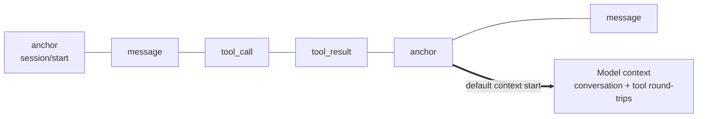

Long-running, multi-step Agents face two competing needs for history:

- **Your application and team** need a complete, append-only record of what happened—every user message, tool call, argument, and result—so you can debug issues, audit decisions, and resume conversations.
- **The model** has a finite context window and works best with a concise, focused slice of relevant messages rather than every intermediate step from the beginning.

Storing both in a single mutable `messages` array forces a bad trade-off: either let requests grow until the context overflows, or truncate the array and destroy your only historical record.

Bub separates recording from reading: **the Tape stores the complete append-only history, and `TapeContext` selects and builds the model context before each model call**.

## One record, two views {#history-and-context}

Think of the Tape as the write side of conversation history and `TapeContext` as the read side:

- **Tape** (write): appends `TapeEntry` records in chronological order, including messages (`message`), tool calls (`tool_call`), tool results (`tool_result`), phase markers (`anchor`), and custom events (`event`). Call `tape.query()` to inspect raw entries.
- **`TapeContext`** (read): selects entries before each model request and converts them into model messages. Call `tape.read_messages()` to get the resulting model context.

By default, an Agent uses `default_tape_context()`, which locates the **latest `anchor`** and reads only entries after it. Any entry written with `context=False` is excluded automatically and never enters model context.

:::note[Append-only, resettable on demand]
During normal runs, the Tape only appends new entries and never mutates existing ones. Calling `tape.reset()` clears the record and writes a new `session/start` anchor.
:::

## Switching phases with anchors and handoffs {#anchors}

As a conversation grows—or shifts from gathering information to executing changes—you often want the model to move on with a clean slate without deleting the earlier history from storage.

Bub handles this with **anchors** and **handoffs**:

- An **anchor** is a milestone marker on the Tape that signals a transition to a new phase (such as `session/start` when a session opens, or `reviewed` after a code review finishes).
- A **handoff** appends a new anchor to the Tape. Because the default `TapeContext` reads only from the latest anchor forward, a handoff **immediately moves the start of the model context to that new marker**, while every earlier entry remains safely stored on the Tape and queryable via `tape.query()`.

Keep in mind that a handoff only **advances the default read start**: it does not automatically summarize past turns, delete old history, or inject the anchor's `state` into the next prompt. When you want a summary carried forward, generate or supply one explicitly. For code usage, see [SDK: anchors and handoffs](/docs/sdk/tape/#anchors-and-handoff) and the built-in [`tape.handoff` tool](/docs/reference/tools/#tape-handoff).

## Where data belongs {#state}

Different kinds of data in Bub have different lifetimes and belong in different places:

| Location | Lifetime | Purpose |
| --- | --- | --- |
| `state` / `TurnState` | Single Run or Turn | Request-scoped scratch values (request ID, permission flags, callbacks) |
| `metadata` | Single Run | Observability metadata for logs and event handlers; never sent to the model |
| `TapeEntry` | Decided by store backend; persists across processes | Conversation messages, tool round-trips, and explicit business events |
| Anchor `state` | Persisted on the Tape | Structured snapshot or summary saved at a handoff point |
| External app storage | Decided by your application | Business state loaded via `load_state` and saved via `save_state` |

`core.Agent` uses an in-memory store (`InMemoryTapeStore`) by default. To persist Tapes to disk, customize context selectors, or work with Tape forks, see [SDK: Tape & Memory](/docs/sdk/tape/); to back the Tape with SQLite or PostgreSQL, see [Store conversation history in a database](/docs/integrations/storage/).
