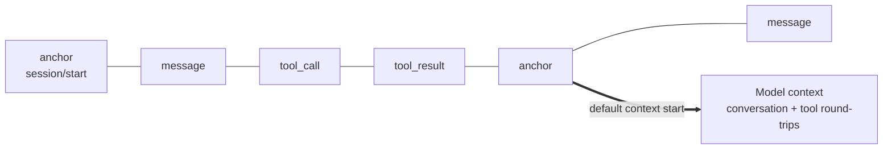

An application needs a complete, trustworthy history; a model needs only a bounded, relevant input. Bub keeps the two apart: **the Tape is the durable record, and the model context is one projection of that record**.

## One record, two views {#history-and-context}

- **The Tape (write)**: appends `TapeEntry` records in order — conversation messages, tool calls, tool results, anchors, and business events recorded explicitly. `tape.query()` returns the raw entries.
- **`TapeContext` (read)**: selects the entries this request needs and converts them into model messages. `tape.read_messages()` returns the projection, not the raw record.

The default projection, `default_tape_context()`, reads the entries after the most recent anchor and rebuilds the conversation and tool round-trips. Entries marked `context=False` are excluded before selection and never enter the model context.

:::note[Append-only, but not an immutable audit log]
Normal recording only appends; `tape.reset()` clears the record and writes a new `session/start` anchor.
:::

## Anchors and handoffs {#anchors}

An **anchor** marks a cognitive transition, such as finishing information gathering or starting a new task. A **handoff** appends a new anchor, moving the start of the default context forward while keeping every earlier record.

A handoff changes only the default read boundary: it generates no summary, deletes no history, and does not automatically inject the anchor's `state` into the next request. When you need a summary, generate one explicitly and write it into later model input. For usage, see [SDK: anchors and handoffs](/docs/sdk/tape/#anchors-and-handoff) and the app's built-in [`tape.handoff` command](/docs/reference/tools/#tape-handoff).

## Where data belongs {#state}

| Home | Lifetime | Good for |
| --- | --- | --- |
| `state` / `TurnState` | One Run or one Turn | Scratch values shared within a request |
| `metadata` | One Run | Observability data such as a request ID; never enters model input |
| Tape entries | Decided by storage; may span processes | Conversation, tool round-trips, and business facts written explicitly |
| Anchor `state` | Kept with the history | Phase snapshots |
| Application storage | Decided by the app | Session settings restored by `load_state` |

`core.Agent` uses an in-memory store by default. See [SDK: Tape and memory](/docs/sdk/tape/) for persistence, forks, and concurrency, and the [Storage integration](/docs/integrations/storage/) for plugging in a store backend.
