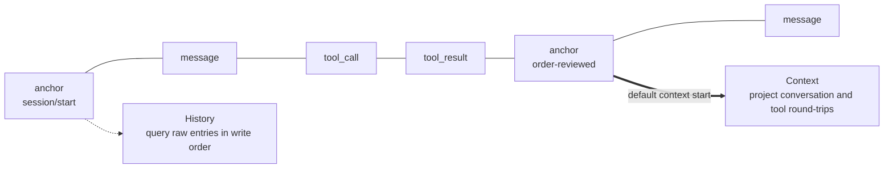

A long-running Agent faces two different memory problems. The application needs a trustworthy record of what happened; the model needs a small, relevant input for its next inference. Treating both as one `messages` array forces a bad choice: either the request grows without bound, or context trimming destroys the only record.

Bub separates those concerns. **Tape is the durable record; `TapeContext` is a projection of that record for the model.** History and context are related, but they are not the same object.

## One record, two views {#history-and-context}

Think of Tape as the write side and `TapeContext` as the read side of the same history:



- **The write model** appends `TapeEntry` objects: conversation messages, requested tool calls, results, anchors, errors, and explicitly recorded business events. Query them in write order with `query()`.
- **The read model** uses `TapeContext` to select entries and convert them into Republic messages. `read_messages()` returns the model-facing projection, not the raw record.

This is an event-sourcing perspective: preserve facts first, then derive the view each consumer needs. It keeps debugging and audit questions—“which arguments were sent?” or “which result came back?”—separate from prompt-budget questions.

Normal recording appends entries and does not rewrite old ones, but Tape is not an unconditionally immutable log. Explicit operations such as `reset()` can clear records, and `TapeRecorder` is not a complete compliance auditor by itself.

`core.Agent` and `BubAgent` share this mechanism; their default stores and Tape naming schemes differ.

## Context is a projection, not a truncation {#context}

By default, the Agent uses `default_tape_context()`. It reads entries after the most recent anchor and reconstructs the conversation and tool round-trips needed by the next request:

| Entry type | Stored fact | Default projection |
| --- | --- | --- |
| `message` | User, assistant, system, and other conversation messages | Converted to the corresponding message |
| `tool_call` | Calls requested by the model | Converted to an assistant message carrying those calls |
| `tool_result` | Values returned by tool execution | Paired with earlier calls and converted to tool messages |
| `anchor` | A context boundary and optional state | Defines the default query boundary; the boundary itself is outside the selected range |
| `event`, `system`, `error` | Business events, system changes, or recorded errors | Not selected |

Entries marked `context=False` are filtered before selection. Ordinary business events therefore remain available in history without automatically consuming context tokens. If the model needs them, include them in a custom projection.

The projection can change without rewriting history. A debugging view can query every entry, while a model view selects only the current phase. This is why moving an anchor is not equivalent to deleting earlier messages.

`default_tape_context()` also reconstructs tool round-trips. A directly constructed `TapeContext()` with no selector converts only `message` entries; do not assume the two defaults are interchangeable.

## Anchors mark cognitive transitions {#anchors}

An **anchor** is more than a truncation offset. It marks a phase boundary: information gathering has finished, an order has been reviewed, or a new task is beginning. A **handoff** records that transition and moves the default context starting point forward without erasing what came before.

```python
async def start_next_phase() -> None:
    await agent.tape("customer-42").handoff(
        name="order-reviewed",
        state={"summary": "Order A123 has shipped; the customer needs tracking details next."},
    )
```

This explicit handoff is a cognitive boundary, not an automatic summarizer. `handoff()` does not generate a summary, and it does not inject `state` into the next request automatically. Generate any summary before the handoff, then supply it deliberately through the next prompt or a custom selector.

`Agent.session()` and `Agent.start()` create a `session/start` anchor for a new session. Calling `agent.tape(name)` alone does not create one.

### Choosing another starting point {#custom-selectors}

`TapeContext.anchor` controls the query range:

| Value | Query range |
| --- | --- |
| `LAST_ANCHOR` (default) | After the most recent anchor |
| `"order-reviewed"` | After the anchor with that name |
| `None` | No anchor filtering |

Use `dataclasses.replace()` when you want the default projection with a different starting point:

```python
from dataclasses import replace

from bub.core import Agent, default_tape_context


agent = Agent(
    context=replace(default_tape_context(), anchor="order-reviewed"),
)
```

For a different projection, pass a function to `TapeContext(select=...)`. It receives the selected entries and context, and returns Republic messages or an awaitable containing them. A custom selector replaces the default one, so conversation, tool round-trips, anchors, and business events are yours to compose deliberately.

### Automatic handoff on context overflow {#context-overflow}

When the Agent recognizes a context-length error, it performs one automatic handoff and retries the original prompt. This is a recovery mechanism, not a memory summary: it moves the starting point, and the retry can still fail if the remaining request is too large.

To manage context proactively against a budget, use the [`bub-context-budget` plugin](/docs/integrations/reuse-app/#other-hooks). It lets the model call `tape.handoff` as it approaches the limit.

## Decide what deserves persistence {#state}

Not every value belongs in permanent history. The `state` passed to `agent.run()` is a mutable dictionary shared during that Run; it is not persisted or restored automatically.

| What you need to keep | Where it belongs |
| --- | --- |
| A temporary value used only in this Run | `state` |
| A business fact to query later | An explicit Tape entry written with `append_event()` |
| Structured state to restore on the next Run | Application storage, or anchor `state` plus explicit loading |
| Conversation and tool round-trips | Tape entries written by `TapeRecorder` |

`TapeRecorder` records conversation, tool round-trips, and selected lifecycle events. Custom business facts must be written explicitly, and `TapeContext` still decides whether they become model input.

## Run forks isolate records, not side effects {#forks}

Each `agent.run()` records new entries on a fork of the Tape. When the stream closes, the fork merges into its parent by default—on normal completion, exceptions, cancellation, and early exit:

```python
async with agent.run("Continue processing the order", tape="customer-42") as stream:
    async for event in stream:
        ...
```

Pass `merge_back=False` to discard the fork's records when it closes. You can also manage the scope with `agent.session(name, merge_back=...)` or `tape.fork_tape(merge_back=...)`.

:::caution
A fork is not a transaction over the outside world. Even with `merge_back=False`, tool changes to files, sent requests, and external writes are not rolled back.
:::

When concurrent Runs need to consume one another's completed results, the application coordinates their order. `FileTapeStore` does not provide a cross-worker session lock; the [FastAPI example](/docs/sdk/web-service/) demonstrates locking within one process.

## Sidecars keep parallel records out of context {#sidecars}

A `TapeSidecar` stores associated data in a separate Tape paired with the main one. Mounted through `Agent(sidecars=...)`, it forks, merges, and resets with the main Tape, but its entries do not enter the main context.

The Bub app uses a spill sidecar for large tool results. The main conversation retains a preview and a handle, and the Agent reads the full result in chunks through `spill.read`. [`BUB_SPILL_THRESHOLD`](/docs/reference/settings/#spill-settings) configures the trigger.

## Media has a separate storage boundary {#media}

Model requests can contain images, audio, and video, but Tape is not a media file store. When a Run's fork writes records, it strips non-text content blocks from the prompt and keeps only text, avoiding inline media in JSONL history.

For later replay or audit, the host stores media in object storage or a filesystem and records a resolvable reference in text. To return media to the current model call from a tool, use [`content_result()`](/docs/reference/python-api/#tools).

## Choose storage for the record {#storage}

A plain `Agent` uses `InMemoryTapeStore` by default, so records live only in the current process. Supply a file store when they must survive process restarts:

```python
from pathlib import Path

from bub.core import Agent
from bub.core.store import FileTapeStore


agent = Agent(store=FileTapeStore(Path("sessions")))
```

`agent.run(..., tape="customer-42")` selects the Tape by name. Reusing a name continues its record; different names remain independent.

Outside a Run, inspect either view through `agent.tape(name)`:

```python
async def inspect_history() -> None:
    tape = agent.tape("customer-42")
    messages = await tape.read_messages()
    entries = list(await tape.query().all())
    print(f"model messages: {len(messages)}, stored entries: {len(entries)}")
```

`read_messages()` applies the projection; `query()` returns raw entries. A custom backend implements `bub.core.store.TapeStore` or `AsyncTapeStore`. See [Storage integration](/docs/integrations/storage/) for a complete replacement example.

### App storage {#app-storage}

The built-in app supplies `FuzzyFileTapeStore` through `provide_tape_store`, with `~/.bub/tapes/` as the default directory. It derives the Tape name from both workspace path and session ID, so same-named sessions in different workspaces do not share history.

`BubAgent` chooses its store in this order:

1. An explicitly supplied `tape_store`;
2. The store returned by `framework.get_tape_store()` when the Agent is created;
3. The in-memory store when neither is available.

Create `BubAgent` inside `framework.running()` when it should use the store supplied by that scope. Replace storage with `provide_tape_store`, and replace the projection strategy with `build_tape_context`.

The built-in app restores session settings such as model, reasoning effort, and code mode from Tape. Persist any other application state explicitly.
