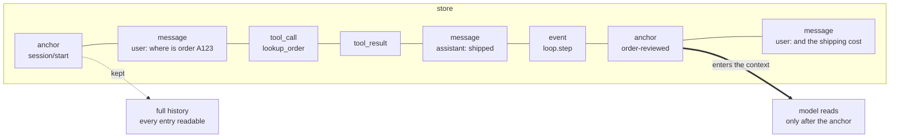
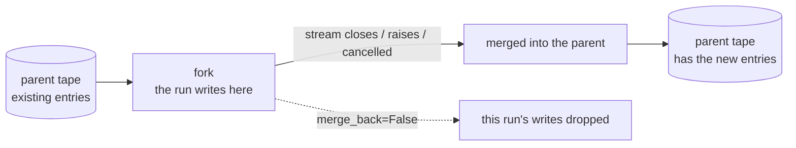

import { Aside } from '@astrojs/starlight/components';

An agent needs two things. It needs a record of its work. It also needs a useful set of messages for the next model call. Bub puts the record in a tape and builds the model context from the entries you select.

Keeping the two apart is the most useful decision in Bub: you can keep a complete history and still send a short request. This page covers how each side works and where the edges are.

`core.Agent` and `BubAgent` share this model. Their default stores and session names differ.

## One conversation, two readings {#history-and-context}

Start with this distinction; everything below hangs off it.



- **History** is every entry in write order, append-only. Incident review, audit, and debugging read it.
- **Context** is a filtered slice, converted to Republic messages and handed to the model. The model never sees what was filtered out.

The filter is `TapeContext`, and its default rule is "conversation entries after the last anchor".

## Storage {#storage}

A plain `Agent` creates an `InMemoryTapeStore` by default. That history lives as long as the store. To keep it between processes, pass a file store:

```python
from pathlib import Path

from bub.core import Agent
from bub.core.store import FileTapeStore

agent = Agent(store=FileTapeStore(Path("sessions")))
```

Each `agent.run(..., tape="customer-42")` uses the tape named `customer-42` in that store. The same name continues the earlier conversation; a different name starts a separate one. `Agent` uses the name you give it as is. The app has its own workspace and session naming rules; see [app storage](#app-storage).

`agent.tape(name)` gives you the tape outside a run. Writes through it go straight to the store:

```python
async def inspect_history() -> None:
    tape = agent.tape("customer-42")
    messages = await tape.read_messages()
    entries = list(await tape.query().all())
    print(len(messages), "model messages;", len(entries), "stored entries")
```

`read_messages()` applies the context rules; `query()` reads raw entries. One tape, two readings — the diagram above, in code.

To write your own store, implement `TapeStore` or `AsyncTapeStore` from `bub.core.store`. The store interface and `TapeQuery` filters are in the [Python API reference](/docs/reference/python-api/). Your store and your app handle persistence and coordination between processes; the [SQLAlchemy guide](/docs/integrations/storage/) shows a complete replacement.

## Context {#context}

Tape entries are messages, tool calls, tool results, events, and anchors. Normal recording only appends. To clear history, call an explicit operation such as `Tape.reset()`.

The default `TapeContext` selects conversation entries after the last anchor, then converts them to Republic messages:

| Entry | Model context |
| --- | --- |
| `anchor` | The default query excludes it. If a custom query selects an anchor, the default selector turns it into an assistant message. |
| `message` | The stored message. |
| `tool_call` | One assistant message carrying the calls. |
| `tool_result` | A tool message, paired with the earlier call. |
| Other events | The default selector skips them. |

Note the last row. **Events do not enter the context by default**, so what you record on the tape and what the model sees are two different things. That is both a freedom and a trap: you can record plenty of useful information that the model never reads.

### Cutting context with an anchor {#anchors}

An anchor marks a new starting point for the context. `handoff()` writes one, and earlier entries stay:

```python
async def start_next_phase() -> None:
    await agent.tape("customer-42").handoff(
        name="order-reviewed",
        state={"summary": "Order A123 has shipped; the customer needs tracking details."},
    )
```

The `state` here is stored on the anchor, before the default query's start. **To bring the summary into the next phase you must put it into the next prompt, or select it explicitly in your context strategy** — a handoff does not hand anything to the model by itself.

This is the most common misunderstanding about handoff: it is a mechanism for **forgetting**, not for remembering. It decides what old entries become invisible; it does not compress them into something new.

A new session gets a `session/start` anchor automatically, so the first run has a starting point too.

### Choosing another rule {#custom-selectors}

To choose another anchor, pass `context=TapeContext(...)` to `Agent`. You can also supply your own `select(entries, context)` function:

```python
from bub.core import Agent
from bub.core.context import default_tape_context
from bub.core.tape import TapeContext


def select_recent_business_events(entries, context):
    """Hand business events to the model, not just messages."""
    return default_tape_context().select(entries, context)


agent = Agent(context=TapeContext(anchor=None, select=select_recent_business_events))
```

A selector returns Republic messages, or an awaitable of them. `default_tape_context()` includes tool round-trips; a `TapeContext` without `select` uses a simpler message conversion. Entries with `context=False` are dropped before either the default or a custom selector runs.

### When the context overflows {#context-overflow}

When the agent recognizes a context-length error, it makes one automatic handoff and retries with the shorter context.

<Aside type="caution">
  An automatic handoff only moves the starting point forward. **If you want a summary of the earlier history, create it before the handoff.** The retry can still fail if the remaining request is too large.
</Aside>

To manage context against a budget on purpose, the [`bub-context-budget` plugin](/docs/sdk/reuse-plugins/) is a working example: it asks the model to call `tape.handoff` as the limit approaches.

## State {#state}

The `state` that you pass to `agent.run()` is a mutable dictionary. Tools, prompt sections, and event handlers share it during the run.

It is **not** persisted. When the run ends, nothing owns the dictionary. Your app owns its persistence: keep durable data in your own store, or write selected facts to the tape and read them back when you need them.

The default [TapeRecorder](/docs/concepts/events/#recording) saves conversation exchanges and selected lifecycle records. To keep other variables, custom events, or decisions, record them yourself — either in `state` for the duration of the run, or with `append_event` on the tape for the long term.

| What you need to keep | Where it goes |
| --- | --- |
| A value computed during this run | `state`, discarded when the run ends |
| A business fact you must query later | an `event` entry on the tape |
| Structured data to read back next run | your own store, or an anchor's `state` plus explicit loading |
| A fully auditable conversation | the tape itself (TapeRecorder already does this) |

## Forks {#forks}

Each `agent.run()` opens a fork of its tape. When the stream closes, the fork appends its new entries to the parent tape.

That holds on the error path too: an exception or an early cancellation still merges. A failed run can therefore leave useful partial history, which is valuable when debugging.



Pass `merge_back=False` and the fork's records are dropped on exit. This affects tape writes only: side effects a tool already produced, such as a sent request or a changed file, remain. **A fork isolates records, not side effects.**

To manage a piece of work yourself, use `agent.session(name, merge_back=...)` or `tape.fork_tape(merge_back=...)`. Both merge on exit by default, including on an exception.

To let two runs share a tape and see each other's finished work, chain them. Your app provides the session lock. The [FastAPI example](/docs/sdk/web-service/) shows locking within one process; multiple workers need separate coordination.

## Sidecars {#sidecars}

A `TapeSidecar` stores related data in a separate tape that still belongs to the same tape conceptually.

A mounted sidecar forks, merges, and resets with the main tape. Its entries do not enter the main context, so they cannot crowd the model request. Pass one with `Agent(sidecars=...)` when your app needs it.

The Bub app mounts a spill sidecar for large tool results. It keeps a short preview and a handle in the conversation, and the agent can then read parts of the result with `spill.read`. This is another way to apply "history can be large, context must be small": move the bulk aside instead of deleting it.

If a sidecar fails during a fork merge or a tape reset, the failure is recorded separately and the main tape operation still completes — a sidecar is an add-on, and a broken one should not take the main flow down. The spill limits are in the [app configuration](/docs/app/configure/).

## App storage {#app-storage}

`BubAgent` uses the store that `BubFramework` provides. The built-in app uses `FuzzyFileTapeStore` under the Bub home directory, normally `~/.bub/tapes/`.

The tape name combines hashes of the workspace path and the session ID. The same session ID in two workspaces therefore has two separate histories: using one session name in `~/work` and `~/scratch` will not show you what the other said.

To change the store, the app uses `provide_tape_store`. To choose context, it uses `build_tape_context`. The [SQLAlchemy guide](/docs/integrations/storage/) shows that plugin route. For a service that uses the SDK directly, pass the implementation to `Agent(store=...)` as shown in [Storage](#storage).

The built-in app restores some session settings from tape records. Any other per-turn state is yours to persist.
