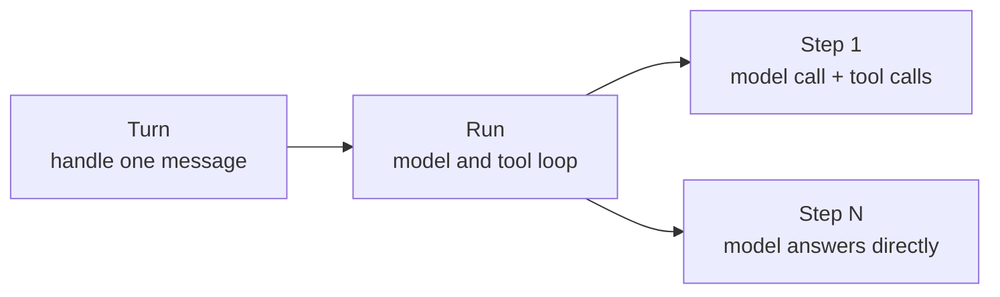

A **Turn** is the complete process of handling one inbound message in the app: find the session, prepare the input, run the model, save state, and send the reply. It keeps that common work outside the Agent loop, so tool and model code only have to focus on the current task.

## Turn, Run, and Step {#definition}

A Turn usually starts one **Run**. A Run is the loop between model and tools, and each loop iteration is a **Step**:



A Step contains one model call plus every tool call that response requests. The Run ends when the model stops requesting tools and no messages are pending. `BUB_MAX_STEPS` limits the number of Steps, not the number of tool calls.

Not every run has all three layers: a direct command does not start a Run, `Agent.run_once()` executes a single Step, and a plugin can replace the whole model stage. When you use `core.Agent` directly, the caller is responsible for sessions, state, and reply routing.

## The seven processing stages {#stages}

`BubFramework.process_inbound()` processes a message in the following order:

| Stage | What it handles | Default behavior |
| --- | --- | --- |
| 1. `resolve_session` | Determine the session | Use the message's `session_id`; otherwise generate `channel:chat_id` |
| 2. `load_state` | Restore this round's state | Restore session settings and bind the Agent |
| 3. `build_prompt` | Build the model input | Recognize commands, and add context, time, and media for ordinary messages |
| 4. `run_model` / `run_model_stream` | Produce the model output | Call `BubAgent.run_stream()` |
| 5. `save_state` | Save this round's state | Exit the message lifecycle |
| 6. `render_outbound` | Generate the reply | Convert model text into outbound messages |
| 7. `dispatch_outbound` | Send the reply | Hand it to the corresponding channel |

Each stage has a corresponding hook. A plugin can add to the default behavior or replace the result according to the hook's contract; for parameters, return values, and priority, see the [Hooks reference](/docs/reference/hooks/#turn-hooks).

### Passing data between stages {#state}

`TurnState` is an ordinary `dict[str, Any]`. Hooks, tools, and event handlers that receive `state` in their signature share the same dictionary.

It exists only for the current Turn. Data that must survive across Turns should be written to storage in `save_state` and restored in `load_state`; the conversation and tool round-trips are stored by the Tape.

When processing finishes, `process_inbound()` returns a `TurnResult`:

| Field | Content |
| --- | --- |
| `session_id` | The session ID for this turn |
| `prompt` | The input received by the model stage |
| `model_output` | The aggregated model text |
| `outbounds` | The replies that were generated and attempted |
| `state` | This turn's state dictionary |

Even when no sending channel is bound, the replies remain in `TurnResult.outbounds` so the host can handle them itself.

## Choosing an entry point {#entry-points}

Choose the entry point according to how much of the process you need to handle:

| Entry point | Scope | The caller is responsible for |
| --- | --- | --- |
| `core.Agent.run()` | A model Run or a direct command | Session, state, and message routing |
| `BubAgent.run_stream()` | Optional initial state loading and a model Run | Saving state, generating and sending replies, and concurrency within the same session |
| `framework.process_inbound()` | The complete Turn | The application resource scope, concurrency within the same session, and channel dispatch |

`process_inbound(stream_output=True)` delivers streaming output to the channel, and still returns a complete `TurnResult` when it finishes.

## Run boundaries {#outside}

A Turn does not own everything related to a message:

| Need | Owner |
| --- | --- |
| Decide whether to accept a new message, or hand it to the current Run | The `admit_message` hook and the channel admission policy |
| Merge consecutive messages that arrive close together | `BufferedMessageHandler` |
| Intercept a single model or tool call | Agent events or application interception hooks |
| Add a message for the next Step | `continue_prompt` or `MessagesPending` |
| Save the conversation and tool round-trips | `TapeRecorder` |

`process_inbound()` provides no session lock, and it is not a database transaction. Channels allow concurrency by default; side effects a tool has already produced, such as file changes or network requests, are not rolled back because a later step fails.

## Errors and resources {#failures}

Once execution enters the model stage, `save_state` runs in a `finally` block, so state is still saved when the model stage fails. Session resolution, state loading, and input building happen before that `finally` is entered, so a failure in those stages does not call `save_state`.

Unhandled exceptions go to `on_error` and are then re-raised. `on_error` is for observing and reporting errors; it does not restore the original Turn.

When hooks provide resources such as storage, process messages inside the `framework.running()` scope:

```python
async with framework.running():
    result = await framework.process_inbound(message)
```

`bub run` opens the scope for one message; `bub chat` and `bub gateway` keep it open for as long as the app runs. When you need the storage that scope provides, create the `BubAgent` inside it as well.
