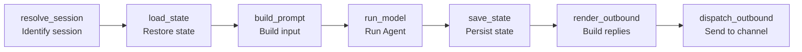

When you talk to Bub through a terminal or a chat platform such as Telegram, the app layer receives more than a prompt for the model. It needs to figure out which session the message belongs to, restore that session's state, check whether the input is a direct command or a normal question, run the Agent, save updated state, and deliver the reply back to the right channel.

In the Bub app layer, this end-to-end lifecycle for handling one inbound message is called a **Turn**, orchestrated by `BubFramework`. A core Agent Run is just the model-execution stage inside it.

## The seven lifecycle stages {#stages}

Every call to `BubFramework.process_inbound()` moves an inbound message through seven stages in order:

| Stage | Responsibility |
| --- | --- |
| `resolve_session` | Determine the message's `session_id` (defaults to `<channel>:<chat_id>`) |
| `load_state` | Restore session state for this Turn and bind the runtime Agent |
| `build_prompt` | Handle internal commands or build the model input |
| `run_model` | Execute the Agent Run (or streaming `run_model_stream`) |
| `save_state` | Persist application state across Turns after the model stage ends |
| `render_outbound` | Package model output into one or more outbound channel messages |
| `dispatch_outbound` | Deliver outbound messages to the channel |

Every stage has a hook of the same name, letting plugins extend or replace any stage without touching core code. For exact signatures and dispatch rules, see the [Hooks reference](/docs/reference/hooks/#turn-hooks).

It helps to distinguish three closely related terms:

- **Session**: the identity boundary across multiple messages. Ten messages in the same chat belong to 1 Session, but trigger 10 separate Turns. A `session_id` is an identifier, not a lock; same-session concurrency is controlled by channel admission policy or the host application.
- **Turn**: the 7-stage app pipeline for one inbound message.
- **Run**: one execution of `core.Agent`'s model-and-tool loop. A normal message starts a Run during `run_model`; a comma command (such as `,help`) finishes inside the Turn without calling the model; calling `agent.run()` via the SDK starts a Run outside any Turn.

## TurnState: per-Turn shared dictionary {#state}

As a Turn progresses, hooks, tools, and event handlers often need to pass request-scoped data to one another—such as a request ID, permission flags, or channel metadata. Bub provides `TurnState` for this purpose.

`TurnState` is a plain Python dictionary (`dict[str, Any]`) that **lives only for the current Turn or Run and is never persisted automatically**.

- Save state that must persist across Turns explicitly in `save_state`, and restore it in `load_state`.
- Conversation history and tool records belong on the Tape, not in `TurnState` (see [Where data belongs](/docs/concepts/tape/#state)).
- Keys starting with `_runtime_` are managed internally by Bub; plugins should not modify or overwrite them.

## Exceptions and failure boundaries {#failures}

Network hiccups, model timeouts, or tool failures can interrupt a Turn at any point. The Turn pipeline defines clear failure boundaries so you know what is guaranteed to run:

- **`save_state` always runs once the model stage starts**: as soon as execution enters `run_model`, `save_state` is guaranteed to run in a `finally` block, even if the model call fails or times out.
- **Pre-model failures skip `save_state`**: if an error occurs in `resolve_session`, `load_state`, or `build_prompt`, the model stage has not started and `save_state` is not called.
- **`on_error` observes without recovering**: unhandled exceptions are passed to `on_error` hooks for logging or alerting, then re-raised to the caller.
- **A Turn does not roll back external side effects**: if a tool has already modified files, sent HTTP requests, or written to a database, a later failure in the Turn does not undo those actions.
