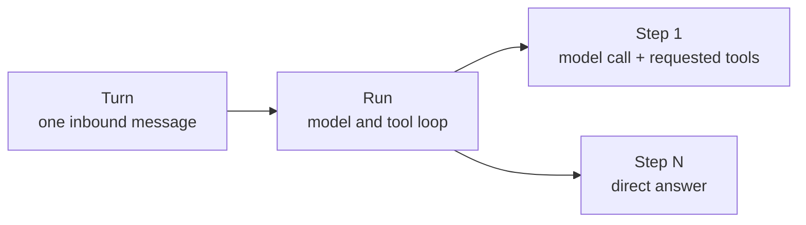
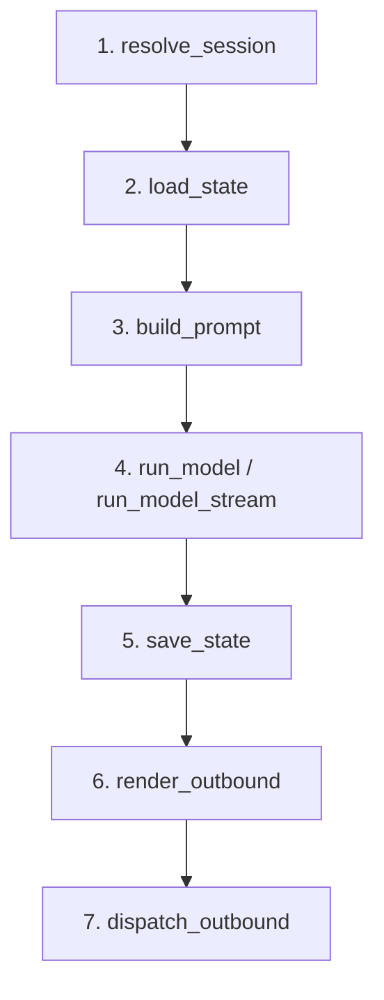

A reply is the visible part of handling a message. Behind it, the application must resolve a session, restore state, prepare input, execute work, save the result, and route the response. If every tool or model adapter handled those concerns itself, each execution path would acquire different failure and ordering rules.

A **Turn** gives that work one deterministic lifecycle in the Bub application. Deterministic does not mean the model's answer is fixed; it means the stages around the answer have a defined order and explicit error boundaries.

## Turn, Run, and Step {#definition}

Three levels describe the work at different granularities:



- A **Turn** owns the complete application interaction, from receiving an `Envelope` to producing outbound replies.
- A **Run** is the Agent loop inside that Turn. It repeats model calls and tool execution until the model answers without requesting tools and no messages are pending.
- A **Step** contains one model inference and all tool calls requested by that response. `BUB_MAX_STEPS` limits Steps, not individual tool calls.

Not every interaction uses all three levels. A direct command does not start a model Run, `Agent.run_once()` executes one Step, and a plugin can replace the model stage. When you use `core.Agent` without the application framework, the caller owns the surrounding Turn concerns.

## The seven-stage pipeline {#stages}

`BubFramework.process_inbound()` gives every ordinary inbound message the same route:



| Stage | Responsibility | Default behavior |
| --- | --- | --- |
| `resolve_session` | Establish the conversation boundary | Use the message's `session_id`, or derive `channel:chat_id` |
| `load_state` | Restore data needed by this Turn | Restore session settings and bind the Agent |
| `build_prompt` | Construct model input | Recognize commands; add context, time, and media to ordinary messages |
| `run_model` / `run_model_stream` | Produce model output | Call `BubAgent.run_stream()` |
| `save_state` | Finish the message lifecycle and persist application state | Run the registered save-state hooks |
| `render_outbound` | Convert output into channel messages | Render model text as outbound replies |
| `dispatch_outbound` | Deliver the replies | Hand each message to the appropriate channel |

Each stage has a corresponding hook. A plugin can augment the default behavior or replace a result according to that hook's contract. This makes the pipeline customizable without making its order implicit. See the [Hooks reference](/docs/reference/hooks/#turn-hooks) for signatures, return values, and priority.

### TurnState is temporary by design {#state}

Stages need a way to share data without turning that data into accidental long-term memory. `TurnState` is the scratchpad: an ordinary `dict[str, Any]` shared by hooks, tools, and event handlers whose signatures receive `state`.

Its lifetime is one Turn. Put request-specific values there; persist data that must survive into the next Turn during `save_state`, and restore it during `load_state`. Conversation and tool round-trips belong to the Tape rather than to this dictionary.

After successful processing, `process_inbound()` returns a `TurnResult`:

| Field | Content |
| --- | --- |
| `session_id` | The resolved session ID |
| `prompt` | The input passed to the model stage |
| `model_output` | Aggregated model text |
| `outbounds` | Replies generated and attempted |
| `state` | The Turn's state dictionary |

Even without a bound sending channel, `TurnResult.outbounds` lets the host handle the replies itself.

## Failure has a defined path {#failures}

The important guarantee begins at the model stage. Once execution enters it, `save_state` runs in a `finally` block. A model error or timeout therefore does not skip the application's state-saving boundary.

The guarantee is deliberately precise:

- Failures in `resolve_session`, `load_state`, or `build_prompt` happen before that `finally` block and do not trigger `save_state`.
- Saving state does not imply that a reply was rendered or dispatched successfully.
- Unhandled exceptions go to `on_error` and are then re-raised. `on_error` observes and reports; it does not resume the original Turn.
- A Turn is not a database transaction. Files changed, requests sent, and other tool side effects are not rolled back.

When hooks provide resources such as storage, process messages inside the `framework.running()` scope:

```python
async with framework.running():
    result = await framework.process_inbound(message)
```

`bub run` opens this scope for one message; `bub chat` and `bub gateway` keep it open while the app runs. Create the `BubAgent` inside the scope as well when it needs storage supplied there.

## What the Turn does not own {#outside}

A clear pipeline also needs clear edges:

| Need | Owner |
| --- | --- |
| Accept a new message or hand it to the current Run | The `admit_message` hook and channel admission policy |
| Merge messages that arrive close together | `BufferedMessageHandler` |
| Intercept one model or tool call | Agent events or application interception hooks |
| Add a message to the next Step | `continue_prompt` or `MessagesPending` |
| Persist conversation and tool round-trips | `TapeRecorder` |
| Serialize concurrent work in one session | The host application |

`process_inbound()` supplies no session lock. Channels allow concurrency by default, so an application that requires one active Turn per session must enforce that policy itself.

## Choose an entry point {#entry-points}

Choose the smallest entry point that matches the lifecycle you need:

| Entry point | Scope | Caller still owns |
| --- | --- | --- |
| `core.Agent.run()` | One model Run or direct command | Sessions, state persistence, and reply routing |
| `BubAgent.run_stream()` | Optional initial state loading and one model Run | State saving, outbound rendering and dispatch, same-session concurrency |
| `framework.process_inbound()` | The complete Turn | Application resource scope, same-session concurrency, and channel setup |

`process_inbound(stream_output=True)` delivers streaming output to the channel and still returns a complete `TurnResult` after processing finishes.
