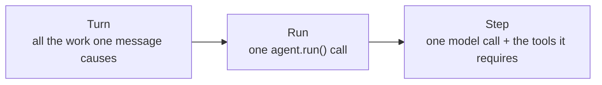

import { Aside, Steps } from '@astrojs/starlight/components';

A turn is one inbound message, and all the work that it causes. `BubFramework` handles a turn: it finds the session, loads the state, builds the prompt, runs the model, and delivers the reply. Each stage has a hook, so a plugin can add to one stage or replace it.

A turn belongs to `bub[app]`. A direct `core.Agent.run()` call has no turn — the loop starts with the prompt, state, and tape that you give it. This page covers the layer between a channel and that loop.

## Turn, run, and step {#turn-run-step}

There are three granularities of "one" here. Separate them first:



turn ⊃ run ⊃ step: a turn usually contains one run, and a run contains multiple steps. The reverse does not hold — when using the SDK directly, an `agent.run()` call can exist independently, with no turn; a step always belongs to a run.

## Why a turn exists {#why-a-turn}

With just a model loop, every call site has to answer the same questions again: which session is this message from? Should last round's state come along? Where does the reply go?

A turn lifts those out of tool and model code and fixes them into named stages. The payoff is concrete:

- **Every piece can be replaced**, but the replacement points have names, so you do not fork the whole flow.
- **The failing stage is explicit**: `on_error(stage=...)` receives its name.
- **One message is one transaction.** State loads at the start and saves at the end, and a failure in between has a defined cleanup.

## Stages {#stages}

`framework.process_inbound(message)` runs these seven stages in order.

<Steps>

1. **`resolve_session`**: select the session ID for the inbound message. The first non-empty result wins; when none is returned, a default is built from the channel and chat identifiers.

2. **`load_state`**: collect state fragments from the hook implementations and merge them into one `TurnState` dictionary. Lower priority merges first, and higher priority overrides.

3. **`build_prompt`**: turn the inbound content into a prompt. The first result wins; when no hook provides one, the inbound content is used as is.

4. **`run_model` / `run_model_stream`**: produce the model output, as a final result or as a stream. The built-in implementation calls `BubAgent.run_stream()`, which enters the loop described below.

5. **`save_state`**: finish the work of the model stage. This stage runs in its own `finally` block, so an exception in the previous stage still reaches it.

6. **`render_outbound`**: turn the result into outbound envelopes. Results from several hooks are concatenated; when all are empty, one default reply is used.

7. **`dispatch_outbound`**: actually deliver each outbound envelope, through its channel.

</Steps>

The first three stages prepare input, one stage produces output, and the last three send it out. Only stage 4 runs for long — the others wrap it on both sides.

The built-in plugin supplies the default implementation of these seven stages. Other plugins can add behavior or replace it, as each hook's contract allows. The [hooks reference](/docs/reference/hooks/#turn-hooks) defines the first-result hooks, the combined results, and the priority rules.

## What crosses the stages {#what-crosses-stages}

Exactly three things pass from stage to stage. Together they are the turn's complete internal state:

| Value | Type | Written by | Read by |
| --- | --- | --- | --- |
| `session_id` | `str` | `resolve_session` | every later stage, and `TurnResult` |
| `state` | `TurnState` | the `load_state` fragments; tools and handlers also mutate it during the run | prompt building, the model call, tools, `save_state` |
| `prompt` | `list[UserContent]` | `build_prompt` | the model stage |

`state` is the one most easily overlooked. It is a plain dictionary that lives from loading to saving, and tools and event handlers receive that same object. To keep anything across turns you must write it out in `save_state` and read it back in `load_state` — the built-in app persists only selected settings. The [tape state section](/docs/concepts/tape/#state) covers where durable data belongs.

## Agent call {#agent-call}

The built-in `run_model_stream` hook calls `BubAgent.run_stream()`. `BubAgent` uses the core model and tool loop, plus the app defaults: settings, skills, commands, steering, and the app tool policies.

The framework converts between streaming and non-streaming hook results, so a plugin that implements only one of them still works. `process_inbound(..., stream_output=True)` lets the channel router read the output as it arrives, and still returns a complete `TurnResult` when the stream ends.

```python
result = await framework.process_inbound(message, stream_output=True)
print(result.session_id, len(result.outbounds))
```

Replacing `run_model` changes this step. An echo plugin, for example, can return text without creating an agent run — in which case no core events fire and no tape records are written. **Core events and tape records occur only when the chosen implementation actually uses the core agent**, which makes it the most direct way to tell how far a turn travelled.

## Resources and failures {#resources-and-failures}

<Aside type="caution" title="Where save_state starts">
  `save_state` runs only once execution reaches the model stage; it also runs when that stage raises. A failure in session resolution, state loading, or prompt construction happens before the `finally` block, so it does **not** run `save_state`. If your plugin acquires resources in those three stages, release them yourself.
</Aside>

If the model stage raises an unhandled exception, the framework runs `save_state`, then skips rendering and dispatch. The outer error path calls `on_error(stage="turn", ...)` and raises the exception again. The built-in error observer can send an error reply through outbound dispatch. A failure in one `on_error` observer does not stop the other observers.

Use `async with framework.running():` when your hooks provide stores or other app resources. It opens those resources and releases them on exit. The built-in per-message lifespan opens during state loading and closes in `save_state`.
