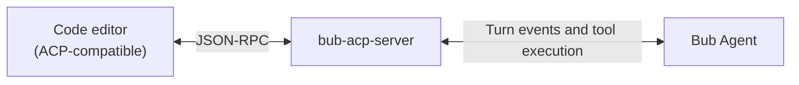

The [Agent Client Protocol](https://agentclientprotocol.com/) (ACP) is an open standard protocol that lets code editors (such as Zed) start an Agent as a subprocess and exchange sessions, prompts, tool call status, and code editing operations bidirectionally over JSON-RPC streaming.

The `bub-acp-server` plugin connects the Bub application to the ACP protocol, so you can summon Bub directly in your everyday IDE for coding, refactoring, and troubleshooting.



## Before you start {#before-you-start}

- You have [installed the Bub application](/docs/getting-started/install/#app-install) and configured a working model.
- You have installed the [Zed](https://zed.dev/) editor (or another ACP-compatible client).

:::note[Environment variables and paths]
Applications such as Zed inherit a `PATH` and environment variables at launch that usually differ from those of a terminal (such as `~/.zshrc` or `~/.bashrc`). First confirm the absolute path of `bub` in your current environment from the terminal:

```bash
command -v bub
```
:::

## 1. Install the plugin {#install}

Install the adapter plugin in the Python environment that contains Bub:

```bash
bub install bub-acp-server@main
bub acp --help
```

If the installation succeeds, the terminal output shows:

```text
Usage: bub acp [OPTIONS]
```

`bub-acp-server` communicates with the host editor over standard input/output (`stdio`) by default.

## 2. Configure Zed {#zed}

In Zed, press `Cmd+Shift+P` (macOS) or `Ctrl+Shift+P` (Linux/Windows) to open the command palette, type and run `zed: open settings`, and add the `agent_servers` configuration to the opened `settings.json`.

### Option A: Global installation {#global-install}

If `bub` is on the system global `PATH` and you do not need to load a project-specific `.env` file, configure it directly:

```json
{
  "agent_servers": {
    "Bub": {
      "type": "custom",
      "command": "bub",
      "args": ["acp"],
      "env": {}
    }
  }
}
```

*If Zed reports that it cannot find `bub`, replace `"command"` with the absolute path you obtained earlier from `command -v bub`.*

### Option B: Use a wrapper script {#wrapper-script}

If your project relies on a specific Python virtual environment, or the model API key is stored in `.env` at the workspace root, we strongly recommend writing a launcher wrapper script (for example `~/.bub/bub-acp-wrapper`):

```bash
#!/usr/bin/env bash
set -euo pipefail

# 1. Activate the virtual environment (if any)
# source /path/to/venv/bin/activate

# 2. Load workspace or user environment variables
if [ -f "$PWD/.env" ]; then
  set -a
  source "$PWD/.env"
  set +a
fi

# 3. Start Bub ACP using an absolute path
exec /path/to/your/bub acp
```

After granting execute permission, point Zed settings at the script:

```bash
chmod +x ~/.bub/bub-acp-wrapper
```

```json
{
  "agent_servers": {
    "Bub": {
      "type": "custom",
      "command": "/Users/yourname/.bub/bub-acp-wrapper",
      "args": [],
      "env": {}
    }
  }
}
```

## 3. Start a session {#start}

After saving the settings, restart Zed or reload the configuration:

1. Press `Cmd+?` (macOS) or `Ctrl+?` (Linux/Windows) to open Zed's Agent side panel.
2. Switch to **Bub** in the model/backend selector menu.
3. Enter a message in the input box to test:
   ```text
   Hello! Please introduce yourself.
   ```
4. Bub streams the response, thinking process, and tool call steps into the panel one by one.

:::tip[Native tool capabilities]
Zed supports letting the Agent operate through the editor's file system and terminal. When Zed has the relevant permissions, Bub's `bash`, `fs.read`, and `fs.write` are automatically executed by the editor in preference; if the client does not declare this capability, they fall back to running locally.
:::

## 4. Sessions and restore {#sessions}

`bub-acp-server` provides full session lifecycle management:

- **New session**: creating a new Thread in the Zed panel corresponds to opening a brand-new session Tape at the underlying layer.
- **History restore**: when you switch back to an old Thread, Bub extracts and replays that session's history messages and tool context from the persistent Tape store.
- **Persistent binding**: the session metadata index is stored in `$BUB_HOME/acp-sessions.json`. As long as your `BUB_HOME` and workspace path stay stable, the history session list remains intact after restarting the editor.
- **Model and reasoning parameters**: the reasoning effort adjusted in the Zed UI, or the specific model alias selected, is automatically appended to subsequent requests in this ACP session.

## 5. Remote service mode {#http}

In most local development scenarios, the default `stdio` is the lightest, lowest-overhead choice. If you deploy Bub on a cloud development machine (Remote Server) or inside a Docker container and need the editor on your local development machine to call it remotely, you can use HTTP/WebSocket service mode.

### Option 1: Run the service standalone {#standalone-service}

```bash
# Start the HTTP service
bub acp --transport http

# Or start the WebSocket service
bub acp --transport websocket
```

The default listen address is `127.0.0.1:28200` (the HTTP endpoint is `http://127.0.0.1:28200/acp`, and the WebSocket endpoint is `ws://127.0.0.1:28200/acp`).

### Option 2: Run long-lived as a Bub Gateway channel {#gateway-channel}

Gateway mode can maintain the session pool and the background connection at the same time:

```bash
bub gateway --enable-channel acp-server
```

| Environment variable | Default | Description |
| --- | --- | --- |
| `BUB_ACP_SERVER_HOST` | `127.0.0.1` | Host IP to listen on (set to `0.0.0.0` to expose it externally; mind network security) |
| `BUB_ACP_SERVER_PORT` | `28200` | Service port |
| `BUB_ACP_SERVER_CERTFILE` | empty | TLS certificate path (required to enable HTTPS/WSS) |
| `BUB_ACP_SERVER_KEYFILE` | empty | TLS private key path |

:::caution[Security boundary]
HTTP/WebSocket endpoints do not provide complex user authentication by default. If you need to expose them over the public internet, be sure to put Nginx or Cloudflare Tunnel in front to add authentication, and enable TLS encryption.
:::

## Troubleshooting {#troubleshooting}

| Common problem | Starting point | Suggested fix |
| --- | --- | --- |
| Zed reports that it cannot find the Agent Server | Check the `"command"` path | Run `command -v bub` in a terminal and change `command` in the configuration to the system absolute path. |
| The panel shows a startup failure or fallback | Environment variables are not taking effect (for example, a missing API key) | Use [Option B](#zed) to write a wrapper script and force `source` the required `.env` in it. |
| Unclear where the protocol handshake is stuck | Check Zed's ACP communication logs | Open the command palette in Zed and run `dev: open acp logs` to observe JSON-RPC interaction events in real time. |
| Tool calls do not trigger properly | Check client capability negotiation (Capabilities) | Confirm that the workspace has read/write permissions; first test whether tools work with `bub run` in the same terminal. |
| Session history cannot be saved | Check the `BUB_HOME` directory permissions | Make sure the user running Zed has read/write access to the `~/.bub` directory. |
