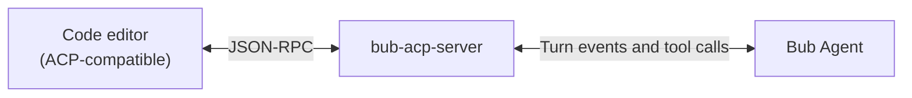

The [Agent Client Protocol](https://agentclientprotocol.com/) (ACP) is an open standard that lets code editors (such as Zed) run an Agent subprocess and stream sessions, prompts, tool calls, and file edits over JSON-RPC.

Install `bub-acp-server` to connect Bub to ACP, so you can summon Bub directly in your everyday IDE for coding, refactoring, and troubleshooting.



## Before you start {#before-you-start}

- [Install the Bub app](/docs/getting-started/install/#app-install) and configure a model.
- Install [Zed](https://zed.dev/) (or another ACP client).

:::note[Find the absolute path to `bub`]
GUI applications often launch with a default system `PATH` that omits shell additions from `~/.zshrc` or `~/.bashrc`. Check the absolute path of `bub` in your terminal first:

```bash
command -v bub
```
:::

## 1. Install the plugin {#install}

Install the adapter plugin in the Python environment that contains Bub:

```bash
bub install bub-acp-server@main
bub acp --help
```

Seeing `Usage: bub acp [OPTIONS]` confirms installation. By default, `bub acp` communicates over `stdio`.

## 2. Configure Zed {#zed}

In Zed, press `Cmd+Shift+P` (macOS) or `Ctrl+Shift+P` (Linux/Windows), run `zed: open settings`, and add `agent_servers` to `settings.json`.

### Option A: Direct command {#global-install}

If you do not need to load a project `.env` file, point directly to `bub` (replace `"bub"` with the absolute path from `command -v bub` if Zed cannot find it):

```json title="~/.config/zed/settings.json"
{
  "agent_servers": {
    "Bub": {
      "type": "custom",
      "command": "bub",
      "args": ["acp"],
      "env": {}
    }
  }
}
```

### Option B: Wrapper script {#wrapper-script}

If your API keys live in a workspace `.env` file or you use a project virtual environment, create a wrapper script at `~/.bub/bub-acp-wrapper`:

```bash title="~/.bub/bub-acp-wrapper"
#!/usr/bin/env bash
set -euo pipefail

# 1. Optional: activate virtual environment
# source /path/to/venv/bin/activate

# 2. Load workspace .env if present
if [ -f "$PWD/.env" ]; then
  set -a
  source "$PWD/.env"
  set +a
fi

# 3. Launch Bub ACP via absolute path
exec /path/to/your/bub acp
```

Make it executable and reference it in Zed's `settings.json`:

```bash
chmod +x ~/.bub/bub-acp-wrapper
```

```json title="~/.config/zed/settings.json"
{
  "agent_servers": {
    "Bub": {
      "type": "custom",
      "command": "/Users/yourname/.bub/bub-acp-wrapper",
      "args": [],
      "env": {}
    }
  }
}
```

## 3. Start a session in Zed {#start}

After saving the settings, restart Zed or reload the configuration:

1. Press `Cmd+?` (macOS) or `Ctrl+?` (Linux/Windows) to open Zed's Agent panel.
2. Select **Bub** from the agent menu.
3. Send a test prompt:
   ```text
   Hello! Please introduce yourself.
   ```
4. Bub streams the response, thinking process, and tool call steps into the panel.

:::tip[Editor-delegated tools]
When Zed advertises filesystem and terminal capabilities, Bub delegates `bash`, `fs.read`, and `fs.write` to the editor automatically, falling back to local execution when unsupported.
:::

## 4. Sessions and parameter sync {#sessions}

- **New and restored threads**: starting a new thread in Zed creates a new Tape; switching back to an earlier thread replays history from the Tape store. The session index is saved in `$BUB_HOME/acp-sessions.json`—as long as `BUB_HOME` and your workspace path stay the same, your session list remains intact across editor restarts.
- **Model and reasoning effort**: changing the model or reasoning effort in the Zed UI updates subsequent requests in the active ACP session.

## 5. Remote mode (HTTP / WebSocket) {#http}

For most local setups, `stdio` is the lightest, lowest-overhead choice. When Bub runs on a remote dev server or inside a Docker container, expose ACP over HTTP or WebSocket instead.

### Run standalone {#standalone-service}

```bash
bub acp --transport http
# or
bub acp --transport websocket
```

Listens on `127.0.0.1:28200` by default (`http://127.0.0.1:28200/acp` or `ws://127.0.0.1:28200/acp`).

### Run as a gateway channel {#gateway-channel}

Gateway mode maintains the session pool and background connection together:

```bash
bub gateway --enable-channel acp-server
```

| Environment variable | Default | Description |
| --- | --- | --- |
| `BUB_ACP_SERVER_HOST` | `127.0.0.1` | Listen host IP (use `0.0.0.0` for external access) |
| `BUB_ACP_SERVER_PORT` | `28200` | Listen port |
| `BUB_ACP_SERVER_CERTFILE` | empty | TLS certificate path (required for HTTPS/WSS) |
| `BUB_ACP_SERVER_KEYFILE` | empty | TLS private key path |

:::caution[Network security]
HTTP/WebSocket endpoints do not include built-in user authentication. Use SSH port forwarding, or place Nginx / Cloudflare Tunnel in front with authentication and TLS.
:::

## Troubleshooting {#troubleshooting}

| Symptom | Fix |
| --- | --- |
| Zed cannot find the Agent server | Set `command` in `settings.json` to the absolute path from `command -v bub` |
| Startup fails or API key is missing | Use [Option B](#wrapper-script) to `source` your `.env` file |
| Inspect JSON-RPC traffic | Run `dev: open acp logs` from Zed's command palette |
| Session history does not persist | Verify the user running Zed has read/write permissions on `$BUB_HOME` (`~/.bub`) |
