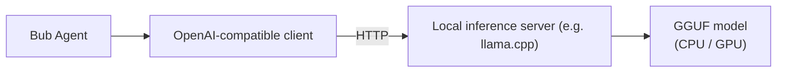

For offline, private-deployment, or privacy-sensitive workloads, you can run an open-source model locally to drive Bub.

Bub ships with a built-in OpenAI-compatible provider, so any local inference server exposing `/v1/chat/completions` (such as `llama.cpp`, `vLLM`, or `Ollama`) works just as seamlessly as a cloud model.



This guide uses `llama.cpp` with [`ggml-org/gemma-4-E2B-it-GGUF`](https://huggingface.co/ggml-org/gemma-4-E2B-it-GGUF) (Q8 quantized).

:::tip[Choosing a local model]
- **Connectivity tests**: a ~4B model is enough to verify basic chat responses.
- **Multi-step tool calling and coding**: use a 7B/8B+ instruction-tuned model with strong tool-calling support (such as `Qwen2.5-Coder-7B-Instruct` or `Llama-3.1-8B-Instruct`).
:::

## Before you start {#before-you-start}

- [Install the Bub app](/docs/getting-started/install/#app-install) and Docker.
- Ensure at least 8 GB of free RAM (~5 GB for the Q8 model weights plus KV cache headroom).
- Download the GGUF files into `~/.cache/llama.cpp/`:

```text
~/.cache/llama.cpp/ggml-org_gemma-4-E2B-it-GGUF_gemma-4-E2B-it-Q8_0.gguf
~/.cache/llama.cpp/ggml-org_gemma-4-E2B-it-GGUF_mmproj-gemma-4-E2B-it-Q8_0.gguf
```

*(`mmproj` is the multimodal vision projector; omit it and the `--mmproj` flag if you only need text chat.)*

## 1. Start `llama-server` {#start-server}

Generate a local API key and start the `llama.cpp` server container:

```bash
export LLAMA_API_KEY="local-$(openssl rand -hex 8)"

docker run --rm -it \
  -p 127.0.0.1:8080:8080 \
  -v "$HOME/.cache/llama.cpp:/models:ro" \
  ghcr.io/ggml-org/llama.cpp:server \
  --host 0.0.0.0 \
  --port 8080 \
  --api-key "$LLAMA_API_KEY" \
  --alias gemma-4-E2B-it \
  -m /models/ggml-org_gemma-4-E2B-it-GGUF_gemma-4-E2B-it-Q8_0.gguf \
  --mmproj /models/ggml-org_gemma-4-E2B-it-GGUF_mmproj-gemma-4-E2B-it-Q8_0.gguf
```

- `-p 127.0.0.1:8080:8080`: binds only to localhost.
- `--alias`: sets the model name expected by `/v1/chat/completions`.
- The server is ready when it prints `server is listening on http://0.0.0.0:8080`.

## 2. Verify the local endpoint {#verify-endpoint}

In another terminal window, use `curl` to verify that the local service is ready:

```bash
curl -sS http://127.0.0.1:8080/v1/models \
  -H "Authorization: Bearer $LLAMA_API_KEY"

curl -sS http://127.0.0.1:8080/v1/chat/completions \
  -H "Authorization: Bearer $LLAMA_API_KEY" \
  -H "Content-Type: application/json" \
  -d '{
    "model": "gemma-4-E2B-it",
    "messages": [{"role": "user", "content": "Reply with one word: hello"}],
    "max_tokens": 16
  }'
```

A JSON response containing `choices[0].message.content` confirms the server is working.

## 3. Configure and run Bub {#configure-bub}

Point Bub's OpenAI provider settings at the local server:

```bash
export BUB_OPENAI_API_BASE="http://127.0.0.1:8080/v1"
export BUB_OPENAI_API_KEY="$LLAMA_API_KEY"
export BUB_MODEL="openai:gemma-4-E2B-it"
```

:::note[Using Ollama]
If you prefer [Ollama](https://ollama.com/), simply start Ollama and point Bub at its default port `11434` (no custom API key needed):
```bash
export BUB_OPENAI_API_BASE="http://127.0.0.1:11434/v1"
export BUB_OPENAI_API_KEY="ollama"
export BUB_MODEL="openai:qwen2.5-coder:7b"
```
:::

Run a prompt for end-to-end verification:

```bash
bub run "Introduce yourself in one sentence and mention that you are running locally."
```

Watch the terminal output: if it starts with `[cli:local]` and prints the model's reply, Bub is connected to your local model.

## 4. Performance tuning {#tune}

Agent workflows place specific demands on context window and memory. Tune these flags based on your hardware:

| Goal | Flag / adjustment | Effect |
| --- | --- | --- |
| **Larger context window** | Add `--ctx-size 8192` (or higher) | System prompts, tool schemas, and Tape history easily exceed a 2048 default |
| **Lower memory usage** | Use a `Q4_K_M` quantized GGUF | Roughly halves RAM/VRAM usage and speeds up inference |
| **GPU offload** | Pass GPU devices and `--n-gpu-layers 33` | Offloads model layers to GPU VRAM |
| **Text-only mode** | Remove `--mmproj` | Skips vision projector memory overhead |

:::caution
Do not increase `--ctx-size` without checking available RAM. KV cache memory scales with context length, so leave enough physical memory to avoid OOM crashes.
:::

## Troubleshooting {#troubleshooting}

| Symptom | Possible cause | Fix |
| --- | --- | --- |
| `401 Unauthorized` | API key mismatch | Ensure `LLAMA_API_KEY` matches the container's `--api-key` |
| `404` or model not found | Alias mismatch | Ensure `BUB_MODEL=openai:<alias>` matches `--alias` |
| Tool calls fail or output is malformed | Model is too small or lacks tool-calling tuning | Switch to a 7B/8B+ model tuned for tool calling |
| Container crashes during startup or inference | Out of memory (OOM) | Lower `--ctx-size` or use a `Q4_K_M` quantization |

## Cleanup {#cleanup}

When you finish testing, press `Ctrl+C` in the container terminal to stop the server and unset the environment overrides:

```bash
unset BUB_API_BASE BUB_API_KEY BUB_OPENAI_API_BASE BUB_OPENAI_API_KEY BUB_MODEL LLAMA_API_KEY
```

:::note
After clearing these environment variables, Bub reverts to your default cloud model configuration. Any Tape session history created during testing remains in Bub's data directory.
:::
