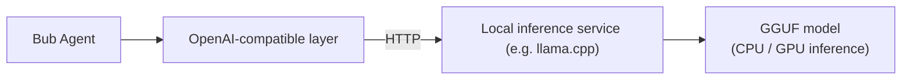

In offline, private deployment, or data-privacy scenarios, you can run an open-source model locally to drive Bub.

Bub ships with a standard OpenAI-compatible Provider. This means that as long as the local inference engine exposes a `/v1/chat/completions` endpoint (for example `llama.cpp`, `vLLM`, or `Ollama`), Bub can call local models as seamlessly as it calls cloud models.



This guide demonstrates the setup with `llama.cpp` and the excellent open-source model [`ggml-org/gemma-4-E2B-it-GGUF`](https://huggingface.co/ggml-org/gemma-4-E2B-it-GGUF) (Q8 quantized version).

:::tip[Choosing a local model]

Agents rely on multi-turn tool calling and long-context reasoning:

- For lightweight testing, a model around 4B can verify basic conversational connectivity.
- If you need reliable tool calling and code generation, choose a model above 7B/8B that has been fine-tuned on instructions and tools (for example `Qwen2.5-Coder-7B-Instruct` or `Llama-3.1-8B-Instruct`).
:::

## Before you begin {#before-you-start}

- You have [installed the Bub application](/docs/getting-started/install/#app-install).
- Docker is installed and the Docker daemon is running properly.
- It is recommended to reserve at least 8 GB of available memory on the machine (the Q8 quantized model file takes about 5 GB, and you also need room for the context KV cache).
- Download the GGUF model files to the local directory `~/.cache/llama.cpp/`:

```text
~/.cache/llama.cpp/ggml-org_gemma-4-E2B-it-GGUF_gemma-4-E2B-it-Q8_0.gguf
~/.cache/llama.cpp/ggml-org_gemma-4-E2B-it-GGUF_mmproj-gemma-4-E2B-it-Q8_0.gguf
```

*(Here `mmproj` is the multimodal vision projection model; if you only handle plain-text interaction, you can skip downloading this file.)*

## 1. Start llama-server {#start-server}

To secure the local service endpoint, generate a random API key:

```bash
export LLAMA_API_KEY="local-$(openssl rand -hex 8)"
echo "Generated local key: $LLAMA_API_KEY"
```

Start the `llama.cpp` server container with Docker:

```bash
docker run --rm -it \
  -p 127.0.0.1:8080:8080 \
  -v "$HOME/.cache/llama.cpp:/models:ro" \
  ghcr.io/ggml-org/llama.cpp:server \
  --host 0.0.0.0 \
  --port 8080 \
  --api-key "$LLAMA_API_KEY" \
  --alias gemma-4-E2B-it \
  -m /models/ggml-org_gemma-4-E2B-it-GGUF_gemma-4-E2B-it-Q8_0.gguf \
  --mmproj /models/ggml-org_gemma-4-E2B-it-GGUF_mmproj-gemma-4-E2B-it-Q8_0.gguf
```

**Key parameters**:
- `-p 127.0.0.1:8080:8080`: binds only to the host loopback address, so other machines on the LAN cannot reach it.
- `--alias`: defines the model alias requested in `/v1/chat/completions`.
- When the terminal prints `server is listening on http://0.0.0.0:8080`, the model has been loaded into memory successfully.

## 2. Verify the service endpoint {#verify-endpoint}

In another terminal window, use `curl` to verify that the local service is ready:

```bash
# Verify the model list
curl -sS http://127.0.0.1:8080/v1/models \
  -H "Authorization: Bearer $LLAMA_API_KEY"
```

Send a minimal chat completion request:

```bash
curl -sS http://127.0.0.1:8080/v1/chat/completions \
  -H "Authorization: Bearer $LLAMA_API_KEY" \
  -H "Content-Type: application/json" \
  -d '{
    "model": "gemma-4-E2B-it",
    "messages": [{"role": "user", "content": "Reply with one word: hello"}],
    "max_tokens": 16
  }'
```

If the response is JSON containing `choices[0].message.content`, the local OpenAI-compatible service is running correctly.

## 3. Configure Bub {#configure-bub}

Set Bub's environment variables so that requests for the OpenAI provider are redirected to the local endpoint:

```bash
export BUB_OPENAI_API_BASE="http://127.0.0.1:8080/v1"
export BUB_OPENAI_API_KEY="$LLAMA_API_KEY"
export BUB_MODEL="openai:gemma-4-E2B-it"
```

:::note[Using another inference framework (such as Ollama)]

If you prefer [Ollama](https://ollama.com/), simply start Ollama and point the environment variables at its compatible endpoint (no custom API key needed):
```bash
export BUB_OPENAI_API_BASE="http://127.0.0.1:11434/v1"
export BUB_OPENAI_API_KEY="ollama"
export BUB_MODEL="openai:qwen2.5-coder:7b"
```
:::

Run a Bub task once for end-to-end verification:

```bash
bub run "Introduce yourself in one sentence and mention that you are a local model."
```

Watch the terminal output. If it starts with `[cli:local]` and prints the model's reply, the whole chain is working.

## 4. Tune performance {#tune}

Agent workflows have specific requirements for context window and memory. Depending on your hardware, you can tune the following parameters in the startup command:

| Tuning goal | Specific measure | Reason and effect |
| --- | --- | --- |
| **Expand the context window** | Add `--ctx-size 8192` or larger | The Agent's system prompt, tool definitions, and Tape history are long, so the default 2048 is easily exceeded. |
| **Reduce memory usage** | Switch to a `Q4_K_M` quantized GGUF | VRAM/memory usage halves, inference is significantly faster, and accuracy loss is minimal. |
| **GPU hardware acceleration** | Mount the GPU and add `--n-gpu-layers 33` | Offload computation layers to VRAM, improving inference speed by several times to tens of times. |
| **Text-only acceleration** | Remove the `--mmproj` parameter and the corresponding image mapping | Skip image modality initialization overhead and reduce system memory usage. |

:::caution
Do not blindly increase `--ctx-size` without limit. The memory consumed by the KV cache is proportional to context length, so make sure to leave enough physical memory to prevent the system from triggering OOM.
:::

## Troubleshooting {#troubleshooting}

| Symptom | Possible cause | Solution |
| --- | --- | --- |
| `curl` returns `401 Unauthorized` | The API key in the request header does not match the one used at container startup | Confirm the `LLAMA_API_KEY` value, or check `--api-key` in `docker run`. |
| The model is reported as not found or returns 404 | The model alias in the request does not match the service | Check that the name after `BUB_MODEL` exactly matches the `--alias` used when starting the container. |
| Cannot call tools or outputs garbled text | The model is too small or was not fine-tuned for Function Calling | Switch to a model above 7B/8B that is fine-tuned for tool calling (such as Qwen2.5-Coder or Llama-3.1). |
| The service crashes or exits when starting the container or during inference | Insufficient physical memory or VRAM causes OOM | Lower `--ctx-size`, or switch to a model file with a smaller quantization level (such as `Q4_K_M`). |

## Cleanup {#cleanup}

After testing, press `Ctrl+C` in the terminal running the Docker container to stop it, and clear the environment variable overrides in the current terminal:

```bash
unset BUB_API_BASE BUB_API_KEY BUB_OPENAI_API_BASE BUB_OPENAI_API_KEY BUB_MODEL LLAMA_API_KEY
```

:::note
After clearing the environment variables, Bub reverts to the default cloud model configuration. Tape session history generated during testing remains in Bub's data directory.
:::
