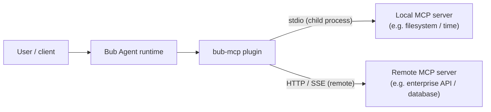

import { Steps } from '@astrojs/starlight/components';

[Model Context Protocol](https://modelcontextprotocol.io/), or **MCP**, is an open protocol that lets Agents securely and consistently call external tools and data sources, whether local or remote.

By installing the [bub-mcp](https://github.com/bubbuild/bub-contrib/tree/main/packages/bub-mcp) plugin, you can seamlessly bring tools from across the MCP ecosystem into the Bub application.



## Get started {#get-started}

Before you start, make sure you have [installed the Bub application](/docs/getting-started/install/#app-install) and that [`uvx`](https://docs.astral.sh/uv/) is installed on your system (it launches the example tool without installation).

<Steps>

1. **Install the plugin and verify the environment**

   ```bash
   bub install bub-mcp@main
   bub hooks
   ```

   `bub install` resolves and installs `bub-mcp` from [`bub-contrib`](https://github.com/bubbuild/bub-contrib). Run `bub hooks` to check whether the plugin is mounted correctly:

   ```text
   load_state: builtin, mcp
   provide_channels: builtin, mcp
   register_cli_commands: builtin, mcp
   ```

   :::note
   If `mcp` does not appear in the list, the plugin was installed into a different Python environment. Confirm that the path of the `bub` you are running (visible via `command -v bub`) matches the environment where it was installed.
   :::

2. **Configure an MCP server**

   `bub-mcp` reads `~/.bub/mcp.json` by default (or `$BUB_HOME/mcp.json` when `BUB_HOME` is defined). This example uses the official time tool [`mcp-server-time`](https://pypi.org/project/mcp-server-time/):

   ```bash
   mkdir -p ~/.bub
   cat > ~/.bub/mcp.json <<'EOF'
   {
     "mcpServers": {
       "time": {
         "command": "uvx",
         "args": ["mcp-server-time"]
       }
     }
   }
   EOF
   ```

   Configuration notes:

    - For local command-line servers (stdio), provide `command` and, optionally, `args` / `env`.
    - A configuration containing `command` automatically uses the stdio transport, so no explicit `transport` is needed.

3. **Test the connection and tool discovery**

   Run `bub mcp list` to check whether the configuration takes effect:

   ```bash
   bub mcp list
   ```

   Normally, the output shows the connection is ready and lists the discovered tools:

   ```text
   🔌 MCP Tools
   - time
     Status: Connected
     Tools: mcp.time_get_current_time, mcp.time_convert_time
   ```

   Notes:

    - Each MCP tool is named `mcp.<server>_<tool>` and injected into Bub.
    - To save prompt tokens, Bub uses a **deferred loading** strategy by default (the model fetches the detailed schema via `tool.describe` when needed). If you want full schemas to go directly into the system prompt, set the environment variable `BUB_MCP_DEFERRED_TOOLS=false`.

4. **Call a tool in a conversation**

   MCP tools are kept connected by the background lifecycle channel `mcp.lifecycle`. Therefore, run in long-connection mode:

   ```bash
   bub chat
   ```

   Ask directly in the interactive interface:

   ```text
   What time is it in UTC right now?
   ```

   The model automatically infers and calls the `mcp.time_get_current_time` tool to answer.

   :::tip[Direct testing without a model]
   If you want to test tool connectivity directly, you can skip model inference and execute a tool command in `bub chat` using a leading comma:
   ```text
   ,mcp.time_get_current_time timezone=UTC
   ```
   :::

</Steps>

## Add other servers {#add-servers}

You can add multiple servers to the `mcpServers` dictionary in `~/.bub/mcp.json`.

### Remote servers (HTTP/SSE) {#remote-http-sse}

If the tool runs as a microservice on a remote server or in a local container, configure it with `url` and `transport`:

```json
{
  "mcpServers": {
    "weather": {
      "url": "https://weather.example.com/mcp",
      "transport": "http"
    },
    "internal_crm": {
      "url": "https://crm.corp.internal/mcp",
      "transport": "sse",
      "headers": {
        "Authorization": "Bearer YOUR_SECRET_TOKEN"
      }
    }
  }
}
```

### Local servers (filesystem) {#local-filesystem}

For local tools with permission restrictions, you can limit their operating directory through `args`:

```json
{
  "mcpServers": {
    "filesystem": {
      "command": "npx",
      "args": ["-y", "@modelcontextprotocol/server-filesystem", "/tmp/bub-sandbox"]
    }
  }
}
```

### Manage with the CLI {#manage-cli}

Besides editing the JSON file directly, you can also use the `bub mcp` CLI to register or remove servers quickly:

```bash
# Register a local stdio tool
bub mcp add --transport stdio time -- uvx mcp-server-time
bub mcp add --transport stdio --env API_KEY=secret custom -- node ./my-server.js

# Register a remote HTTP or SSE server (with an auth header)
bub mcp add --transport http weather https://weather.example.com/mcp
bub mcp add --transport sse --header "Authorization: Bearer token" events https://events.example.com/mcp

# Remove a server
bub mcp remove time
```

## Use with Agent Plugins {#with-agent-plugins}

Bub also supports standard [Agent Plugins](/docs/integrations/agent-plugins/). MCP servers from the two sources have separate lifecycle channels and tool namespaces, so they can run seamlessly at the same time:

| Source | Configuration file | Runtime channel | Tool name prefix |
|---|---|---|---|
| Global MCP | `~/.bub/mcp.json` | `mcp.lifecycle` | `mcp.<server>_<tool>` |
| Agent Plugin | `<plugin>/mcp.json` | `agent-plugins.mcp` | `mcp.<plugin>.<server>_<tool>` |

## Troubleshooting {#troubleshooting}

| Symptom | Possible cause | Solution |
| --- | --- | --- |
| `mcp` is missing from `bub hooks` | The plugin was not installed into the Python environment currently in use | Run `command -v bub`, confirm the current execution environment, then run `bub install bub-mcp@main` again. |
| `bub mcp list` shows `Status: Disconnected` | The external service is not running or the command cannot execute | Run `uvx mcp-server-time` separately in a terminal, or access the `url` with `curl`, to confirm it responds correctly. |
| MCP tools cannot be called in `bub run "..."` | `bub run` is a one-shot task and does not start the background lifecycle channel | For long-running use, use `bub chat` or `bub gateway`; for a one-off call, use `,mcp.<tool>` in the interactive session. |
| `bub mcp add` prints `CancelledError` when saving | The process exits early, but the configuration is usually already persisted | Run `bub mcp list` to confirm whether the entry was written to `mcp.json`. |
| `Permission denied` when writing the configuration | The owner permissions of the `~/.bub/` directory do not match | Check the permissions of the `~/.bub` directory, or set `BUB_HOME` to a path the current user can write to. |
