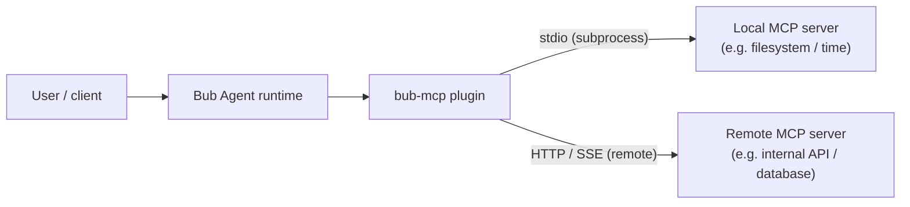

import { Steps } from '@astrojs/starlight/components';

[Model Context Protocol](https://modelcontextprotocol.io/) (MCP) is an open protocol that lets Agents securely and consistently call local or remote tools and data sources.

By installing the [`bub-mcp`](https://github.com/bubbuild/bub-contrib/tree/main/packages/bub-mcp) plugin, you can seamlessly bring tools from across the MCP ecosystem into the Bub app.



## Quick start {#get-started}

Before starting, [install the Bub app](/docs/getting-started/install/#app-install) and ensure [`uvx`](https://docs.astral.sh/uv/) is available on your `PATH` (it launches the example server without installing it).

<Steps>

1. **Install the plugin and verify**

   ```bash
   bub install bub-mcp@main
   bub hooks
   ```

   `bub install` resolves and installs `bub-mcp` from [`bub-contrib`](https://github.com/bubbuild/bub-contrib). Confirm `mcp` appears in the `bub hooks` output:

   ```text
   load_state: builtin, mcp
   provide_channels: builtin, mcp
   register_cli_commands: builtin, mcp
   ```

   :::note
   If `mcp` is missing, run `command -v bub` to verify that `bub` runs in the same Python environment where the plugin was installed.
   :::

2. **Configure an MCP server**

   `bub-mcp` reads `~/.bub/mcp.json` by default (or `$BUB_HOME/mcp.json` when `BUB_HOME` is set). Configure the official [`mcp-server-time`](https://pypi.org/project/mcp-server-time/) server:

   ```bash
   mkdir -p ~/.bub
   cat > ~/.bub/mcp.json <<'EOF'
   {
     "mcpServers": {
       "time": {
         "command": "uvx",
         "args": ["mcp-server-time"]
       }
     }
   }
   EOF
   ```

   Entries with `command` use the local `stdio` transport automatically.

3. **Check connection and discovered tools**

   Run `bub mcp list` to verify that the configuration takes effect:

   ```bash
   bub mcp list
   ```

   Output when connected:

   ```text
   🔌 MCP Tools
   - time
     Status: Connected
     Tools: mcp.time_get_current_time, mcp.time_convert_time
   ```

   - MCP tools are registered as `mcp.<server>_<tool>`.
   - To save prompt tokens, MCP tools use **deferred loading** by default (the model calls `tool.describe` on demand); set `BUB_MCP_DEFERRED_TOOLS=false` to inject full schemas into the initial system prompt.

4. **Call the tool in a chat session**

   MCP connections are maintained by the `mcp.lifecycle` background service, so use `bub chat` or `bub gateway`:

   ```bash
   bub chat
   ```

   Ask a question:

   ```text
   What time is it in UTC right now?
   ```

   The model automatically calls `mcp.time_get_current_time` to answer.

   :::tip[Test a tool directly without the model]
   If you want to test tool connectivity directly without model inference, use a leading comma in `bub chat`:
   ```text
   ,mcp.time_get_current_time timezone=UTC
   ```
   :::

</Steps>

## Add more servers {#add-servers}

You can register multiple servers under `mcpServers` in `~/.bub/mcp.json`.

### Remote servers (HTTP / SSE) {#remote-http-sse}

When a tool runs as a remote service or in a container, configure it with `url`, `transport`, and optional `headers`:

```json title="~/.bub/mcp.json"
{
  "mcpServers": {
    "weather": {
      "url": "https://weather.example.com/mcp",
      "transport": "http"
    },
    "internal_crm": {
      "url": "https://crm.corp.internal/mcp",
      "transport": "sse",
      "headers": {
        "Authorization": "Bearer YOUR_SECRET_TOKEN"
      }
    }
  }
}
```

### Local filesystem server {#local-filesystem}

For local tools that need directory restrictions, pass allowed paths through `args`:

```json title="~/.bub/mcp.json"
{
  "mcpServers": {
    "filesystem": {
      "command": "npx",
      "args": ["-y", "@modelcontextprotocol/server-filesystem", "/tmp/bub-sandbox"]
    }
  }
}
```

### Manage servers from the CLI {#manage-cli}

Besides editing the JSON file directly, you can use `bub mcp` commands to add or remove servers:

```bash
# Add local stdio servers
bub mcp add --transport stdio time -- uvx mcp-server-time
bub mcp add --transport stdio --env API_KEY=secret custom -- node ./my-server.js

# Add remote HTTP or SSE servers
bub mcp add --transport http weather https://weather.example.com/mcp
bub mcp add --transport sse --header "Authorization: Bearer token" events https://events.example.com/mcp

# Remove a server
bub mcp remove time
```

## Use alongside Agent Plugins {#with-agent-plugins}

Global MCP servers and [Agent Plugins](/docs/integrations/agent-plugins/) use separate lifecycle channels and tool prefixes, so they can run side by side:

| Source | Config file | Lifecycle channel | Tool name format |
|---|---|---|---|
| Global MCP | `~/.bub/mcp.json` | `mcp.lifecycle` | `mcp.<server>_<tool>` |
| Agent Plugin | `<plugin>/mcp.json` | `agent-plugins.mcp` | `mcp.<plugin>.<server>_<tool>` |

## Troubleshooting {#troubleshooting}

| Symptom | Possible cause | Fix |
| --- | --- | --- |
| `mcp` missing from `bub hooks` | Plugin installed in another Python environment | Check `command -v bub` and re-run `bub install bub-mcp@main` in that environment |
| `bub mcp list` shows `Disconnected` | Server command failed or remote URL is unreachable | Run `uvx mcp-server-time` or `curl` the URL directly to inspect the error |
| MCP tools unavailable in `bub run "..."` | `bub run` does not start `mcp.lifecycle` | Use `bub chat` or `bub gateway` instead |
| `bub mcp add` logs `CancelledError` on exit | Subprocess cleanup log; config is usually saved | Run `bub mcp list` to verify the entry was written |
| `Permission denied` when saving config | `~/.bub/` is not writable | Fix permissions on `~/.bub` or point `BUB_HOME` to a writable directory |
