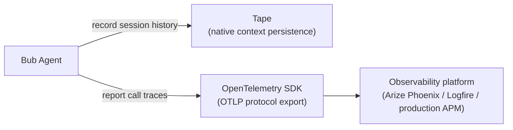

Bub's observability follows a "**dual-track**" principle:

- **State introspection (Tape)**: Inspect **what the Agent remembers**, how the context window is being consumed, and the prompt cache hit rate (built in, no external components required).
- **Run telemetry (Traces)**: Track **how each turn actually executes**, the latency bottlenecks of models and tools, and error call stacks (exported to an external APM through OpenTelemetry).



## Before you start {#before-you-start}

- You have [installed the Bub application](/docs/getting-started/install/#app-install) and configured a working model.
- If you are testing Phoenix locally, Docker or Podman must be installed.

## Inspect the Tape {#inspect-tape}

The Tape is Bub's built-in session recording mechanism. With no configuration at all, you can use the built-in commands to check the health of the current session:

```bash
bub run "What tools do you have, and what is each one good for?"
bub run ",tape.info"
```

Expected terminal output looks similar to:

```text
name: becda04eb9f7369c__065943a03cbe6395
entries: 98
anchors: 2
last_anchor: session/start
entries_since_last_anchor: 44
last_token_usage: 7458
last_token_cache_hit_rate: 72.50%
```


### Interpreting core metrics {#core-metrics}

| Field | Meaning and troubleshooting value |
|---|---|
| `entries` | Total number of events recorded in the session (including input, output, and tool calls). |
| `anchors` / `last_anchor` | Number of history anchors and the latest context boundary. This determines the starting context for model calls. |
| `entries_since_last_anchor` | Number of new entries since the last anchor; when this is too high, consider a handoff to move the context start forward. |
| `last_token_usage` | Total token consumption of the most recent model call. |
| `last_token_cache_hit_rate` | Prompt cache hit rate. A high hit rate means faster responses and lower cost. |

### Quickly search historical events {#search-events}

When you need to check whether a tool call succeeded or find a specific step, there is no need to page through the full log manually; use `,tape.search`:

```bash
# Search for events containing loop steps or tool calls
bub run ",tape.search query=loop.step"
```

## Export traces {#export-traces}

When you need to analyze model latency, tool execution time, and error reports, you can export traces to a dedicated analysis dashboard through OpenTelemetry (OTLP).

### Arize Phoenix (local deployment) {#arize-phoenix}

[Arize Phoenix](https://github.com/Arize-ai/phoenix) is an excellent open-source AI telemetry tool that starts with a single Docker command:

```bash
docker run --rm --name bub-phoenix \
  -p 6006:6006 \
  arizephoenix/phoenix:latest
```

Once it is running, open the console in your browser at `http://localhost:6006`.

Install the tracing dependencies in the environment where Bub runs:

```bash
# Source installation
uv sync --extra app --extra trace

# Or distribution installation
uv add "bub[app,trace]"
```

Configure the standard OpenTelemetry environment variables and run a task:

```bash
export OTEL_SERVICE_NAME=bub
export OTEL_EXPORTER_OTLP_TRACES_ENDPOINT=http://localhost:6006/v1/traces
export OTEL_EXPORTER_OTLP_TRACES_PROTOCOL=http/protobuf

bub run "Use a tool to list the files in the current workspace."
```

After the run completes, refresh the Phoenix console, open the Default project, and you will see the complete call waterfall, clearly showing the detailed timing of each model call (`chat <model>`) and tool execution (`execute_tool <tool>`):


### Pydantic Logfire {#pydantic-logfire}

If you do not want to maintain a Docker container locally, you can use [Pydantic Logfire](https://logfire.pydantic.dev/):

```bash
# Clear explicit OTLP endpoints (so Logfire takes over automatically)
unset OTEL_EXPORTER_OTLP_TRACES_ENDPOINT OTEL_EXPORTER_OTLP_ENDPOINT

# Install the logfire dependency
uv add "bub[logfire]"

# Log in and bind a project
logfire auth
logfire projects use

# Run a task
bub run "Inspect this repository and summarize its directory structure."
```

Log in to the Logfire web console, and on the Agents page you can view Bub's run call stack and sub-Agent chains in real time.

### Python code configuration {#python-config}

If you are reusing Bub through the Python SDK, you can also start telemetry explicitly when initializing the program:

```python
from bub.tracing import configure_otlp

# Automatically reads standard environment variables such as OTEL_EXPORTER_OTLP_TRACES_ENDPOINT
configure_otlp()
```

## Troubleshooting {#troubleshooting}

| Common issue | Possible cause | Solution |
| --- | --- | --- |
| No traces appear in the Phoenix UI | The OTLP protocol or endpoint is misconfigured | Confirm that `OTEL_EXPORTER_OTLP_TRACES_ENDPOINT` includes `/v1/traces` and that the protocol is `http/protobuf`. |
| The terminal reports that the `opentelemetry` dependency is missing | The `trace` optional dependency is missing | Run `uv sync --extra app --extra trace` or `pip install "bub[app,trace]"`. |
| Logfire cannot report data | You are not logged in, or the OTLP variables were not cleared | Explicitly `unset OTEL_EXPORTER_OTLP_TRACES_ENDPOINT` and run `logfire auth` to reauthorize. |
| `,tape.info` reports no active Tape | No task has run in the current workspace or session | Run any `bub run "..."` command first to generate a session record. |

## Cleanup {#cleanup}

Stop and remove the local Phoenix container used for testing:

```bash
docker rm -f bub-phoenix
unset OTEL_SERVICE_NAME OTEL_EXPORTER_OTLP_TRACES_ENDPOINT OTEL_EXPORTER_OTLP_TRACES_PROTOCOL
```
