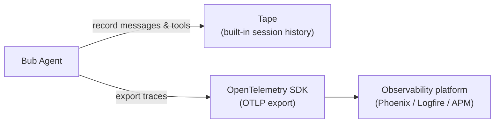

Bub provides two complementary ways to inspect and debug Agent runs:

- **Inspect the session Tape** (built-in): check entry counts, token usage, and prompt cache hit rates, and search historical events with zero external setup.
- **Export OpenTelemetry traces**: track per-step latency and error stacks across model calls and tool executions in platforms such as Arize Phoenix or Pydantic Logfire.



## Inspect the session Tape {#inspect-tape}

Tape is Bub's built-in session recording mechanism. With no configuration at all, you can use built-in commands to check the health of the current session:

```bash
bub run "What tools do you have, and what is each one good for?"
bub run ",tape.info"
```

Example output:

```text
name: becda04eb9f7369c__065943a03cbe6395
entries: 98
anchors: 2
last_anchor: session/start
entries_since_last_anchor: 44
last_token_usage: 7458
last_token_cache_hit_rate: 72.50%
```


### Metrics explained {#core-metrics}

| Field | Meaning |
|---|---|
| `entries` | Total entries recorded in the session (messages, tool calls/results, and events) |
| `anchors` / `last_anchor` | Total anchors and the latest anchor name (the default context start point) |
| `entries_since_last_anchor` | New entries since the latest anchor; run `tape.handoff` when this grows large |
| `last_token_usage` | Total tokens used by the most recent model call |
| `last_token_cache_hit_rate` | Prompt cache hit rate on the most recent model call |

### Search historical events {#search-events}

When you need to check whether a tool call succeeded or locate a specific step, skip paging through raw logs and search the Tape directly with `,tape.search`:

```bash
bub run ",tape.search query=loop.step"
```

## Export OpenTelemetry traces {#export-traces}

When you need to analyze model latency, tool execution time, and error stacks, export traces to an observability platform over OpenTelemetry (OTLP).

### Arize Phoenix (local Docker) {#arize-phoenix}

1. Start a local [Arize Phoenix](https://github.com/Arize-ai/phoenix) container (UI at `http://localhost:6006`):

   ```bash
   docker run --rm --name bub-phoenix -p 6006:6006 arizephoenix/phoenix:latest
   ```

2. Install the `trace` extra in Bub's environment:

   ```bash
   # Project or virtual environment
   uv add "bub[app,trace]"

   # Or in a Bub source checkout
   uv sync --extra app --extra trace
   ```

3. Set OTLP environment variables and run a task:

   ```bash
   export OTEL_SERVICE_NAME=bub
   export OTEL_EXPORTER_OTLP_TRACES_ENDPOINT=http://localhost:6006/v1/traces
   export OTEL_EXPORTER_OTLP_TRACES_PROTOCOL=http/protobuf

   bub run "Use a tool to list the files in the current workspace."
   ```

Open `http://localhost:6006` and select the Default project to inspect the trace waterfall for model calls (`chat <model>`) and tool executions (`execute_tool <tool>`):


### Pydantic Logfire {#pydantic-logfire}

If you prefer not to run a local Docker container, export traces to hosted [Pydantic Logfire](https://logfire.pydantic.dev/):

```bash
# Unset custom OTLP endpoints so Logfire takes over
unset OTEL_EXPORTER_OTLP_TRACES_ENDPOINT OTEL_EXPORTER_OTLP_ENDPOINT

uv add "bub[logfire]"
logfire auth
logfire projects use

bub run "Inspect this repository and summarize its directory structure."
```

Open the Logfire web console and visit the Agents page to inspect Bub's live call stack and subagent traces.

### Enable in Python SDK code {#python-config}

If you embed Bub through the Python SDK, call `configure_otlp()` at service startup (reads `OTEL_EXPORTER_OTLP_TRACES_ENDPOINT` and standard OpenTelemetry environment variables):

```python
from bub.tracing import configure_otlp

configure_otlp()
```

## Troubleshooting {#troubleshooting}

| Symptom | Possible cause | Fix |
| --- | --- | --- |
| No traces appear in Phoenix | Endpoint path or protocol mismatch | Ensure `OTEL_EXPORTER_OTLP_TRACES_ENDPOINT` ends with `/v1/traces` and protocol is `http/protobuf` |
| Missing `opentelemetry` module | `trace` extra is not installed | Run `uv add "bub[app,trace]"` or `pip install "bub[app,trace]"` |
| Logfire receives no data | Conflicting OTLP env vars or unauthenticated | `unset OTEL_EXPORTER_OTLP_TRACES_ENDPOINT` and re-run `logfire auth` |

## Cleanup {#cleanup}

When finished testing, stop the local Phoenix container and clear the environment variables:

```bash
docker rm -f bub-phoenix
unset OTEL_SERVICE_NAME OTEL_EXPORTER_OTLP_TRACES_ENDPOINT OTEL_EXPORTER_OTLP_TRACES_PROTOCOL
```
