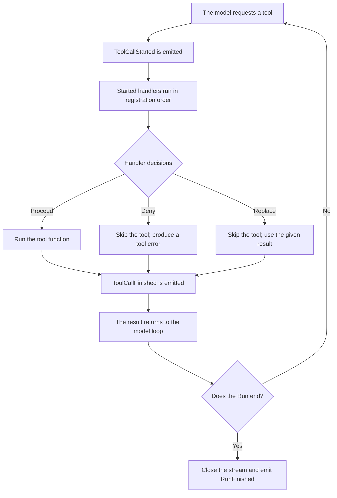

Tools hold the business logic, such as looking up an order or updating its status. Real applications often need extra logic around those calls: logging, sanitizing arguments, checking permissions, or measuring latency.

Agent events provide hooks into these stages. By listening to and handling them, you can extend the Agent's behavior without changing the tools themselves. For how the three kinds of data differ and which delivery rules apply, see [Agent events](/docs/concepts/events/#three-kinds).

## Agent events vs. App Hooks {#events-and-app-hooks}

For the division of responsibilities, see [Division of labor with App hooks](/docs/concepts/events/#app-hooks). In the SDK, use `agent.events` to add logic around model or tool calls.

## Registering and removing handlers {#register}

`EventBus.on()` both registers directly and works as a decorator; `off()` removes a handler:

```python
from bub.core.events import StepFinished, ToolCallStarted


def record_tool_start(event: ToolCallStarted) -> None:
    print(f"Calling: {event.call.tool}")


# Register
agent.events.on(ToolCallStarted, record_tool_start)

# The decorator form is equivalent
@agent.events.on(ToolCallStarted)
def log_tool_start(event: ToolCallStarted) -> None:
    print(f"Arguments: {event.call.arguments}")


# Remove
agent.events.off(ToolCallStarted, record_tool_start)
```

A handler registered for a base class also receives its subclasses: listening for `AgentEvent` covers everything, and `TapeEvent` gives you `event.tape`. Handlers may be plain functions or `async def`.

## Listen for tool calls {#listen-to-tool-calls}

Using the order-lookup tool as an example, here is how to log calls. The tool function only performs the lookup; the event handler records the call.

```python
from bub.core import Agent
from bub.core.events import ToolCallStarted
from bub.core.tools import tool


@tool
def get_order(order_id: str) -> dict[str, str]:
    """Look up an order's status by its ID."""
    return {"order_id": order_id, "status": "shipped"}


agent = Agent(
    tools=[get_order],
    system_prompt="Use the get_order tool to answer order status questions.",
)

```

When the tool finishes, `ToolCallFinished` provides the result, any error, and the duration:

```python
from bub.core.events import ToolCallFinished

@agent.events.on(ToolCallFinished)
def log_tool_finish(event: ToolCallFinished) -> None:
    status = "error" if event.result.error else "ok"
    print(
        f"Finished: {event.result.tool}, "
        f"{status}, {event.result.duration_ms}ms"
    )

```

## Tool call flow {#tool-call-order}

In the Agent loop, a tool call follows this path:



`ToolCallStarted` handlers run before the tool does. Several handlers run in registration order; if one sets a deny or replace decision, the remaining handlers and the tool function are skipped.

`ToolCallFinished` is emitted whether the tool ran normally, was denied, or was replaced. A finished tool call does not end the Agent run; listen for `RunFinished` to judge the final state.

Tool calls made through code mode's `tools.<name>()` and through text commands emit the same two events.

## Modify arguments before execution {#modify-tool-call}

Handlers can also change arguments before the tool runs. For example, strip whitespace from an order ID and uppercase it:

```python
from dataclasses import replace
from bub.core.events import ToolCallStarted


@agent.events.on(ToolCallStarted)
def normalize_order_id(event: ToolCallStarted) -> None:
    if event.call.tool != "get_order":
        return

    arguments = {
        **event.call.arguments,
        "order_id": event.call.arguments["order_id"].strip().upper(),
    }
    # ToolCall is immutable; build a new object with replace and reassign it
    event.call = replace(event.call, arguments=arguments)

```

## Permission checks and decisions {#control-tool-call}

By setting `event.decision`, a handler can proceed, deny, or use a replacement result before execution. For the semantics of all four outcomes, see [Decisions come before side effects](/docs/concepts/events/#call-control); the examples below show how to write them.

### 1. Deny a call {#deny-a-call}

To block certain operations by argument (for example, disallow a special order):

```python
from bub.core.events import ToolCallDecision, ToolCallStarted


@agent.events.on(ToolCallStarted)
def check_order_access(event: ToolCallStarted) -> None:
    if (
        event.call.tool == "get_order"
        and event.call.arguments.get("order_id") == "A123"
    ):
        event.decision = ToolCallDecision.deny("This order may not be looked up.")

```

After `ToolCallDecision.deny(...)`, the tool function does not run. The model loop hands the denial back to the model as a tool error; a direct command has no model to receive it, so the error is raised to the caller instead.

### 2. Use a replacement result {#replacement-result}

When the data is already available (for example, a cache hit), skip the tool and return it:

```python
@agent.events.on(ToolCallStarted)
def use_cached_order(event: ToolCallStarted) -> None:
    if (
        event.call.tool == "get_order"
        and event.call.arguments.get("order_id") == "A123"
    ):
        event.decision = ToolCallDecision.replace(
            {"order_id": "A123", "status": "shipped"}
        )

```

### 3. Change a model call {#control-llm-call}

`LLMCallStarted` supports replacing the whole request or producing output without calling the provider:

```python
from dataclasses import replace

from bub.core.events import LLMCallDecision, LLMCallStarted


@agent.events.on(LLMCallStarted)
def guard_llm_call(event: LLMCallStarted) -> None:
    if event.request.max_tokens and event.request.max_tokens > 8000:
        event.request = replace(event.request, max_tokens=8000)
    if event.state.get("offline"):
        event.decision = LLMCallDecision.finish("Offline demo mode is active.")
```

## Custom events {#custom-events}

Events are ordinary dataclasses: subclass `AgentEvent` to publish one, or `TapeEvent` when it needs the current Tape:

```python
from dataclasses import dataclass

from bub.core.events import TapeEvent


@dataclass(kw_only=True)
class OrderReviewed(TapeEvent):
    order_id: str


@agent.events.on(OrderReviewed)
async def record_review(event: OrderReviewed) -> None:
    await event.tape.append_event("order.reviewed", {"order_id": event.order_id})


async def mark_reviewed() -> None:
    tape = agent.tape("customer-42")
    await agent.events.emit(
        OrderReviewed(state=tape.context.state, tape=tape, order_id="A123")
    )
```

Conventions:

- `TapeRecorder` does not record custom events automatically; the example writes one explicitly.
- Tracing and Tape recording are independent: turning tracing off stops neither `TapeRecorder` nor the Tape records of conversation and tool round-trips.
- Custom events have no built-in `decision` protocol. Define mutable fields to return data, and override the `stopped` property if a decision should end delivery.
- Tools can emit events through `context.events`.

## Model, Step, and Run events {#other-events}

A run is made of three granularities — model calls (LLMCall), steps (Step), and the run itself (Run) — each worth listening to for metrics, usage statistics, and audit logs.

### 1. Model calls {#model-calls}

```python
from bub.core.events import LLMCallFinished, LLMCallStarted


@agent.events.on(LLMCallStarted)
def log_llm_start(event: LLMCallStarted) -> None:
    print(f"Calling the model with {len(event.request.messages)} messages")


@agent.events.on(LLMCallFinished)
def log_llm_finish(event: LLMCallFinished) -> None:
    if event.result.error:
        print(f"Model call failed: {event.result.error}")
    else:
        print(f"Model call succeeded, token usage: {event.result.usage}")

```

### 2. Step events {#step-events}

A Step is one model inference plus the tool calls it requested. `StepFinished.status` says whether the run continues after this step (`continue`) or ends (`ok`):

```python
from bub.core.events import StepFinished, StepStarted


@agent.events.on(StepStarted)
def log_step_start(event: StepStarted) -> None:
    print(f"--- Step {event.step} started ---")


@agent.events.on(StepFinished)
def log_step_finish(event: StepFinished) -> None:
    print(f"--- Step {event.step} finished: {event.status}, {event.elapsed_ms}ms ---")

```

Setting `StepFinished.next_prompt` gives the next step of a continuing run a user message; a `MessagesPending` handler adds messages that arrived during the run through `event.messages`.

### 3. Run events {#run-events}

`RunStarted` and `RunFinished` bracket the whole task. Note especially that `RunFinished` fires when the run's stream closes, including on normal completion, an exception, or an early cancel. A Run closed before it is iterated ends as `cancelled` with zero steps.

```python
from bub.core.events import RunFinished, RunStarted


@agent.events.on(RunStarted)
def log_run_start(event: RunStarted) -> None:
    print("Agent run started...")


@agent.events.on(RunFinished)
def log_run_result(event: RunFinished) -> None:
    print(f"Agent run finished: status={event.status}, steps={event.steps}")
```

The full event list, fields, and trigger points are in the [Python API: events](/docs/reference/python-api/#events).
