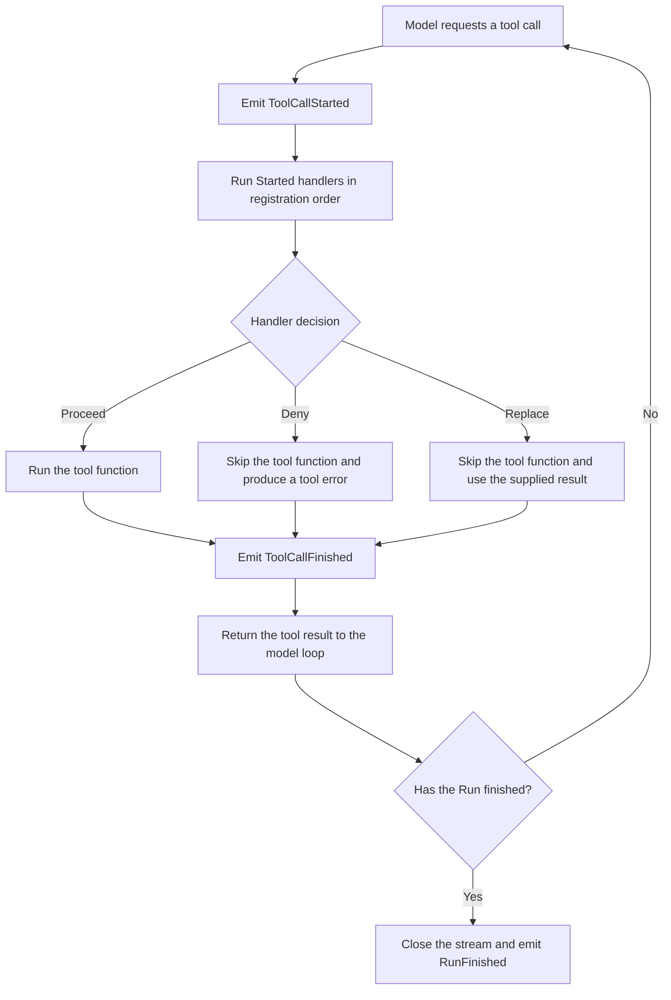

Tools hold the business logic, such as looking up an order or updating its status. Real applications often need extra logic around those calls: logging, sanitizing arguments, checking permissions, or measuring latency.

Agent events provide hooks into these stages. By listening to and handling them, you can extend the Agent's behavior without changing the tools themselves.

This section shows how to listen for events and implement custom logic.

## Agent events vs. App Hooks {#events-and-app-hooks}

Before we start, here are the two extension mechanisms in Bub:

| Mechanism | Scope | Common uses |
| --- | --- | --- |
| **Agent events** | The core Agent's run | Observe model or tool calls, modify arguments, record Run state |
| **Bub App Hooks** | The Bub app's processing pipeline | Build prompts, provide tools, handle messages, extend the app lifecycle |

In short:

* If you use `bub.core.Agent` and want to add logic at some stage of a model or tool call, use `agent.events`.
* If you are writing an application plugin, see [Plugins and Hooks](/docs/app/plugins/).

## Listen for tool calls {#listen-to-tool-calls}

Using the order-lookup tool as an example, here is how to log calls. The tool function only performs the lookup; the event handler records the call.

```python
from bub.core import Agent
from bub.core.events import ToolCallFinished, ToolCallStarted
from bub.core.tools import tool


@tool
def get_order(order_id: str) -> dict[str, str]:
    """Look up an order's status by ID."""
    return {"order_id": order_id, "status": "shipped"}


agent = Agent(
    tools=[get_order],
    system_prompt="When the user asks about order status, use the get_order tool.",
)

```

Register event handlers with `agent.events.on(EventType)`. To record something before a tool runs, listen for `ToolCallStarted`:

```python
from bub.core.events import ToolCallStarted

@agent.events.on(ToolCallStarted)
def log_tool_start(event: ToolCallStarted) -> None:
    print(f"Calling: {event.call.tool}")
    print(f"Arguments: {event.call.arguments}")

```

To remove a handler later, pass the function to both `on()` and `off()`:

```python
def record_tool_start(event: ToolCallStarted) -> None:
    print(f"Calling: {event.call.tool}")


# Register
agent.events.on(ToolCallStarted, record_tool_start)

# Unregister
agent.events.off(ToolCallStarted, record_tool_start)

```

After a tool finishes, `ToolCallFinished` provides the result, error information, and duration:

```python
from bub.core.events import ToolCallFinished

@agent.events.on(ToolCallFinished)
def log_tool_finish(event: ToolCallFinished) -> None:
    status = "error" if event.result.error else "ok"
    print(
        f"Finished: {event.result.tool}, "
        f"{status}, {event.result.duration_ms}ms"
    )

```

## Tool call flow {#tool-call-order}

The basic flow of a tool call in the Agent loop is:



`ToolCallStarted` handlers run before the tool. Handlers run in registration order; if one of them denies or replaces the call, the remaining handlers and the original tool function are skipped.

`ToolCallFinished` is emitted whether the tool runs normally, is denied, or is replaced. Note that one tool call finishing does not mean the whole Agent call is over; listen for `RunFinished` if you need the final status.


## Modify arguments before execution {#modify-tool-call}

Besides observing calls, a handler can modify arguments before the tool runs. For example, strip whitespace from an order ID and normalize it to uppercase:

```python
from dataclasses import replace
from bub.core.events import ToolCallStarted


@agent.events.on(ToolCallStarted)
def normalize_order_id(event: ToolCallStarted) -> None:
    if event.call.tool != "get_order":
        return

    arguments = {
        **event.call.arguments,
        "order_id": event.call.arguments["order_id"].strip().upper(),
    }
    # ToolCall is immutable; create a new object with replace and assign it back
    event.call = replace(event.call, arguments=arguments)

```

## Check permissions and control decisions {#control-tool-call}

By setting `event.decision`, you can decide before a tool runs whether to continue, deny the call, or supply a replacement result. Bub handles each case as follows:

| Action | Does the original tool run? | What the model receives |
| --- | --- | --- |
| Leave the decision unset (default) | Yes | The tool's actual result or error |
| Replace `event.call` | Yes | The new call's result or error |
| `ToolCallDecision.deny(message)` | No | The denial reason (as a tool error) |
| `ToolCallDecision.replace(result)` | No | The supplied replacement result |


### 1. Deny a call {#deny-a-call}

To block an operation based on its arguments, for example to prevent lookups of a special order:

```python
from bub.core.events import ToolCallDecision, ToolCallStarted


@agent.events.on(ToolCallStarted)
def check_order_access(event: ToolCallStarted) -> None:
    if (
        event.call.tool == "get_order"
        and event.call.arguments.get("order_id") == "A123"
    ):
        event.decision = ToolCallDecision.deny("This order cannot be queried right now.")

```

After you set `ToolCallDecision.deny(...)`, the original tool function does not run, and the denial reason is returned to the model as a tool error.

### 2. Supply a replacement result {#replacement-result}

If the data is already available, such as a cache hit, skip the tool function and return a replacement result:

```python
@agent.events.on(ToolCallStarted)
def use_cached_order(event: ToolCallStarted) -> None:
    if (
        event.call.tool == "get_order"
        and event.call.arguments.get("order_id") == "A123"
    ):
        event.decision = ToolCallDecision.replace(
            {"order_id": "A123", "status": "shipped"}
        )

```

## Listen to model, Step, and Run events {#other-events}

A full Agent run combines model interaction (LLM), Step execution, and the overall Run. Beyond the tool layer, you can listen to other lifecycle events to implement metrics, usage accounting, audit logging, and similar logic.

### 1. Model calls {#model-calls}

These fire when a request is sent to the model and when the response arrives. They are commonly used to track token usage, latency, or model-side failures:

```python
from bub.core.events import LLMCallFinished, LLMCallStarted


@agent.events.on(LLMCallStarted)
def log_llm_start(event: LLMCallStarted) -> None:
    print(f"Requesting the model with {len(event.request.messages)} input messages")


@agent.events.on(LLMCallFinished)
def log_llm_finish(event: LLMCallFinished) -> None:
    if event.result.error:
        print(f"Model call failed: {event.result.error}")
    else:
        print(f"Model call succeeded; token usage: {event.result.usage}")

```

### 2. Step events {#step-events}

An Agent task (a Run) usually contains multiple loop iterations. One Step may contain several rounds of "model thinks → decides to call tools → tools return." Use `StepStarted` and `StepFinished` to track how many iterations the Agent executes:

```python
from bub.core.events import StepFinished, StepStarted


@agent.events.on(StepStarted)
def log_step_start(event: StepStarted) -> None:
    print(f"--- Starting step {event.step} ---")


@agent.events.on(StepFinished)
def log_step_finish(event: StepFinished) -> None:
    print(f"--- Step {event.step} finished ---")

```

### 3. Run events {#run-events}

`RunStarted` and `RunFinished` bracket the whole conversation task. Pay particular attention to `RunFinished`: it fires when the entire run's event stream closes, including normal completion, an error, or early cancellation.

```python
from bub.core.events import RunFinished, RunStarted


@agent.events.on(RunStarted)
def log_run_start(event: RunStarted) -> None:
    print("Agent task started...")


@agent.events.on(RunFinished)
def log_run_result(event: RunFinished) -> None:
    print(f"Agent task finished: status={event.status}, steps={event.steps}")
```
