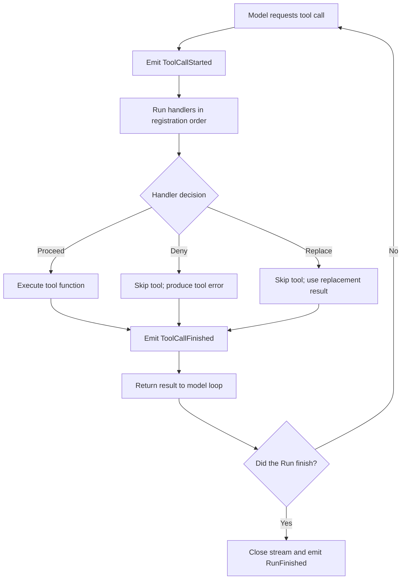

Tools hold your business logic (such as looking up an order or updating its status), while real applications often need extra cross-cutting logic around those calls—logging, argument sanitization, permission checks, or latency metrics. With the `agent.events` event bus, you can hook into model and tool calls without modifying the tool functions themselves.

For the difference between the three event/record types and synchronous delivery rules, see [Agent events](/docs/concepts/events/#three-kinds); for a comparison with App hooks (`@hookimpl`), see [Agent events vs. App hooks](/docs/concepts/events/#app-hooks).

## Register and remove handlers {#register}

`agent.events.on()` can be called directly or used as a decorator; `off()` removes a handler:

```python "agent.events.on" "agent.events.off"
from bub.core.events import ToolCallStarted


def record_tool_start(event: ToolCallStarted) -> None:
    print(f"Calling: {event.call.tool}")


# Direct registration
agent.events.on(ToolCallStarted, record_tool_start)


# Decorator registration
@agent.events.on(ToolCallStarted)
def log_tool_start(event: ToolCallStarted) -> None:
    print(f"Arguments: {event.call.arguments}")


# Unregister
agent.events.off(ToolCallStarted, record_tool_start)
```

Handlers can be synchronous functions or `async def` coroutines. A handler registered on a base class receives all its subclasses (`AgentEvent` receives every event; `TapeEvent` receives every event with `event.tape`).

## Listen for tool calls {#listen-to-tool-calls}

Using an order-lookup tool as an example, let's decouple business logic from logging: the tool only looks up the order, while an event handler records each call. First, define the tool and initialize the Agent:

```python
from bub.core import Agent
from bub.core.tools import tool


@tool
def get_order(order_id: str) -> dict[str, str]:
    """Look up an order's status by ID."""
    return {"order_id": order_id, "status": "shipped"}


agent = Agent(
    tools=[get_order],
    system_prompt="Use get_order to answer order status questions.",
)
```

Listen to `ToolCallFinished` to log the status and duration of each call:

```python
from bub.core.events import ToolCallFinished


@agent.events.on(ToolCallFinished)
def log_tool_finish(event: ToolCallFinished) -> None:
    status = "error" if event.result.error else "ok"
    print(f"Finished: {event.result.tool}, {status}, {event.result.duration_ms}ms")
```

## Tool event execution order {#tool-call-order}

In the Agent loop, a tool call follows this path:



- Multiple `ToolCallStarted` handlers run in registration order; if a handler sets a `deny` or `replace` decision, subsequent handlers and the tool function are skipped.
- `ToolCallFinished` fires whether the tool ran normally, was denied, or was replaced. Note that a finished tool call does not end the Agent run; listen for `RunFinished` to check the final outcome.
- Tool calls triggered via code mode (`tools.<name>()`) and direct commands emit the same two events.

## Modify arguments before execution {#modify-tool-call}

Beyond observing calls, handlers can also sanitize or rewrite arguments before execution. Because `ToolCall` is immutable, use `dataclasses.replace()` in a `ToolCallStarted` handler to update `event.call` (for example, trimming whitespace and uppercasing an order ID):

```python {14}
from dataclasses import replace
from bub.core.events import ToolCallStarted


@agent.events.on(ToolCallStarted)
def normalize_order_id(event: ToolCallStarted) -> None:
    if event.call.tool != "get_order":
        return

    arguments = {
        **event.call.arguments,
        "order_id": event.call.arguments["order_id"].strip().upper(),
    }
    event.call = replace(event.call, arguments=arguments)
```

## Deny or replace calls {#control-tool-call}

Before a tool runs, you can also set `event.decision` to enforce permissions, block a call, or return a cached result (see [Pre-call interception and decisions](/docs/concepts/events/#call-control)):

### 1. Deny a tool call {#deny-a-call}

```python "ToolCallDecision.deny"
from bub.core.events import ToolCallDecision, ToolCallStarted


@agent.events.on(ToolCallStarted)
def check_order_access(event: ToolCallStarted) -> None:
    if event.call.tool == "get_order" and event.call.arguments.get("order_id") == "A123":
        event.decision = ToolCallDecision.deny("Access to this order is not permitted.")
```

When denied, the tool function does not run. The model loop returns the denial message to the model as a tool error; for direct commands, the error is raised to the caller.

### 2. Return a replacement result {#replacement-result}

Skip the tool function and return a cached or mocked result directly:

```python "ToolCallDecision.replace"
@agent.events.on(ToolCallStarted)
def use_cached_order(event: ToolCallStarted) -> None:
    if event.call.tool == "get_order" and event.call.arguments.get("order_id") == "A123":
        event.decision = ToolCallDecision.replace({"order_id": "A123", "status": "shipped"})
```

### 3. Modify or short-circuit a model call {#control-llm-call}

In `LLMCallStarted`, replace `event.request` (e.g., to cap `max_tokens`) or set `LLMCallDecision.finish(text)` to return text without calling the model provider:

```python "LLMCallDecision.finish"
from dataclasses import replace
from bub.core.events import LLMCallDecision, LLMCallStarted


@agent.events.on(LLMCallStarted)
def guard_llm_call(event: LLMCallStarted) -> None:
    if event.request.max_tokens and event.request.max_tokens > 8000:
        event.request = replace(event.request, max_tokens=8000)
    if event.state.get("offline"):
        event.decision = LLMCallDecision.finish("Offline demo mode is active.")
```

## Emit custom events {#custom-events}

Besides listening to built-in events, you can define and emit your own. Events are plain Python dataclasses—subclass `AgentEvent` (or `TapeEvent` when you need the current Tape):

```python "class OrderReviewed(TapeEvent):" "await agent.events.emit"
from dataclasses import dataclass
from bub.core.events import TapeEvent


@dataclass(kw_only=True)
class OrderReviewed(TapeEvent):
    order_id: str


@agent.events.on(OrderReviewed)
async def record_review(event: OrderReviewed) -> None:
    await event.tape.append_event("order.reviewed", {"order_id": event.order_id})


async def mark_reviewed() -> None:
    tape = agent.tape("customer-42")
    await agent.events.emit(
        OrderReviewed(state=tape.context.state, tape=tape, order_id="A123")
    )
```

Notes:

- **Record to the Tape explicitly**: `TapeRecorder` does not write custom events to the Tape automatically; call `event.tape.append_event(...)` if you want them persisted.
- **Custom fields and early stop**: custom events have no built-in `decision` attribute. Define mutable fields to collect handler results, and override `stopped` to stop further handlers early.
- **Emit from tools**: tools can emit events via `context.events.emit(...)`.

## Listen to Model, Step, and Run events {#other-events}

Beyond tool calls, an Agent run exposes three lifecycle levels—model calls, Steps, and the Run itself—useful for metrics, token usage tracking, and audit logs.

### 1. Model call events {#model-calls}

```python
from bub.core.events import LLMCallFinished, LLMCallStarted


@agent.events.on(LLMCallStarted)
def log_llm_start(event: LLMCallStarted) -> None:
    print(f"Calling model with {len(event.request.messages)} messages")


@agent.events.on(LLMCallFinished)
def log_llm_finish(event: LLMCallFinished) -> None:
    if event.result.error:
        print(f"Model call failed: {event.result.error}")
    else:
        print(f"Model call succeeded, usage: {event.result.usage}")
```

### 2. Step events {#step-events}

`StepFinished` fires after each pass of model inference + tool execution. `event.status` is `"continue"` when another Step follows, or `"ok"` when the model produced a final reply:

```python
from bub.core.events import StepFinished, StepStarted


@agent.events.on(StepStarted)
def log_step_start(event: StepStarted) -> None:
    print(f"--- Step {event.step} started ---")


@agent.events.on(StepFinished)
def log_step_finish(event: StepFinished) -> None:
    print(f"--- Step {event.step} finished: {event.status}, {event.elapsed_ms}ms ---")
```

Set `StepFinished.next_prompt` (when `status == "continue"`) to append a user prompt to the next Step, or listen to `MessagesPending` and append to `event.messages` to inject steering messages that arrived during execution.

### 3. Run events {#run-events}

`RunStarted` and `RunFinished` bracket the entire Run. `RunFinished` fires **when the stream closes**; a Run closed before iteration ends with `status="cancelled"` and `steps=0`:

```python
from bub.core.events import RunFinished, RunStarted


@agent.events.on(RunStarted)
def log_run_start(event: RunStarted) -> None:
    print("Run started...")


@agent.events.on(RunFinished)
def log_run_result(event: RunFinished) -> None:
    print(f"Run finished: status={event.status}, steps={event.steps}")
```

See [Python API: Events](/docs/reference/python-api/#events) for all event classes and fields.
