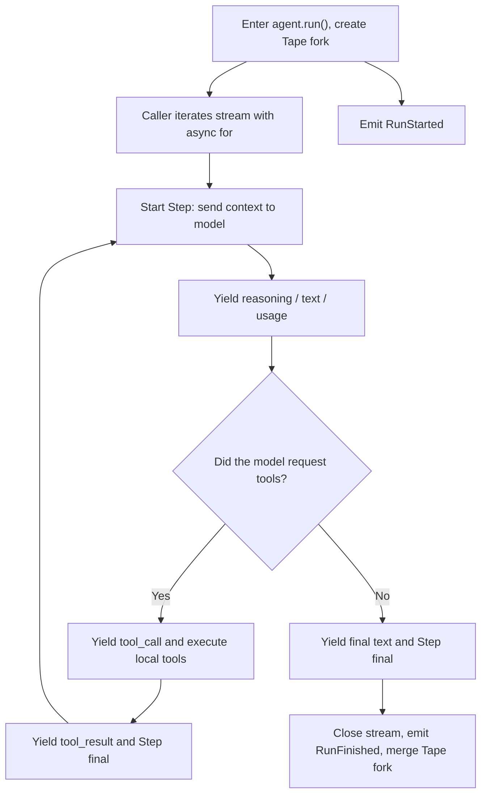

`bub.core.Agent` is Bub's minimal kernel. It drives the interaction loop between a model and your local tools, and can be embedded directly in any Python service, backend framework, or script.

In [Quickstart](/docs/getting-started/quickstart/), we already saw how to initialize and run an Agent:

```py title="main.py" {8, 13}
import asyncio
import republic
from bub.core import Agent


async def main() -> None:
    # Create the core Agent with a system prompt
    agent = Agent(system_prompt="Be concise.")

    # Connect to the model via republic
    async with republic.get_model("openai:gpt-5-mini") as model:
        # Start a Run on the named Tape
        async with agent.run("What can you do?", model=model, tape="demo") as stream:
            async for event in stream:
                if event.kind == "text":
                    print(event.data.get("delta", ""), end="", flush=True)


asyncio.run(main())
```

Next, we will walk through consuming the event stream, handling stream events, and managing Tapes. For definitions of Runs, Steps, and Turns, see [The Agent loop](/docs/concepts/agent/#loop).

## 1. Run and Step flow {#run-and-step}

A multi-step Run that calls tools progresses as follows:



## 2. Consuming the event stream {#consume-the-stream}

Entering `agent.run()` initializes the session and emits `RunStarted`, but execution is **lazy**: model calls and tool executions advance only as you iterate the event stream with `async for`—simply entering the context without consuming the stream does not run the task.

```python
async with agent.run(prompt, model=model, tape="quickstart") as stream:
    async for event in stream:
        ...
```

Always wrap `agent.run()` in an `async with` block so the stream and underlying resources are cleaned up on normal completion, exceptions, or cancellation. A Run closed before completion ends with `status="cancelled"`.

:::caution
An `event.kind == "final"` event marks the end of the **current Step**, not the end of the Run. If the model requested tools in that Step, the Agent runs them and enters another Step, emitting further events. Wait for the `async for event in stream` loop to finish to know the whole Run is complete.
:::

## 3. Stream event types {#stream-events}

As you iterate over `stream`, you receive events with different `kind` values. Inspect `event.kind` and `event.data` as they arrive:

| `event.kind` | `event.data` shape | Meaning |
| --- | --- | --- |
| `reasoning` | `{"delta": "..."}` | Incremental reasoning / chain-of-thought text |
| `text` | `{"delta": "..."}` | Incremental user-facing reply text |
| `tool_call` | `{"tool_calls": [{"id", "name", "arguments"}, ...]}` | Tools requested by the model (`arguments` is a JSON string) |
| `tool_result` | `{"tool_results": [...]}` | Tool execution results in call order (including tool errors) |
| `usage` | `{"usage": {...}, "elapsed_seconds": ...}` | Token usage and duration for the current Step |
| `final` | `{"ok": True, "text": ...}` or tool summary | Summary of the current Step |

In your host code, you typically branch on `event.kind` inside the loop to handle the events you care about:

```python
async for event in stream:
    if event.kind == "tool_call":
        for call in event.data["tool_calls"]:
            print(f"Calling tool: {call['name']}")
    elif event.kind == "text":
        print(event.data["delta"], end="", flush=True)
```

## 4. Tape and session memory {#tape-management}

The `tape="demo"` argument selects the conversation history used for the Run. For multi-turn persistence, custom context selectors, and fork merging, continue to [SDK: Tape & Memory](/docs/sdk/tape/); for how history differs from model context, see [Tape concepts](/docs/concepts/tape/).
