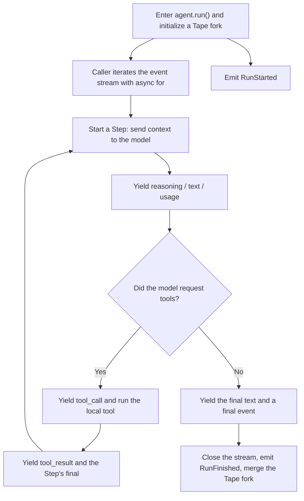

`bub.core.Agent` is the minimal core of `bub`. It drives the interaction loop between the model and your local tools, and you can embed it directly in any Python service, backend framework, or custom script.

In [Quickstart](/docs/getting-started/quickstart/), we already saw how to initialize and run an Agent:

```py
import asyncio
import republic
from bub.core import Agent


async def main() -> None:
    # Create the core Agent and give it a system prompt
    agent = Agent(system_prompt="Be concise.")

    # Use republic to get the underlying model connection
    async with republic.get_model("openai:gpt-5-mini") as model:
        # Start a Run and name the conversation Tape
        async with agent.run("What can you do?", model=model, tape="demo") as stream:
            async for event in stream:
                if event.kind == "text":
                    print(event.data.get("delta", ""), end="", flush=True)


asyncio.run(main())
```

This page covers consuming run streams, handling stream events, and managing Tapes. For the definitions of Runs, Steps, and Turns, see [The Agent loop](/docs/concepts/agent/#loop).

## 1. Runs and Steps {#run-and-step}

The diagram below shows a multi-step Run that calls a tool:



## 2. Consuming the stream {#consume-the-stream}

After you enter `agent.run()`, `bub` initializes the session and emits `RunStarted`. The underlying model and tool loop uses **lazy evaluation**: the Agent starts stepping and working only when you consume the event stream. Creating the context without consuming the stream does not run the task. A simple example:

```python
async with agent.run(prompt, model=model, tape="quickstart") as stream:
    async for event in stream:
        ...
```

Always put `agent.run()` inside an `async with` block. That guarantees the underlying connection and stream are cleaned up whether the Run completes normally, raises partway through, or is cancelled from outside. A Run that does not complete normally ends with the `cancelled` status.

You can read the type of every event from `event.kind`.

:::caution
A `final` event marks the end of the **current Step**, not the end of the Run.
If the model requested tools in the current Step, the Agent must run them and then enter another Step with the results, producing more events. So whether you are streaming a response to a client or tracking task completion, wait for the entire `async for event in stream` loop to finish before acting on it.
:::

## 3. Event types and payloads {#stream-events}

As you iterate over `stream`, you receive events with different `kind` values. Each event's `event.data` has the following shape:

| Event type | Example `event.data` | Meaning |
| --- | --- | --- |
| `reasoning` | `{"delta": "..."}` | Text deltas from the model's chain of thought or reasoning |
| `text` | `{"delta": "..."}` | Text deltas of the user-facing reply |
| `tool_call` | `{"tool_calls": [{"id", "name", "arguments"}, ...]}` | Tools the model asked to call (`arguments` is a JSON string) |
| `tool_result` | `{"tool_results": [...]}` | Execution results in call order; error details are also returned to the model here |
| `usage` | `{"usage": {...}, "elapsed_seconds": ...}` | Token usage and elapsed time for the current Step |
| `final` | `{"ok": True, "text": ...}` or a tool summary | Summary of the current Step |

A host program typically branches on `event.kind` as events arrive. That is why this is called the Agent loop: it is really one loop that dispatches a stream of events:

```python
async for event in stream:
    if event.kind == "tool_call":
        for call in event.data["tool_calls"]:
            print(f"[{event.step_index}] Model requested tool: {call['name']}")
    elif event.kind == "text":
        print(event.data["delta"], end="", flush=True)
```

## 4. Tape and memory branches {#tape-management}

The `tape="demo"` argument in the example selects the history used by this Run. For continuous conversations, persistence, and fork merging, see [SDK: Tape & Memory](/docs/sdk/tape/); for the difference between history and model context, see [Tape concepts](/docs/concepts/tape/).
