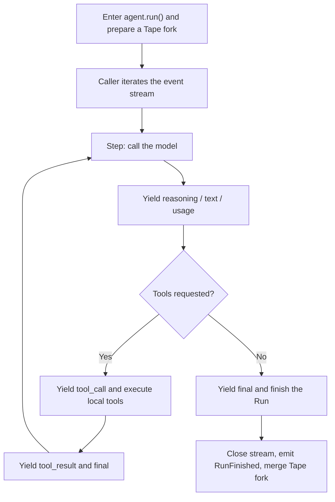

`bub.core.Agent` is an agent kernel embedded in a host program. It drives the model-tool loop, but it does not manage your web framework, configuration discovery, or channel lifecycle.

This tutorial builds the same **order assistant** chapter by chapter, ending with a FastAPI service that supports durable conversations and SSE:

1. **The Agent loop**: run a minimal assistant and understand its event stream.
2. **[Tools](/docs/sdk/tools/)**: query orders and handle arguments, results, and tool errors.
3. **[Events](/docs/sdk/events/)**: add audit logs and enforce a permission policy before refunds.
4. **[Tape & Memory](/docs/sdk/tape/)**: persist conversations and distinguish history from model context.
5. **[Capstone: FastAPI Service](/docs/sdk/web-service/)**: manage application lifetime, per-session concurrency, and streaming output.

If you would rather reuse the app's configuration, skills, plugins, or complete Turn pipeline than assemble these components yourself, see [Reuse the Bub app](/docs/integrations/reuse-app/).

## Create the first assistant {#quickstart}

Install the core package. `bub` already includes `republic`, which this guide uses to create the model connection:

```bash
uv init bub-order-agent
cd bub-order-agent
uv add bub
```

Create `main.py`:

```python
import asyncio

import republic

from bub.core import Agent


async def main() -> None:
    agent = Agent(
        system_prompt="You are an order support assistant. Be concise and say when order information is unavailable.",
        max_steps=6,
    )

    async with republic.get_model("openai:gpt-5-mini") as model:
        async with agent.run(
            "What kinds of order questions can you help me with?",
            model=model,
            tape="customer-42",
            options={"max_tokens": 512},
            state={"session_id": "customer-42"},
        ) as stream:
            async for event in stream:
                if event.kind == "text":
                    print(event.data["delta"], end="", flush=True)
                elif event.kind == "reasoning":
                    print(event.data["delta"], end="", flush=True)
        print()


if __name__ == "__main__":
    asyncio.run(main())
```

Set the model credential and run it:

```bash
export REPUBLIC_OPENAI_API_KEY=sk-...
uv run python main.py
```

`options` is passed to every model call in this Run. The host owns the model connection through `async with`; exiting a Run does not close that connection for you.

## Runs, Steps, and the event stream {#how-the-loop-works}

One `agent.run()` is a **Run**. A Run contains one or more **Steps**: each Step calls the model once and executes its requested tools. Tool results feed the next Step until the model answers without requesting more tools.



### Consuming events drives the model loop

Entering `agent.run()` prepares the session and emits `RunStarted`, but `async for` drives the model and tool loop on demand. Do not create a stream and leave it unconsumed.

`async with` closes the stream on early `break`, exceptions, and cancellation. A Run closed before normal completion ends as `cancelled`. By default, records already written to the fork still merge into the parent Tape when the stream closes; this is not a transaction rollback. See [Tape & Memory](/docs/sdk/tape/#forks-and-merges).

### `final` ends a Step, not necessarily the Run

A Step that calls tools also yields `final`, and another Step may follow. Do not treat the first `final` as the completion signal for an HTTP response or frontend. Wait until stream iteration finishes.

## Handle event payloads correctly {#stream-events}

Each `kind` has a different `event.data` shape. Tool events carry lists, not a single `name` and `args`:

| `kind` | Key payload | Meaning |
| --- | --- | --- |
| `reasoning` | `{"delta": "..."}` | Reasoning deltas supplied by the model |
| `text` | `{"delta": "..."}` | User-facing text deltas |
| `tool_call` | `{"tool_calls": [{"id", "name", "arguments"}, ...]}` | Calls requested by one model response; `arguments` is a JSON string |
| `tool_result` | `{"tool_results": [...]}` | Results in call order; ordinary tool errors also reach the model here |
| `usage` | `{"usage": {...}, "elapsed_seconds": ...}` | Model usage for the current Step |
| `final` | `{"ok": True, "text": ...}` or tool calls and results | Summary of the current Step |

For example, observe tool names without exposing their arguments:

```python
async for event in stream:
    if event.kind == "tool_call":
        for call in event.data["tool_calls"]:
            print(f"Model requested: {call['name']}")
    elif event.kind == "text":
        print(event.data["delta"], end="", flush=True)
```

Whether to forward reasoning, tool arguments, or tool results to end users is a product and security decision made by the host. Do not expose every event by default.

## Stream lifetime, failures, and resource boundaries {#stream-lifecycle}

Model, storage, and event-handler exceptions can propagate directly from stream iteration. **Do not wait for an `error` event as a substitute for exception handling**:

```python
try:
    async with agent.run(prompt, model=model, tape="customer-42") as stream:
        async for event in stream:
            ...
except Exception as exc:
    # Log the server-side error and return a stable error to the caller.
    report_error(exc)
```

Argument validation failures and ordinary tool exceptions usually become tool results, allowing the model to observe the failure and adjust its response. That is different from an exception that aborts the whole Run.

When assembling a service, make resource ownership explicit:

| Resource | Owner and lifetime |
| --- | --- |
| Model connection | Created and closed by the host, usually for the application lifetime |
| Run event stream | Managed by `async with agent.run(...)` and closed on exit |
| Per-Run `state` | Shared within one Run; never persisted automatically |
| Tape fork records | Merged on close by default; discarded with `merge_back=False` |
| External tool side effects | Owned by business code; closing a stream or discarding Tape records does not roll them back |

Next, give the assistant an order-query capability: [Tools](/docs/sdk/tools/).
