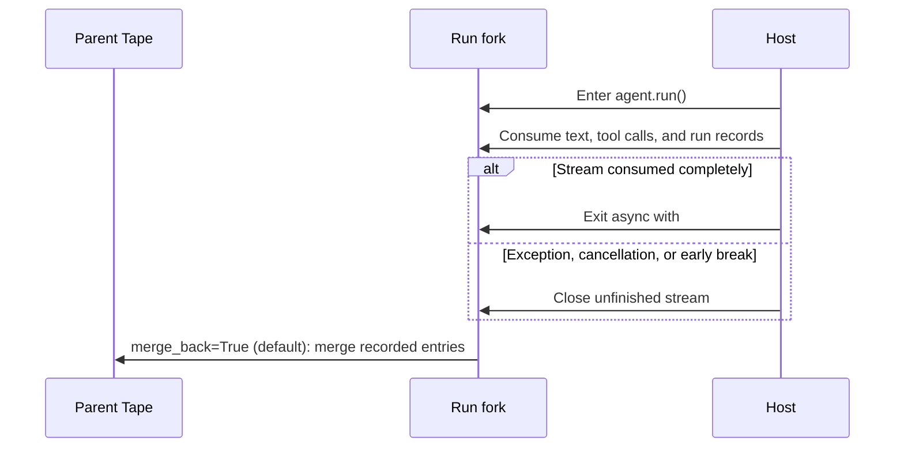

Multi-turn agent memory is more than reusing a `messages` list. Bub uses a **Tape** to record conversations, tool round-trips, and run events, then a **TapeContext** to project part of that history into the next model input.

Normal execution appends records. Explicit operations such as `reset()` can still clear a Tape, so it is not an immutable compliance audit log.

## Preserve an order conversation across requests {#complete-example}

This example keeps the previous chapter's `get_order` and writes records to `./sessions` with `FileTapeStore`. Replace `main.py` with:

```python
import asyncio
from pathlib import Path

import republic

from bub.core import Agent
from bub.core.store import FileTapeStore
from bub.core.tools import tool


@tool
async def get_order(order_id: str) -> dict[str, str]:
    """Look up an order's status by ID."""
    await asyncio.sleep(0.1)
    if order_id == "A123":
        return {"order_id": "A123", "status": "shipped"}
    return {"order_id": order_id, "error": "order_not_found"}


async def run_turn(agent: Agent, model, prompt: str) -> None:
    print(f"\nUser: {prompt}\nAssistant: ", end="", flush=True)
    async with agent.run(
        prompt,
        model=model,
        tape="customer-42",
        state={"session_id": "customer-42"},
    ) as stream:
        async for event in stream:
            if event.kind == "text":
                print(event.data["delta"], end="", flush=True)
    print()


async def main() -> None:
    agent = Agent(
        store=FileTapeStore(Path("sessions")),
        tools=[get_order],
        system_prompt="You are an order support assistant. Use tools for lookups and remember delivery preferences.",
        max_steps=6,
    )

    async with republic.get_model("openai:gpt-5-mini") as model:
        await run_turn(agent, model, "My order is A123. Please leave the delivery at the front desk.")
        await run_turn(agent, model, "What delivery note did I just leave?")


if __name__ == "__main__":
    asyncio.run(main())
```

Run it:

```bash
uv run python main.py
```

Both Runs use `tape="customer-42"`, so the second reads the conversation merged by the first. Records are stored at:

```text
sessions/customer-42.jsonl
```

After a process restart, a new Agent using the same directory and Tape name can resume the conversation.

:::note
The default `InMemoryTapeStore` also preserves memory across Runs on the same Agent instance, but loses it when the process exits. Creating a new Agent for every request does not share default in-memory history, even when the Tape name is unchanged.
:::

## History is not the same as model context {#history-and-context}

A Tape has two kinds of read views:

| View | Read with | Question answered |
| --- | --- | --- |
| Raw history | `tape.query()` / `store.fetch_all()` | Which messages, tool calls, anchors, and run events were recorded? |
| Model context | `tape.read_messages()` | Which messages can the next model call see? |

Inspect both after the two Runs:

```python
tape = agent.tape("customer-42")
entries = list(await tape.store.fetch_all(tape.query()))
messages = await tape.read_messages()

print("Entry kinds:", [entry.kind for entry in entries])
print("Model message roles:", [message.role for message in messages])
```

`default_tape_context()` selects conversation and tool round-trips after the most recent anchor, filtering ordinary run events. Audit facts can remain in history without automatically consuming context tokens.

`agent.session()` and `agent.start()` create a `session/start` anchor for a new session. An explicit `handoff()` moves the default context start forward without deleting earlier history or generating a summary automatically. See [Tape concepts](/docs/concepts/tape/#context) for selection strategies.

## Separate `state`, `metadata`, and Tape data {#state-and-metadata}

These inputs can all carry request data, but they serve different purposes:

| Data | Lifetime and purpose |
| --- | --- |
| `state={...}` | Mutable dictionary shared by tools and Agent events during this Run; never persisted or restored automatically |
| `metadata={...}` | Run-level observability data included in `RunStarted` and its Tape record; not automatically added to the model prompt |
| Tape entries | Persisted conversations, tool round-trips, or explicit business facts; `TapeContext` decides whether they enter model input |

For example, a request ID fits `state` and observability metadata. An order note needed for later queries can use `append_event()`. Conversation that the next Run should see automatically relies on message records and context projection.

## Forks merge on close by default {#forks-and-merges}

Each `agent.run()` records new entries on a Tape fork, isolating its writes from the parent until the stream closes. **The default is to merge on close, not only on success:**



Consequences:

- After a network failure or early cancellation, partial conversation and error records may still enter the parent Tape.
- `RunFinished` can report `ok`, `error`, or `cancelled`; these are not database transaction commit or rollback states.
- External tool side effects remain the business layer's responsibility regardless of Tape merging.

If records from a Run must not be retained, disable merging explicitly:

```python
async with agent.run(
    prompt,
    model=model,
    tape="preview-42",
    merge_back=False,
) as stream:
    async for event in stream:
        ...
```

`merge_back=False` discards the fork's Tape records. It does not undo the fact that models or tools ran, nor their external side effects.

## Choose a store {#storage}

`Agent(store=...)` determines where Tapes live:

| Store | Lifetime | Best for |
| --- | --- | --- |
| `InMemoryTapeStore` (default) | Current Agent instance and process | Tests and temporary scripts |
| `FileTapeStore` | One `.jsonl` file per Tape | Single-machine CLIs, development, and single-node services |
| Custom `TapeStore` / `AsyncTapeStore` | Defined by the host | Redis, SQL, and distributed storage |

The custom protocols use `list_tapes`, `reset`, `fetch_all`, and `append`, not an invented `get` / `save` interface. See [Storage integration](/docs/integrations/storage/) for a complete database example.

`FileTapeStore` incorporates the Tape name into a filename. Web services should use server-generated safe identifiers or strictly restrict name characters and length, and include tenant and user identity in the session namespace.

## The host coordinates same-session concurrency {#concurrency}

Two Runs using the same Tape name create forks from the history visible when each starts. Bub Core does not decide whether those requests should queue, overwrite, or interleave.

- Different sessions can generally run in parallel.
- Requests in one session that depend on earlier results should be serialized by session.
- `asyncio.Lock` coordinates only one process; `FileTapeStore` provides no cross-worker or cross-instance lock.

The [FastAPI capstone](/docs/sdk/web-service/) demonstrates process-local session locks and their limits. Next, add auditing and refund interception to the order assistant: [Events](/docs/sdk/events/).
