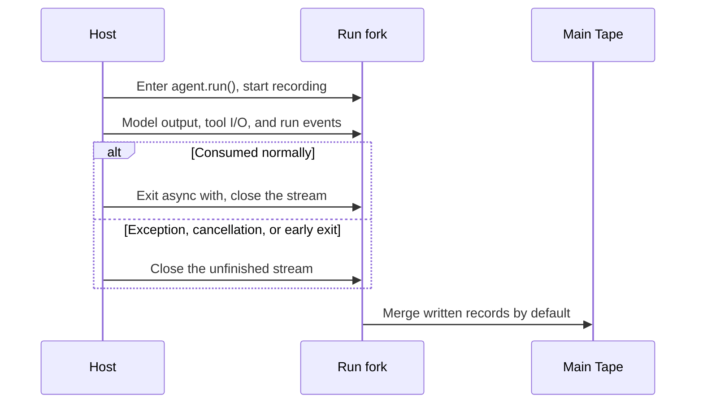

If every request sends only the current message to the model, the Agent cannot continue a previous conversation. To remember what you said earlier, it must save the conversation and pass the relevant history to the model on the next turn.

Bub uses a [Tape](/docs/concepts/tape/) to save conversations, tool inputs and outputs, and run records, giving your Agent memory and multi-turn continuity.

## Remember previous turns {#remember-previous-turn}

To let the model continue a conversation or remember what you said, reuse the same Tape name in `agent.run()`:

```python
import asyncio

import republic

from bub.core import Agent


async def run_turn(agent: Agent, model, prompt: str) -> None:
    async with agent.run(prompt, model=model, tape="demo-user") as stream:
        async for event in stream:
            if event.kind == "text":
                print(event.data["delta"], end="", flush=True)
    print("DONE")


async def main() -> None:
    agent = Agent(
        system_prompt="You are a concise assistant. Remember the answer format the user asks for.",
        max_steps=6,
    )

    async with republic.get_model("openai:gpt-5-mini") as model:
        await run_turn(agent, model, "From now on, answer with a short numbered list. Got it?")
        await run_turn(agent, model, "What answer format do I prefer?")


if __name__ == "__main__":
    asyncio.run(main())
```

Both calls use the `demo-user` Tape, so the second can continue the first. Bub uses `InMemoryTapeStore` by default, which is lost when the process exits. Also, creating a new Agent for every request does not share default in-memory history, even when the Tape name is unchanged.

## Persist memory {#persist-memory}

Bub includes `FileTapeStore` to persist Tapes locally, so history can be restored after the process exits. Configure it when creating the Agent:

```python
from pathlib import Path

from bub.core import Agent
from bub.core.store import FileTapeStore

agent = Agent(
    store=FileTapeStore(Path("sessions")),
    system_prompt="You are a concise assistant. Remember the answer format the user asks for.",
)
```

Run the program again with the same storage directory and Tape name to read the history back. The conversation above is saved in `sessions/demo-user.jsonl`.

### Which store should I use? {#storage}

| Store | Lifetime | Best for |
| --- | --- | --- |
| `InMemoryTapeStore` (default) | Current Agent instance and process | Tests and temporary scripts |
| `FileTapeStore` | One `.jsonl` file per Tape | Single-machine CLIs, development, and single-node services |
| Custom `TapeStore` / `AsyncTapeStore` | Defined by the host | Redis, SQL, and distributed storage |

:::note[Notes]

- `FileTapeStore` uses the Tape name as a file name. If the name comes from users, validate it strictly, such as restricting characters and length or using randomly generated identifiers; multi-tenant services should also include tenant and user identity in the session namespace.
- For production, implement a custom Tape store. See the [Python API](/docs/reference/python-api/#tape) for the complete protocol, and [Storage integration](/docs/integrations/storage/) for a database example.
:::

## TapeContext {#history-and-context}

In Bub, the **Tape** and the model context (messages) are strictly separate:

- **Tape (complete log)**: an append-only event stream recording user input, model replies, tool calls, tool results, anchors, and custom business events.
- **TapeContext (projection logic)**: decides how to select and convert Tape entries into the message list the model can consume directly.

Use `agent.tape(name)` to get a Tape instance. You can inspect the raw log and the projected model messages separately:

```python
tape = agent.tape("demo-user")

# 1. Every raw entry recorded in the Tape
entries = list(await tape.query().all())

# 2. The messages the next model call can see after TapeContext projection
messages = await tape.read_messages()

print("Tape entry kinds:", [entry.kind for entry in entries])
print("Model message roles:", [message.role for message in messages])
```

### Default context and customization {#default-context}

Every Agent is bound to a `context` (by default `default_tape_context()`). The `agent` above is equivalent to:

```python
from bub.core import Agent, default_tape_context

agent = Agent(
    context=default_tape_context(),  # default; every agent.tape(name) carries it
    # ...
)
```

### What TapeContext contains {#tape-context-fields}

`TapeContext` is a data class controlling how context is trimmed and converted. Its core fields are:

| Field | Default | Purpose |
| --- | --- | --- |
| `anchor` | `LAST_ANCHOR` | Anchor filter (see below): read entries after the latest anchor; pass an anchor name, or `None` for no anchor filter. |
| `select` | `None` | Custom conversion function: converts selected Tape entries into a model message list. When `None`, the built-in standard conversion applies (supports ordinary messages, tool round-trips, and more). |
| `state` | `{}` | Temporary state dictionary. Each `agent.run(state=...)` or `agent.tape(state=...)` writes it here; `ToolContext.state` inside tools is the same dictionary. |

:::tip[Class vs. factory]
Calling `TapeContext()` directly builds a minimal low-level context (typically handling only basic text messages), while `default_tape_context()` is the official **full-featured factory** that handles multi-turn conversations, tool calls (`tool_call` / `tool_result`), and anchors.

If you want to keep all default features and only change the starting `anchor`, use the standard-library `dataclasses.replace()`:

```python
from dataclasses import replace
from bub.core import Agent, default_tape_context

agent = Agent(
    context=replace(default_tape_context(), anchor="order-reviewed"),
    # ...
)
```
:::

### Switch read mode temporarily {#read-with-another-context}

If you do not want to change the Agent's default context and only want a different view for one read (for example, ignoring the anchor to see the full conversation), use `tape.with_context()`:

```python
from dataclasses import replace

from bub.core import default_tape_context

tape = agent.tape("demo-user")

# Temporarily build a context with no anchor filter and the default conversion rules
full_messages = await tape.with_context(
    replace(default_tape_context(), anchor=None)
).read_messages()
```

This changes only this read; it does not modify the Tape's records or the context later Agent calls use.

### anchor and handoff {#anchors-and-handoff}

As conversations grow, Tape records grow without bound, but the model's context window is finite. Bub uses **anchors** to move the model's reading start without discarding history.

- **Anchor**: a special boundary marker in the Tape with a name and optional `state`. With the default `TapeContext` and `anchor=LAST_ANCHOR`, only entries after the most recent anchor are projected to the model. Earlier history remains in the Tape and can be queried at any time with `tape.query().all()`.
- **Handoff**: the operation that writes an anchor to the Tape. It means "the current phase is complete; begin the next one", after which the default context start moves forward.

:::tip
Handoff is not an automatic summarizer. It does not delete old messages or generate a summary. If you need a summary, generate it with the model before the handoff, then store it explicitly in the Tape or include it with the new prompt.
:::

Two things to note:

- When `agent.run()`, `agent.start()`, or `agent.session()` starts a new session and the Tape has no anchor, the system writes an initial anchor named `session/start` automatically.
- Calling `agent.tape(name)` only gets a reference and does not create an anchor. If a manually initialized empty Tape has no anchor, reading it with the default `LAST_ANCHOR` raises an error. For a completely blank Tape, either run once, call `handoff()` explicitly, or read with `TapeContext(anchor=None)`.

### Run handoff manually {#manual-handoff}

You can write anchors at key business points (for example, order confirmation or a step transition):

```python
tape = agent.tape("demo-user")

await tape.handoff(
    name="order-reviewed",
    state={"summary": "Order A123 has been reviewed and approved."},
)
```

- `name`: later usable as a starting point via `TapeContext(anchor="order-reviewed")`.
- `state`: can carry a structured snapshot of the phase for the application to read.

After the handoff, the default `read_messages()` loads only the conversation after that anchor, while the historical data remains intact:

```python
# All historical anchors and their state
anchors = await tape.anchors()

# The original, complete history is still queryable
history = list(await tape.query().all())
```

### When to use them {#when-to-use-anchors}

| Need | Recommended approach |
| --- | --- |
| Business phase transition (for example, from tracking to after-sales) | Call `await tape.handoff(name="after-shipping")` when the current phase ends |
| Resume context from a historical checkpoint | Configure `TapeContext(anchor="checkpoint-name")` |
| Get the complete, god's-eye view of history | Configure `TapeContext(anchor=None)` |
| Handle context-window overflow | When the model reports a length error, the system automatically performs one fallback `handoff(name="auto_handoff/context_overflow")` and retries |

## Where should data live? {#state-and-metadata}

The [tools chapter](/docs/sdk/tools/#tool-context) showed how to pass data temporarily with `state`; here the Tape provides persistent memory. Bub also offers `metadata` for observability data such as request identifiers and trace correlation.

These inputs can all carry run data, but their lifetimes and purposes differ:

| Data | Best for | Constraint |
| --- | --- | --- |
| `state={...}` | Temporary data shared within a call | Never persisted or restored automatically |
| `metadata={...}` | Call-level observability data, such as a request ID | Recorded in run information, but not automatically added to the model prompt |
| Tape entries | Conversations and tool inputs/outputs across calls | Persisted; TapeContext decides whether they enter model input |

For example, a request ID fits in `state` and observability metadata; an order note needed for later queries can be appended to the Tape explicitly; conversation that the next turn should continue naturally relies on message records and context projection.

```python
from bub.core.tools import ToolContext, tool


@tool(context=True)
async def add_order_note(note: str, *, context: ToolContext) -> str:
    """Append an order note to the current session."""
    await context.tape.append_event(
        "order.note",
        {"text": note, "request_id": context.state.get("request_id")},
    )
    return "Note recorded."
```

Ordinary business events written to the Tape do not automatically become model input. To let the model see them in later calls, use TapeContext to select them appropriately.

## What happens to conversation history when a call ends {#forks-and-merges}

Each `agent.run()` records new entries on a Tape fork. When the stream closes, Bub merges the written records back into the main Tape by default:



The default merge happens when the stream closes, not only when the call succeeds. This means after a network error, task cancellation, or early exit, part of the conversation and run records already written to the fork may remain in the main Tape. If you do not want to keep a run's records, set `merge_back=False`:

```python
async with agent.run(
    prompt,
    model=model,
    tape="preview-demo",
    merge_back=False,
) as stream:
    async for event in stream:
        ...
```

This discards the Tape fork records for this call, but it does not undo **tool operations or other external side effects that already happened**.

## Session limits {#concurrency}

When two different Agents use the same Tape name at the same time, each creates a fork from the history visible at its start. Bub does not decide whether these requests should queue, overwrite, or interleave. For the same session Tape, if a later request depends on the previous result, the host should serialize requests per session; for concurrency or cross-worker or cross-instance calls, consider session locking.
