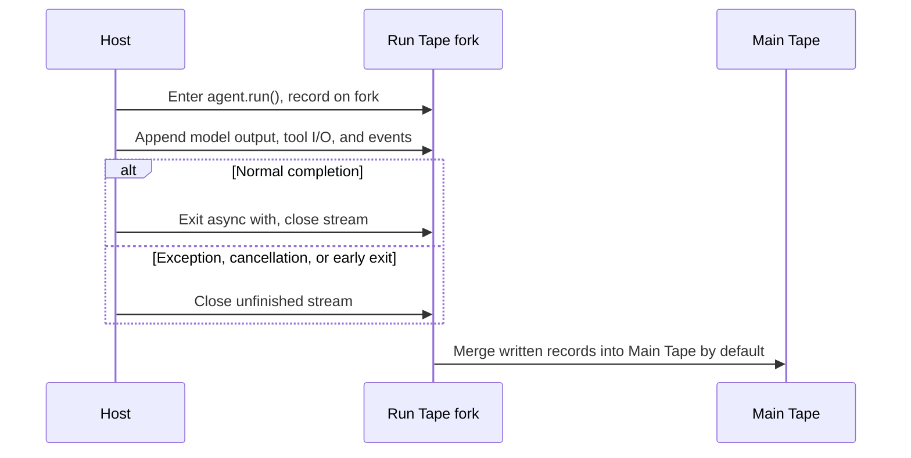

If every request sent only the latest message to the model, an Agent could never continue a conversation. To remember what you said earlier, it needs to record the exchange and pass relevant history on the next turn. Bub uses a Tape to store messages, tool round-trips, and events so an Agent maintains memory across turns. For how the Tape relates to model context, see [Tape and model context](/docs/concepts/tape/#history-and-context).

## Multi-turn conversations {#remember-previous-turn}

To let the model continue a conversation and remember your preferences, reuse the same `tape` name across `agent.run()` calls:

```python 'tape="demo-user"'
import asyncio
import republic
from bub.core import Agent


async def run_turn(agent: Agent, model, prompt: str) -> None:
    async with agent.run(prompt, model=model, tape="demo-user") as stream:
        async for event in stream:
            if event.kind == "text":
                print(event.data["delta"], end="", flush=True)
    print("\nDONE")


async def main() -> None:
    agent = Agent(
        system_prompt="You are a concise assistant. Remember the answer format the user asks for.",
        max_steps=6,
    )

    async with republic.get_model("openai:gpt-5-mini") as model:
        await run_turn(agent, model, "From now on, answer with a short numbered list. Got it?")
        await run_turn(agent, model, "What answer format do I prefer?")


if __name__ == "__main__":
    asyncio.run(main())
```

`Agent` defaults to `InMemoryTapeStore`, which lives only in the current `Agent` instance and process. Exiting the process or creating a new `Agent` per request loses in-memory history.

## Persist to disk or a database {#persist-memory}

To keep conversation history across process restarts, pass Bub's built-in `FileTapeStore` to persist each Tape as a local `.jsonl` file:

```python "FileTapeStore"
from pathlib import Path
from bub.core import Agent
from bub.core.store import FileTapeStore

agent = Agent(
    store=FileTapeStore(Path("sessions")),
    system_prompt="You are a concise assistant. Remember the answer format the user asks for.",
)
```

With this configuration, `tape="demo-user"` is saved to `sessions/demo-user.jsonl`.

### Tape naming and isolation {#tape-names}

`agent.run(..., tape="customer-42")` selects a Tape by name: reusing a name continues its history, while a new name starts an isolated session. `core.Agent` adds no workspace or tenant prefix automatically.

### Choosing a store {#storage}

| Store | Lifetime | Best for |
| --- | --- | --- |
| `InMemoryTapeStore` (default) | Current `Agent` instance and process | Tests and one-off scripts |
| `FileTapeStore` | One `.jsonl` file per Tape | Local CLIs, development, and single-node services |
| Custom `TapeStore` / `AsyncTapeStore` | Defined by the backend | Production SQL databases, Redis, or distributed stores |

:::note[Security and production notes]
- `FileTapeStore` uses the Tape name directly as a filename. If the name comes from user input, **validate its character set and length** (or map it to a random UUID); in multi-tenant services, include tenant and user IDs in the name to prevent cross-tenant access.
- For store protocols, see [Python API: `TapeStore`](/docs/reference/python-api/#tape-store); for SQL databases, see [Store conversation history in a database](/docs/integrations/storage/).
:::

### Inspect history outside a Run {#inspect}

Use `agent.tape(name)` to read either the selected model messages or the raw Tape entries:

```python
async def inspect_history(agent: Agent) -> None:
    tape = agent.tape("customer-42")
    messages = await tape.read_messages()          # Model messages built via TapeContext
    entries = list(await tape.query().all())       # Raw stored TapeEntry items
    print(f"model messages: {len(messages)}, raw entries: {len(entries)}")
```

## Customize `TapeContext` {#history-and-context}

Every `Agent` is bound to a `context` (`default_tape_context()` by default):

```python
from bub.core import Agent, default_tape_context

agent = Agent(
    context=default_tape_context(),
)
```

### `TapeContext` fields {#tape-context-fields}

| Field | Default | Purpose |
| --- | --- | --- |
| `anchor` | `LAST_ANCHOR` | Read start point: entries after the latest anchor (`LAST_ANCHOR`), after a named anchor string, or `None` for all entries |
| `select` | `None` | Custom selector function converting Tape entries into model messages (`None` uses the built-in selector) |
| `state` | `{}` | Request-scoped state dictionary (shared with `agent.run(state=...)` and `ToolContext.state`) |

:::tip[`TapeContext()` vs. `default_tape_context()`]
Calling `TapeContext()` directly builds a minimal low-level context, whereas `default_tape_context()` is the full-featured factory preconfigured for multi-turn conversations, tool round-trips, and anchors.

If you want to keep all the default behavior and only change the starting `anchor`, use `dataclasses.replace()` on `default_tape_context()`:

```python
from dataclasses import replace
from bub.core import Agent, default_tape_context

agent = Agent(
    context=replace(default_tape_context(), anchor="order-reviewed"),
)
```
:::

### Choose a different start anchor {#custom-anchors}

| `anchor` value | Entries read |
| --- | --- |
| `LAST_ANCHOR` (default) | Entries after the most recent anchor |
| `"order-reviewed"` | Entries after the anchor named `"order-reviewed"` |
| `None` | All entries from the beginning of the Tape |

### Custom selectors (`select`) {#custom-selectors}

Pass a selector function to `TapeContext(select=...)` to include custom business events (`kind="event"`) in model messages:

```python showLineNumbers {23}
from collections.abc import Iterable
import republic
from bub.core import Agent, TapeContext, default_tape_context
from bub.core.tape import TapeEntry, build_messages


def with_order_notes(
    entries: Iterable[TapeEntry], _context: TapeContext
) -> list[republic.Message]:
    """Append order notes as a system reminder on top of the default messages."""
    entries = list(entries)
    messages = build_messages(entries, default_tape_context())
    notes = [
        entry.payload.get("data", {})
        for entry in entries
        if entry.kind == "event" and entry.payload.get("name") == "order.note"
    ]
    if notes:
        messages.append(republic.system(f"Known order notes: {notes}"))
    return messages


agent = Agent(context=TapeContext(anchor=None, select=with_order_notes))
```

Two common gotchas to watch out for when writing a custom selector:

1. **Materialize `entries` with `list(entries)` first**: `entries` is an `Iterable` that may be a single-pass generator.
2. **Pass a fresh `default_tape_context()` to `build_messages()`**: never pass `_context` (which holds your custom `select`) back into `build_messages()`, or it will recurse infinitely.

A custom selector replaces the default selector; entries written with `context=False` are filtered out before your selector runs.

### Switch context for a single read {#read-with-another-context}

If you want a different view for a single read without changing the Agent's default context (for example, bypassing the anchor to inspect the full conversation), use `tape.with_context(...)`:

```python
from dataclasses import replace
from bub.core import default_tape_context

tape = agent.tape("demo-user")
full_messages = await tape.with_context(
    replace(default_tape_context(), anchor=None)
).read_messages()
```

### Anchors and handoffs {#anchors-and-handoff}

For the concepts behind anchors and handoffs, see [Moving the context start with anchors and handoffs](/docs/concepts/tape/#anchors). Two initialization rules apply in code:

- Starting a session via `agent.run()`, `agent.start()`, or `agent.session()` writes an initial `session/start` anchor automatically if the Tape has no anchors yet.
- Calling `agent.tape(name)` does not write an anchor. Reading a blank Tape that has no anchors with the default `LAST_ANCHOR` raises `BubError [not_found]` (`No anchors found in tape`). Run once, call `handoff()`, or read with `anchor=None`.

### Perform a manual handoff {#manual-handoff}

Write an anchor at phase transitions to advance the default context start:

```python
tape = agent.tape("demo-user")

await tape.handoff(
    name="order-reviewed",
    state={"summary": "Order A123 has been reviewed and approved."},
)
```

After the handoff, `tape.read_messages()` reads only entries after `order-reviewed`, while earlier history remains available via `anchors()` and `query()`:

```python
anchors = await tape.anchors()
history = list(await tape.query().all())
```

### Common anchor patterns {#when-to-use-anchors}

| Scenario | Approach |
| --- | --- |
| Phase transition (e.g., shipping check to after-sales) | Call `await tape.handoff(name="after-shipping")` |
| Resume context from a specific checkpoint | Configure `replace(default_tape_context(), anchor="checkpoint-name")` |
| Read full unfiltered history | Configure `replace(default_tape_context(), anchor=None)` |
| Automatic recovery on context overflow | On a model context-length error, the Agent writes `auto_handoff/context_overflow` and retries once |
| Proactive compaction by token budget | Attach the [`bub-context-budget` plugin](/docs/integrations/reuse-app/#agent-loop-hooks) and provide the `tape.handoff` tool |

## Sidecars: keep large payloads out of main context {#sidecars}

Sometimes you need to store large companion data alongside a session—such as ten-thousand-line command output or scraped web pages—without filling up the main conversation's model context. Bub provides `TapeSidecar` for this: mounted beside the main Tape via `Agent(sidecars=...)`, it **forks, merges, and resets with the main Tape**, while keeping its entries out of the main model context.

For example, the Bub app uses a `spill` sidecar for large tool outputs: when a tool result exceeds [`BUB_SPILL_THRESHOLD`](/docs/reference/settings/#spill-settings), the full output is written to the `spill` sidecar while the main conversation keeps only a short preview and a handle for `spill.read` (see [Built-in tools](/docs/reference/tools/#code-and-spill)). Plugins can register custom sidecars via [`provide_tape_sidecar`](/docs/reference/hooks/#provide_tape_sidecar).

## Multimodal media storage boundaries {#media}

The Tape is designed for text and event records, not raw media storage:

- **User-supplied media is stripped before writing to the Tape**: when recording a user prompt, Bub strips non-text blocks and writes only plain text so large Base64 payloads do not bloat session storage. To audit or replay user media, save files to object storage or disk in your host code and record a path or URL reference in text or an event.
- **Tool-returned media can be passed to the model**: tools can use [`content_result()`](/docs/reference/python-api/#tools) to return text together with images, audio, or video (as `fs.read` does for image files). These are recorded in `tool_result` and reconstructed into multimodal content blocks by `result_content()`.

## Combine temporary `state` with persistent events {#state-and-metadata}

Here is how a tool can combine request-scoped `state` (such as `request_id`) with a persistent business event on the Tape:

```python
from bub.core.tools import ToolContext, tool


@tool(context=True)
async def add_order_note(note: str, *, context: ToolContext) -> str:
    """Append an order note to the current session."""
    await context.tape.append_event(
        "order.note",
        {"text": note, "request_id": context.state.get("request_id")},
    )
    return "Note recorded."
```

As a reminder, custom business events written via `append_event()` are persisted on the Tape but do not enter the model context automatically—pair them with a [custom selector](#custom-selectors) if you want the model to see them. For a comparison of data lifetimes, see [Where data belongs](/docs/concepts/tape/#state).

## Tape forks and `merge_back` {#forks-and-merges}

Each `agent.run()` does not write directly to the main Tape; instead, it creates a temporary Tape fork for the Run and merges it back into the main Tape when the stream closes:



One important detail: **merging happens when the stream closes, not only when the task succeeds**. Even if a Run fails partway, is cancelled, or exits early, steps already recorded on the fork still merge into the main Tape by default.

To discard a Run's records on exit (e.g., for dry runs or previews), pass `merge_back=False`:

```python ins={5}
async with agent.run(
    prompt,
    model=model,
    tape="preview-demo",
    merge_back=False,
) as stream:
    async for event in stream:
        ...
```

You can also control fork scope explicitly with `agent.session(name, merge_back=...)` or `tape.fork_tape(merge_back=...)`.

:::caution
Tape forks manage conversation history only and **do not roll back external side effects**. Even with `merge_back=False`, file edits, HTTP calls, or database writes performed by tools are not undone.
:::

## Same-session concurrency and locking {#concurrency}

If two concurrent requests call `agent.run()` with the same Tape name, each forks from the history visible at start and merges back on close. `core.Agent` does not queue same-session requests automatically.

In a web service where requests in the same session depend on prior turns, **serialize requests per `session_id` with a lock**. `FileTapeStore` includes only a per-file thread lock within one process; see the [FastAPI capstone](/docs/sdk/web-service/#concurrency) for an in-process session lock example.
