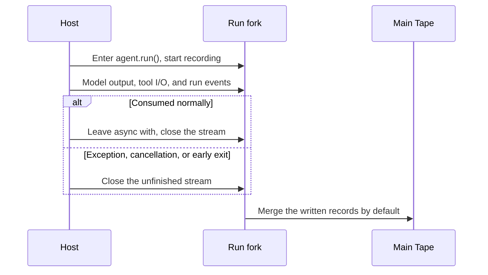

If every request sends only the current message to the model, the Agent cannot continue a previous conversation. To remember what you said earlier, it must save the conversation and pass the relevant history to the model on the next turn.

Bub uses a Tape to save conversations, tool inputs and outputs, and run records, giving your Agent memory and multi-turn continuity. For why history and model context are separate, and where `TapeContext` starts reading, see [Tape and model context](/docs/concepts/tape/#history-and-context).

## Remember previous turns {#remember-previous-turn}

To let the model continue a conversation or remember what you said, reuse the same Tape name in `agent.run()`:

```python
import asyncio

import republic

from bub.core import Agent


async def run_turn(agent: Agent, model, prompt: str) -> None:
    async with agent.run(prompt, model=model, tape="demo-user") as stream:
        async for event in stream:
            if event.kind == "text":
                print(event.data["delta"], end="", flush=True)
    print("DONE")


async def main() -> None:
    agent = Agent(
        system_prompt="You are a concise assistant. Remember the answer format the user asks for.",
        max_steps=6,
    )

    async with republic.get_model("openai:gpt-5-mini") as model:
        await run_turn(agent, model, "From now on, answer with a short numbered list. Got it?")
        await run_turn(agent, model, "What answer format do I prefer?")


if __name__ == "__main__":
    asyncio.run(main())
```

Both calls use the `demo-user` Tape, so the second can continue the first. Bub uses `InMemoryTapeStore` by default, which is lost when the process exits. Also, creating a new Agent for every request does not share default in-memory history, even when the Tape name is unchanged.

## Persist memory {#persist-memory}

Bub includes `FileTapeStore` to persist Tapes locally, so history can be restored after the process exits. Configure it when creating the Agent:

```python
from pathlib import Path

from bub.core import Agent
from bub.core.store import FileTapeStore

agent = Agent(
    store=FileTapeStore(Path("sessions")),
    system_prompt="You are a concise assistant. Remember the answer format the user asks for.",
)
```

Run the program again with the same storage directory and Tape name to read the history back. The conversation above is saved in `sessions/demo-user.jsonl`.

### Tape names decide continuity {#tape-names}

`agent.run(..., tape="customer-42")` selects a Tape by name. Reusing a name continues its record; different names stay independent. Naming is the caller's job: `core.Agent` adds no workspace, tenant, or user prefix.

`FileTapeStore` uses the Tape name directly as a file name. Validate names that come from users or external identifiers — restrict characters and length, or use random identifiers — and include tenant and user identity in the session namespace for multi-tenant services.

### Which store should I use? {#storage}

| Store | Lifetime | Best for |
| --- | --- | --- |
| `InMemoryTapeStore` (default) | Current Agent instance and process | Tests and temporary scripts |
| `FileTapeStore` | One `.jsonl` file per Tape | Single-machine CLIs, development, and single-node services |
| Custom `TapeStore` / `AsyncTapeStore` | Defined by the host | Redis, SQL, and distributed storage |

:::note[Notes]

- `FileTapeStore` uses the Tape name as a file name. If the name comes from users, validate it strictly, such as restricting characters and length or using randomly generated identifiers; multi-tenant services should also include tenant and user identity in the session namespace.
- For production, implement a custom Tape store. See the [Python API](/docs/reference/python-api/#tape) for the complete protocol, and [Storage integration](/docs/integrations/storage/) for a database example.
:::

### Inspect the record outside a Run {#inspect}

Outside a Run, `agent.tape(name)` returns the same record, and you can inspect both views:

```python
async def inspect_history(agent: Agent) -> None:
    tape = agent.tape("customer-42")
    messages = await tape.read_messages()
    entries = list(await tape.query().all())
    print(f"model messages: {len(messages)}, stored entries: {len(entries)}")
```

`read_messages()` applies the projection; `query()` returns raw entries.

## TapeContext {#history-and-context}

For the difference between the Tape and model context, and how to read raw entries and projected messages, see [One record, two views](/docs/concepts/tape/#history-and-context). The sections below explain how to customize the projection.

### Default context and customization {#default-context}

Every Agent is bound to a `context` (by default `default_tape_context()`). The `agent` above is equivalent to:

```python
from bub.core import Agent, default_tape_context

agent = Agent(
    context=default_tape_context(),  # default; every agent.tape(name) carries it
    # ...
)
```

### What TapeContext contains {#tape-context-fields}

`TapeContext` is a data class controlling how context is trimmed and converted. Its core fields are:

| Field | Default | Purpose |
| --- | --- | --- |
| `anchor` | `LAST_ANCHOR` | Anchor filter (see below): read entries after the latest anchor; pass an anchor name, or `None` for no anchor filter. |
| `select` | `None` | Custom conversion function: converts selected Tape entries into a model message list. When `None`, the built-in standard conversion applies (supports ordinary messages, tool round-trips, and more). |
| `state` | `{}` | Temporary state dictionary. Each `agent.run(state=...)` or `agent.tape(state=...)` writes it here; `ToolContext.state` inside tools is the same dictionary. |

:::tip[Class vs. factory]
Calling `TapeContext()` directly builds a minimal low-level context (typically handling only basic text messages), while `default_tape_context()` is the official **full-featured factory** that handles multi-turn conversations, tool calls (`tool_call` / `tool_result`), and anchors.

If you want to keep all default features and only change the starting `anchor`, use the standard-library `dataclasses.replace()`:

```python
from dataclasses import replace
from bub.core import Agent, default_tape_context

agent = Agent(
    context=replace(default_tape_context(), anchor="order-reviewed"),
    # ...
)
```
:::

### Choose another start point {#custom-anchors}

`TapeContext.anchor` controls the query range:

| Value | Query range |
| --- | --- |
| `LAST_ANCHOR` (default) | After the most recent anchor |
| `"order-reviewed"` | After the anchor with that name |
| `None` | No anchor filter |

### Custom selectors {#custom-selectors}

To change the projection, pass a function to `TapeContext(select=...)`. It receives the selected entries and the context, and returns Republic messages or an awaitable:

```python
from collections.abc import Iterable

import republic

from bub.core import Agent, TapeContext, default_tape_context
from bub.core.tape import TapeEntry, build_messages


def with_order_notes(
    entries: Iterable[TapeEntry], _context: TapeContext
) -> list[republic.Message]:
    """Add order notes as a system reminder on top of the default projection."""
    entries = list(entries)
    messages = build_messages(entries, default_tape_context())
    notes = [
        entry.payload.get("data", {})
        for entry in entries
        if entry.kind == "event" and entry.payload.get("name") == "order.note"
    ]
    if notes:
        messages.append(republic.system(f"Known order notes: {notes}"))
    return messages


agent = Agent(context=TapeContext(anchor=None, select=with_order_notes))
```

Two easy mistakes:

- The `entries` you receive are an `Iterable` and may be a generator. Materialize them with `list()` before traversing, or a second pass sees nothing.
- To reuse the default projection, pass a fresh `default_tape_context()` rather than the `context` holding the current selector; passing it back would make the selector call itself.

A custom selector **replaces** the default one, so conversation messages, tool round-trips, anchors, and the business events you care about must all be composed deliberately. Entries with `context=False` are still filtered before your selector runs.

### Switch read mode temporarily {#read-with-another-context}

If you do not want to change the Agent's default context and only want a different view for one read (for example, ignoring the anchor to see the full conversation), use `tape.with_context()`:

```python
from dataclasses import replace

from bub.core import default_tape_context

tape = agent.tape("demo-user")

# Temporarily build a context with no anchor filter and the default conversion rules
full_messages = await tape.with_context(replace(default_tape_context(), anchor=None)).read_messages()
```

This changes only this read; it does not modify the Tape's records or the context later Agent calls use.

### anchor and handoff {#anchors-and-handoff}

For the concepts and boundaries of anchors and handoffs, see [Tape and model context](/docs/concepts/tape/#anchors). Two initialization behaviors are worth noting when using them:

- When `agent.run()`, `agent.start()`, or `agent.session()` starts a session and the Tape has no anchor, the system writes an initial anchor named `session/start` automatically.
- Calling `agent.tape(name)` only gets a reference and does not create an anchor. If a manually initialized empty Tape has no anchor, reading it with the default `LAST_ANCHOR` raises `BubError [not_found]` (`No anchors found in tape`). For a completely blank Tape, either run once, call `handoff()` explicitly, or read with `TapeContext(anchor=None)`.

### Run handoff manually {#manual-handoff}

You can write anchors at key business points (for example, order confirmation or a step transition):

```python
tape = agent.tape("demo-user")

await tape.handoff(
    name="order-reviewed",
    state={"summary": "Order A123 has been reviewed and approved."},
)
```

- `name`: later usable as a starting point via `TapeContext(anchor="order-reviewed")`.
- `state`: can carry a structured snapshot of the phase for the application to read.

After the handoff, the default `read_messages()` loads only the conversation after that anchor, while the historical data remains intact:

```python
# All historical anchors and their state
anchors = await tape.anchors()

# The original, complete history is still queryable
history = list(await tape.query().all())
```

### When to use them {#when-to-use-anchors}

| Need | Recommended approach |
| --- | --- |
| Business phase transition (for example, from tracking to after-sales) | Call `await tape.handoff(name="after-shipping")` when the current phase ends |
| Resume context from a historical checkpoint | Configure `TapeContext(anchor="checkpoint-name")` |
| Get the complete, unfiltered history | Configure `TapeContext(anchor=None)` |
| Handle context-window overflow | When the model reports a length error, the Agent automatically writes `handoff(name="auto_handoff/context_overflow")` and retries the original prompt once |
| Compress proactively by budget | Use the [`bub-context-budget` plugin](/docs/integrations/reuse-app/#agent-loop-hooks) to let the model call `tape.handoff` near the limit |

## Sidecars keep parallel records out of context {#sidecars}

A `TapeSidecar` is a capability backed by a sibling Tape mounted beside the session Tape. Mounted through `Agent(sidecars=...)`, it forks, merges, and resets with the main Tape, but its entries never enter the main Tape's model context.

The Bub app uses a spill sidecar for large tool results. The main conversation retains a preview and a handle, and the model reads the full result in chunks through `spill.read`. [`BUB_SPILL_THRESHOLD`](/docs/reference/settings/#spill-settings) configures the trigger; see [code mode and spill](/docs/reference/tools/#code-and-spill) for behavior.

A custom sidecar is provided by a plugin through `provide_tape_sidecar`; the protocol is in the [Hooks reference](/docs/reference/hooks/#provide_tape_sidecar).

## Media has a separate storage boundary {#media}

Model requests can contain images, audio, and video, but the Tape is not a media file store. When a normal Agent Run writes a record, it drops non-text blocks from the prompt's `content` / `prompt`, keeping only text, so inline media never reaches the stored history. Do not assume the original user media can be read back from the Tape later.

When media must be replayed or audited, the host saves it to object storage or a filesystem and records a resolvable reference in text.

To return media together with text to the current model call, a tool uses [`content_result()`](/docs/reference/python-api/#tools). Tool results follow a separate path from inbound prompt stripping: the media they return is recorded as a tool result and turned back into images, audio, or video by `result_content()` during projection.

## Where should data live? {#state-and-metadata}

For the lifetimes and purposes of `state`, `metadata`, Tape entries, and anchor `state`, see [Where data belongs](/docs/concepts/tape/#state). The example below shows how to combine temporary data with a persistent record:

```python
from bub.core.tools import ToolContext, tool


@tool(context=True)
async def add_order_note(note: str, *, context: ToolContext) -> str:
    """Append an order note to the current session."""
    await context.tape.append_event(
        "order.note",
        {"text": note, "request_id": context.state.get("request_id")},
    )
    return "Note recorded."
```

Ordinary business events written to the Tape do not automatically become model input. To let the model see them in later calls, use TapeContext to select them appropriately.

## What happens to conversation history when a call ends {#forks-and-merges}

Each `agent.run()` records new entries on a Tape fork. When the stream closes, Bub merges the written records back into the main Tape by default:



The merge happens when the stream closes, not when the call succeeds. After a network error, cancellation, or early exit, the parts of the conversation and run record already written to the fork may still remain on the main Tape. To discard a Run's records, pass `merge_back=False`:

```python
async with agent.run(
    prompt,
    model=model,
    tape="preview-demo",
    merge_back=False,
) as stream:
    async for event in stream:
        ...
```

This discards the Run's fork records, but does **not** undo tool operations or other external side effects already performed. You can also manage the scope yourself with `agent.session(name, merge_back=...)` or `tape.fork_tape(merge_back=...)`.

:::caution
A fork is not a transaction over the outside world. Even with `merge_back=False`, tool changes to files, sent requests, and external writes are not rolled back.
:::

## Session constraints {#concurrency}

When two different Agents use the same Tape name at the same time, each forks from the history it can see at start. Bub does not decide for you whether those requests should queue, overwrite, or interleave. If a later request in the same session depends on the result of an earlier one, the host should serialize work per session; across processes or workers, consider a session lock.

`FileTapeStore` does not provide a cross-worker session lock; the [FastAPI example](/docs/sdk/web-service/) demonstrates locking within one process. When concurrent Runs need to consume one another's completed results, the application coordinates their order.
