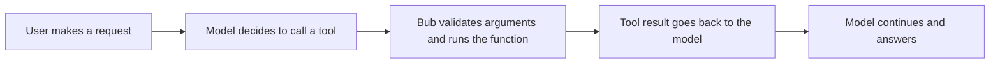

An Agent can understand a user's request, but to query real data or perform actions it needs a way to call external capabilities. Tools are the Agent's **hands and feet**: you can wrap any piece of processing logic as a tool, and the Agent then decides from the user's request whether to call it.

This section starts with an order-lookup example and then walks through how to define a tool, how the model calls it, and how to handle arguments, results, and runtime data.

## Add a custom tool {#add-a-tool}

Suppose we already have a Python function that looks up orders. For the Agent to call it, mark the function with the `@tool` decorator from the Bub SDK and pass it when creating the Agent:

```python
from bub.core import Agent
from bub.core.tools import tool


ORDERS = {
    "A123": {
        "order_id": "A123",
        "status": "shipped",
        "item": "Mechanical keyboard",
        "amount": 399.0,
    }
}


@tool
def get_order(order_id: str) -> dict[str, str | float]:
    """Look up an order's status, item, and amount by order ID."""
    if order := ORDERS.get(order_id):
        return order
    return {"order_id": order_id, "error": "order_not_found"}


agent = Agent(
    tools=[get_order],
    system_prompt="When the user asks about an order, use the tool; never guess order status.",
)
```

The `@tool` decorator turns a type-annotated Python function into a tool the Agent can use. The function contains the actual business logic; the tool name, argument types, and description help the model decide when and how to call it.

## Tool call flow {#tool-call-flow}

The model never executes Python directly. It first requests a tool call; Bub then validates the arguments and runs the matching function; finally, the result goes back to the model:



So when we call `agent.run()`, the stream shows both the calls the model requested and the results the tools returned:

```python
async with agent.run(prompt, model=model, tape="tools-demo") as stream:
    async for event in stream:
        if event.kind == "tool_call":
            for call in event.data["tool_calls"]:
                print(f"Model requested: {call['name']}, arguments: {call['arguments']}")
        elif event.kind == "tool_result":
            print(f"Tool result: {event.data['tool_results']}")
        elif event.kind == "text":
            print(event.data["delta"], end="", flush=True)
```

A tool call takes two Steps:

1. The model requests the `get_order` tool; Bub runs the function and returns the result to the model.
2. The model uses that result to produce its answer.

Whether to call a tool is still up to the model.

## Tool descriptions and constraints {#tool-schema}

For a Python function marked with `@tool`, the argument types become a JSON Schema and the [docstring](https://peps.python.org/pep-0257/) becomes the tool's description. Parameter names and descriptions are therefore part of the tool's interface. Write an accurate signature and description so the model can call it correctly.

```python
@tool
def get_order(order_id: str) -> dict[str, str | float]:
    """Look up an order by ID. order_id is the complete customer-provided ID, such as A123."""
    ...
```

When the input has many parameters or needs constraints such as ranges and lengths, a validation library such as [Pydantic](https://pydantic.dev/) can help. Pass the model to the `@tool` decorator's `model` argument:

```python
from pydantic import BaseModel, Field

from bub.core.tools import tool


class RefundInput(BaseModel):
    order_id: str = Field(description="Complete order ID, such as A123")
    amount: float = Field(gt=0, description="Refund amount; must be greater than zero")
    reason: str = Field(min_length=1, description="Refund reason supplied by the user")


@tool(name="refund_order", model=RefundInput)
def refund_order(param: RefundInput) -> dict[str, str | float]:
    """Request a refund for a paid order; run the authorization check before executing."""
    return {
        "order_id": param.order_id,
        "amount": param.amount,
        "status": "refund_requested",
    }
```

During execution, if an argument has the wrong type or fails Pydantic validation, Bub returns the error to the model as a tool error. The model can correct the arguments and try again, though a successful retry is not guaranteed.

When writing the actual business function, distinguish a business outcome from an execution error:

| Situation | Default behavior |
| --- | --- |
| An argument does not match its type or a Pydantic constraint | Converted to a validation tool error and returned to the model |
| The tool raises an ordinary exception | Converted to a tool error and returned to the model |
| The tool returns a business error object, such as `order_not_found` | Returned to the model as a normal tool result |
| Storage, the model, or an event handler interrupts the call | The exception may propagate from stream iteration; handle it in the integration layer |

A business error object is not a Python exception. Returning a stable structured result lets both the model and the caller recognize business states such as "order not found".

## Inject context into a tool {#tool-context}

Sometimes a tool needs the current session, request-scoped permissions, or the event bus. The `ToolContext` object injected by Bub provides them:

```python
from bub.core.tools import ToolContext, tool


@tool(context=True)
async def add_order_note(note: str, *, context: ToolContext) -> str:
    """Append an order note to the current session."""
    await context.tape.append_event(
        "order.note",
        {"text": note, "request_id": context.state.get("request_id")},
    )
    return f"Note written to session {context.tape.name}"
```

Pass `state` when calling the Agent, and the tool can read it through `context.state`:

```python
async with agent.run(
    prompt,
    model=model,
    tape="tools-demo",
    state={"session_id": "tools-demo", "request_id": "req-01"},
) as stream:
    ...
```

:::tip
Bub injects the `context` argument, so it does not appear in the argument Schema the model sees. `context.state` is shared only within the current call and is not persisted or restored automatically.
:::

## Async and concurrent calls {#concurrency}

The `@tool` decorator works with plain functions and with async functions. In general, any logic that might block the program should run as an async function, and should be moved to a separate thread when necessary:

```python
import time
import asyncio

def build_report_blocking(order_id: str) -> None:
    time.sleep(3)

@tool
async def export_order_report(order_id: str) -> str:
    """Build an order report and return its download URL."""
    return await asyncio.to_thread(build_report_blocking, order_id)
```

The model may request several tools in a single response. To avoid hitting the host's own resource limits, Bub lets you cap this with the `max_tool_concurrency` argument:

```python
from bub.core import Agent
from bub.core.tools import tool


ORDERS = {
    "A123": {
        "order_id": "A123",
        "status": "shipped",
        "item": "Mechanical keyboard",
        "amount": 399.0,
    }
}


@tool
def get_order(order_id: str) -> dict[str, str | float]:
    """Look up an order's status, item, and amount by order ID."""
    if order := ORDERS.get(order_id):
        return order
    return {"order_id": order_id, "error": "order_not_found"}


agent = Agent(
    tools=[get_order],
    system_prompt="When the user asks about an order, use the tool; never guess order status.",
    max_tool_concurrency=2,
)

```

`Agent(tools=[...])` also accepts tools from other libraries, such as `republic.tools.WebSearch()`. The model provider runs those tools, so they bypass the local `ToolExecutor` and are not subject to the local `max_tool_concurrency` limit.


## Call a tool directly {#call-a-tool-without-a-model}

If you have a clear idea of which command you want to run, set a `command_prefix` on the Agent. Commands use the same tool implementations and argument validation, but skip the model:

```python
agent = Agent(tools=[get_order], command_prefix=",")

async with agent.run(",get_order A123", model=model, tape="tools-demo") as stream:
    async for event in stream:
        if event.kind == "text":
            print(event.data["delta"], end="")
```

The difference from an ordinary function call is that a direct command emits Bub-defined events, so your existing Agent flow can handle it the same way. If the command fails, however, the error is not sent back to the model for correction the way a model tool error is.

## Code mode {#compose-tools-with-codemode}

When there are many tools or the task needs conditional logic, let the model write Python through the `run_code` tool. This gives it more flexibility and lets it compose several tools in one execution:

```python
from bub.core.codemode import CodeMode

code_mode = CodeMode([get_order])

agent = Agent(
    tools=[code_mode.run_code],
    system_prompt=[
        "Use the available tools to complete the task; you can write Python that calls tools.*.",
        code_mode.prompt,
    ],
)
```

The model then generates and runs Python such as:

```python
order = await tools.get_order(order_id="A123")
print(order)
```

## Secure and isolated execution environments {#choose-an-execution-environment}

By default, every tool or piece of code used by the Agent runs on the host machine executing the Python process. That is not an isolated or secure sandbox. When necessary, isolate execution and configure limits for the filesystem, network, and permissions.

Bub lets you use a remote or isolated environment as the execution container by providing a custom `Environment`. See [Environment](/docs/reference/python-api/#environment) for the complete protocol.
