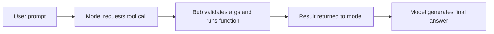

A model can understand a user's request, but to query real data or take action it needs external capabilities. Tools are the Agent's **hands and feet**: you can wrap any Python function as a tool and let the Agent call it on demand.

This guide starts with an order-lookup example and walks through defining tools, how the model calls them, and how to handle validation, runtime context, and concurrency.

## Define a custom tool {#add-a-tool}

Suppose you already have a Python function that looks up orders. To let the Agent call it, decorate the type-annotated function with `@tool` and pass it to `Agent(tools=[...])`:

```python "@tool" "tools=[get_order]"
from bub.core import Agent
from bub.core.tools import tool


ORDERS = {
    "A123": {
        "order_id": "A123",
        "status": "shipped",
        "item": "Mechanical keyboard",
        "amount": 399.0,
    }
}


@tool
def get_order(order_id: str) -> dict[str, str | float]:
    """Look up an order's status, item, and amount by order ID."""
    if order := ORDERS.get(order_id):
        return order
    return {"order_id": order_id, "error": "order_not_found"}


agent = Agent(
    tools=[get_order],
    system_prompt="When the user asks about an order, use the tool; never guess order status.",
)
```

`@tool` derives the parameter JSON Schema from the function's type annotations and uses its docstring as the tool description shown to the model.

## Tool call flow {#tool-call-flow}

The model does not execute Python directly. It emits a tool call request; Bub validates the arguments, runs the function, and sends the result back to the model:



You can observe both the tool call and its result in the stream (1 tool Step + 1 answer Step = 2 Steps total):

```python
async with agent.run(prompt, model=model, tape="tools-demo") as stream:
    async for event in stream:
        if event.kind == "tool_call":
            for call in event.data["tool_calls"]:
                print(f"Model requested: {call['name']}, args: {call['arguments']}")
        elif event.kind == "tool_result":
            print(f"Tool result: {event.data['tool_results']}")
        elif event.kind == "text":
            print(event.data["delta"], end="", flush=True)
```

As you can see, a tool call takes two Steps: first the model requests `get_order` and receives the result, then it uses that result to produce the final answer. Whether to call a tool is still up to the model.

## Parameter schemas and Pydantic validation {#tool-schema}

With `@tool`, parameter types become a JSON Schema and the [docstring](https://peps.python.org/pep-0257/) becomes the tool's manual for the model. Clear names, type annotations, and docstrings help the model call the tool accurately:

```python
@tool
def get_order(order_id: str) -> dict[str, str | float]:
    """Look up an order by ID. order_id is the full ID, such as A123."""
    ...
```

When a tool takes multiple parameters or requires value constraints (such as numeric bounds or string lengths), pass a [Pydantic](https://pydantic.dev/) model via `@tool(model=...)`:

```python
from pydantic import BaseModel, Field
from bub.core.tools import tool


class RefundInput(BaseModel):
    order_id: str = Field(description="Full order ID, such as A123")
    amount: float = Field(gt=0, description="Refund amount; must be greater than zero")
    reason: str = Field(min_length=1, description="Refund reason supplied by the user")


@tool(name="refund_order", model=RefundInput)
def refund_order(param: RefundInput) -> dict[str, str | float]:
    """Request a refund for a paid order."""
    return {
        "order_id": param.order_id,
        "amount": param.amount,
        "status": "refund_requested",
    }
```

When writing real tools, separate **expected business outcomes** from **execution errors**—returning a structured dict such as `{"error": "order_not_found"}` lets the model and caller recognize known business states cleanly:

| Outcome | Behavior |
| --- | --- |
| Argument type mismatch or Pydantic validation error | Returned to the model as a tool error so it can adjust arguments and retry |
| Tool raises an ordinary exception | Returned to the model as a tool error |
| Tool returns a structured dict (e.g. `{"error": "order_not_found"}`) | Returned to the model as a normal result (recommended for expected business outcomes) |
| Store, model client, or event handler raises an exception | Propagates out of stream iteration to the host caller |

## Inject `ToolContext` {#tool-context}

Sometimes a tool needs more than its arguments—such as the current session Tape, request-scoped `state`, or the event bus. Set `@tool(context=True)` so Bub injects `context: ToolContext`:

```python "context=True" "context: ToolContext"
from bub.core.tools import ToolContext, tool


@tool(context=True)
async def add_order_note(note: str, *, context: ToolContext) -> str:
    """Append an order note to the current session."""
    await context.tape.append_event(
        "order.note",
        {"text": note, "request_id": context.state.get("request_id")},
    )
    return f"Note written to session {context.tape.name}"
```

Pass `state` to `agent.run()`, and read it inside the tool via `context.state`:

```python
async with agent.run(
    prompt,
    model=model,
    tape="tools-demo",
    state={"session_id": "tools-demo", "request_id": "req-01"},
) as stream:
    ...
```

:::tip
`context` is injected by Bub and is hidden from the model-facing parameter schema. `context.state` lives only for the current call and is not persisted automatically.
:::

## Async functions and concurrency limits {#concurrency}

`@tool` supports both synchronous functions and `async def` coroutines. Use `async def` for I/O-bound work, or offload blocking calls with `asyncio.to_thread()`:

```python
import asyncio
import time
from bub.core.tools import tool


def build_report_blocking(order_id: str) -> str:
    time.sleep(3)
    return f"https://example.com/reports/{order_id}.pdf"


@tool
async def export_order_report(order_id: str) -> str:
    """Build an order report and return its download URL."""
    return await asyncio.to_thread(build_report_blocking, order_id)
```

A model may request multiple tool calls in a single response. To protect downstream services and host resources, cap concurrent local executions per Step with `max_tool_concurrency`:

```python
agent = Agent(
    tools=[get_order],
    system_prompt="Use the tool when asked about an order.",
    max_tool_concurrency=2,
)
```

`Agent(tools=[...])` also accepts provider-executed tools (such as `republic.tools.WebSearch()`), which execute remotely on the provider side and are not subject to local `max_tool_concurrency`.

## Call tools directly without the model {#call-a-tool-without-a-model}

If you already know which tool you want to run and want to skip model inference (and token usage), configure `command_prefix` on the Agent. Input starting with that prefix bypasses the model and invokes the tool directly:

```python
agent = Agent(tools=[get_order], command_prefix=",")

async with agent.run(",get_order A123", model=model, tape="tools-demo") as stream:
    async for event in stream:
        if event.kind == "text":
            print(event.data["delta"], end="")
```

Direct commands still run through `agent.run()` and emit tool events, but if execution fails, the error is raised directly to the caller rather than returned to a model.

## Code mode {#compose-tools-with-codemode}

When an Agent has many tools or needs loops and conditionals, wrap tools with `CodeMode` so the model can write Python via `run_code` to compose multiple tool calls in one pass:

```python
from bub.core import Agent
from bub.core.codemode import CodeMode

code_mode = CodeMode([get_order])

agent = Agent(
    tools=[code_mode.run_code],
    system_prompt=[
        "Use available tools to complete the task; you can write Python calling tools.*.",
        code_mode.prompt,
    ],
)
```

Example Python generated by the model inside `run_code`:

```python
order = await tools.get_order(order_id="A123")
print(order)
```

## Custom execution environments {#choose-an-execution-environment}

By default, tools and code mode execute directly on the host machine running the Python process (no sandbox). To isolate filesystem, network, and process access, implement a custom [`Environment`](/docs/reference/python-api/#environment).
