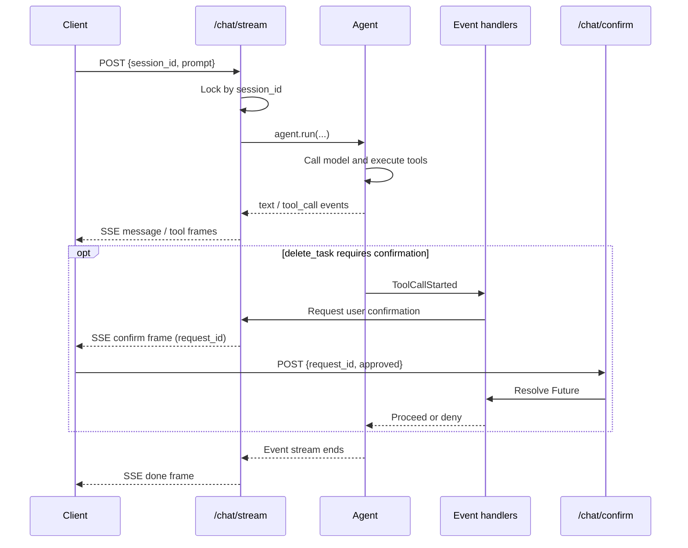

import { Code, FileTree, Steps } from '@astrojs/starlight/components';
import fullMainPy from '../../../../../public/examples/bub-todo-agent/main.py?raw';

With the basics of the Bub SDK behind us, this guide introduces no new concepts. Instead, it ties `Agent`, tools, event interception, and Tape storage together into a working FastAPI Todo Agent with Server-Sent Events (SSE) streaming and human-in-the-loop delete confirmation.

:::tip[Ask when something is unclear]
This guide focuses on the backend logic; the frontend UI is not covered in detail. If you run into a concept, a piece of code, or an error you are unsure about, ask Bub directly or have your coding assistant explain it alongside the source code.
:::

The complete example is available in [bub-todo-agent](https://github.com/bubbuild/bub/blob/main/website/public/examples/bub-todo-agent/). Download it to experiment, or build along step by step:

<FileTree>

- bub-todo-agent/
  - **main.py** # Backend service (covered in this guide)
  - index.html # Frontend demo UI
  - static/
    - uno.global.js
    - alpine.min.js
  - sessions/ # Tape storage directory created at runtime

</FileTree>

:::caution
This example is for demonstration only and omits production authentication and database backing. Do not expose it directly to the public internet.
:::

## 1. Initialize the Agent in FastAPI Lifespan {#lifespan}

First, let's build the application skeleton: create the model client and `Agent` inside FastAPI's [lifespan](https://fastapi.tiangolo.com/advanced/events/#lifespan) and attach them to `app.state` so all requests reuse a single instance:

```python title="main.py" showLineNumbers collapse={1-33} {50-58}
#!/usr/bin/env -S uv run --script
# /// script
# requires-python = ">=3.12"
# dependencies = [
#   "bub @ git+https://github.com/bubbuild/bub@main",
#   "fastapi>=0.135",
#   "python-dotenv",
#   "uvicorn",
# ]
# ///

import asyncio
import logging
import os
from collections import defaultdict
from collections.abc import AsyncIterable, Awaitable, Callable
from contextlib import asynccontextmanager, suppress
from itertools import count
from pathlib import Path
from typing import Literal
from uuid import uuid4

import republic
from dotenv import load_dotenv
from fastapi import FastAPI, HTTPException, Request
from fastapi.sse import EventSourceResponse, ServerSentEvent
from pydantic import BaseModel, Field

from bub.core import Agent
from bub.core.events import ToolCallDecision, ToolCallFinished, ToolCallStarted
from bub.core.store import FileTapeStore
from bub.core.tools import tool


logger = logging.getLogger(__name__)
BASE_DIR = Path(__file__).resolve().parent

load_dotenv()

MODEL = os.getenv("BUB_MODEL", "openai:gpt-4o-mini")
BASE_URL = os.getenv("BUB_API_BASE", "https://api.openai.com/v1")
API_KEY = os.getenv("BUB_API_KEY") or os.getenv("REPUBLIC_OPENAI_API_KEY")
HOST = os.getenv("BUB_HOST", "127.0.0.1")
PORT = int(os.getenv("BUB_PORT", "8000"))


@asynccontextmanager
async def lifespan(app: FastAPI):
    async with republic.get_model(MODEL, api_base=BASE_URL, api_key=API_KEY) as model:
        agent = Agent(
            store=FileTapeStore(BASE_DIR / "sessions"),
            system_prompt=(
                "You are a personal todo assistant. Always use tools to read or change todos; "
                "never guess task state. If a request is ambiguous, look it up or ask the user "
                "first, and respect tool errors and denial reasons."
            ),
            max_steps=6,
        )

        app.state.model = model
        app.state.agent = agent
        app.state.session_locks = defaultdict(asyncio.Lock)
        # request_id -> future; delete hook awaits confirmation here, woken by POST /chat/confirm
        app.state.pending_confirms = {}
        yield


app = FastAPI(title="Bub Todo Agent", lifespan=lifespan)
```

- Mounting `agent` on `app.state` avoids re-creating the Agent on every request.
- `max_steps=6` caps the steps per Run.
- `FileTapeStore` persists conversation history under `sessions/`.

So far this is just a minimal skeleton—the model can only chat and cannot act yet. Next, let's give it tools to do real work.

## 2. Define business tools {#tools}

With the Agent in place, let's make it genuinely useful by wrapping todo list, create, complete, and delete operations with `@tool`:

```python title="main.py"
from itertools import count
from pydantic import BaseModel, Field
from bub.core.tools import tool

TASKS: dict[str, dict[str, object]] = {}
TASK_IDS = count(3)


@tool
def list_tasks() -> list[dict[str, object]]:
    """List every todo with its task ID, title, and completion state."""
    return [dict(task) for task in TASKS.values()]


class AddTaskInput(BaseModel):
    title: str = Field(min_length=1, max_length=100, description="Short, specific todo title")


@tool(name="add_task", model=AddTaskInput)
def add_task(param: AddTaskInput) -> dict[str, object]:
    """Add a new incomplete todo."""
    task_id = f"task-{next(TASK_IDS)}"
    task = {"task_id": task_id, "title": param.title, "completed": False}
    TASKS[task_id] = task
    return dict(task)


@tool
def complete_task(task_id: str) -> dict[str, object]:
    """Mark a todo complete by task ID. Call list_tasks first if the ID is unknown."""
    if task := TASKS.get(task_id):
        task["completed"] = True
        return dict(task)
    return {"task_id": task_id, "error": "task_not_found"}


@tool
def delete_task(task_id: str) -> dict[str, object]:
    """Permanently delete a todo by task ID. The host must authorize it first."""
    if task := TASKS.pop(task_id, None):
        return {"task_id": task_id, "status": "deleted", "title": task["title"]}
    return {"task_id": task_id, "error": "task_not_found"}
```

The code above is straightforward Python, so we won't walk through every line—just keep three things in mind:

- Each function's docstring and type annotations become the tool schema the model reads before calling it.
- Return values must be JSON-serializable; return `{"error": ...}` for expected business failures instead of raising exceptions.
- `delete_task` is irreversible, so we'll intercept it in a moment to ask for confirmation.

Now pass the tools to `Agent` and set `max_tool_concurrency=2`:

```python title="main.py" ins={6,13}
@asynccontextmanager
async def lifespan(app: FastAPI):
    async with republic.get_model(MODEL, api_base=BASE_URL, api_key=API_KEY) as model:
        agent = Agent(
            store=FileTapeStore(BASE_DIR / "sessions"),
            tools=[list_tasks, add_task, complete_task, delete_task],
            system_prompt=(
                "You are a personal todo assistant. Always use tools to read or change todos; "
                "never guess task state. If a request is ambiguous, look it up or ask the user "
                "first, and respect tool errors and denial reasons."
            ),
            max_steps=6,
            max_tool_concurrency=2,
        )
```

## 3. Wrap `agent.run()` {#tape}

Now that the Agent has tools — its "hands and feet" — let's write a small helper `run_agent` that passes `ChatRequest`, `session_id`, and the `confirm_delete` callback into `agent.run()`:

```python
ConfirmDelete = Callable[[dict[str, object]], Awaitable[bool]]


class ChatRequest(BaseModel):
    session_id: str = Field(pattern=r"^[A-Za-z0-9_-]{1,64}$")
    prompt: str = Field(min_length=1, max_length=10_000)
    think_level: Literal["auto", "low", "medium", "high"] = "auto"


def run_agent(agent: Agent, model, req: ChatRequest, confirm_delete: ConfirmDelete):
    options = None if req.think_level == "auto" else {"reasoning_effort": req.think_level}
    return agent.run(
        req.prompt,
        model=model,
        options=options,
        tape=req.session_id,
        state={"session_id": req.session_id, "confirm_delete": confirm_delete},
    )
```

- `tape=req.session_id` shares history across turns in the same session (validated by regex so it is safe as a filename).
- `state` passes the per-request confirmation callback to the event handlers.

## 4. Register event handlers (logging & delete approval) {#events}

With tools wired up, we can also use the event bus to step in at key moments—such as logging every tool call or pausing before a deletion to ask the user. Register two handlers in `lifespan`:

1. `ToolCallFinished`: logs tool name, status, and duration.
2. `ToolCallStarted`: intercepts `delete_task` and awaits user confirmation; denies the call with `ToolCallDecision.deny(...)` if rejected or timed out.

```python title="main.py" "@agent.events.on(ToolCallFinished)" "@agent.events.on(ToolCallStarted)" "ToolCallDecision.deny"
        @agent.events.on(ToolCallFinished)
        def audit_tool(event: ToolCallFinished) -> None:
            logger.info(
                "tool=%s status=%s duration_ms=%s",
                event.result.tool,
                "error" if event.result.error else "ok",
                event.result.duration_ms,
            )

        @agent.events.on(ToolCallStarted)
        async def authorize_tool(event: ToolCallStarted) -> None:
            if event.call.tool != "delete_task":
                return
            confirm: ConfirmDelete | None = event.state.get("confirm_delete")
            if confirm is None or not await confirm(event.call.arguments):
                event.decision = ToolCallDecision.deny(
                    "The user did not approve deleting this todo. Do not retry; offer to mark "
                    "the todo complete instead."
                )
```

Because `EventBus` awaits async handlers synchronously, the Run pauses at `await confirm(...)` until the user responds in the UI. Note that `deny` skips only this tool call rather than aborting the whole Run—the model receives the denial reason and adjusts its response.

## 5. Session locks and confirmation endpoint {#concurrency}

In the previous step we paused the handler before deleting a task, but two pieces are needed for that pause to work reliably in a web service: same-session requests must queue, and the user's answer from the browser must reach the waiting handler. Two dictionaries on `app.state` handle this:

```python
app.state.session_locks = defaultdict(asyncio.Lock)
app.state.pending_confirms = {}
```

- `session_locks`: serializes requests per `session_id` so two requests never mutate the same Tape concurrently.
- `pending_confirms`: maps `request_id -> asyncio.Future` so `POST /chat/confirm` can wake the paused `ToolCallStarted` handler:

```python
class Confirmation(BaseModel):
    request_id: str
    approved: bool


@app.post("/chat/confirm")
async def confirm_tool_call(req: Confirmation, request: Request):
    future = request.app.state.pending_confirms.pop(req.request_id, None)
    if future is None or future.done():
        raise HTTPException(status_code=404, detail="confirmation_not_found")
    future.set_result(req.approved)
    return {"approved": req.approved}
```

With locks and confirmations in place, let's wire up the final piece.

## 6. Stream responses over SSE {#sse}

Now we can bring everything together in `/chat/stream`: a background task drives the Agent Run and pushes text deltas, tool calls, confirmation requests, and the final completion frame onto an `asyncio.Queue` yielded as [SSE](https://developer.mozilla.org/en-US/docs/Web/API/Server-sent_events/) events:

```python title="main.py" collapse={1-8}
import asyncio
from collections.abc import AsyncIterable
from contextlib import suppress
from uuid import uuid4

from fastapi import Request
from fastapi.sse import EventSourceResponse, ServerSentEvent


@app.post("/chat/stream", response_class=EventSourceResponse)
async def chat_stream(req: ChatRequest, request: Request) -> AsyncIterable[ServerSentEvent]:
    state = request.app.state
    lock: asyncio.Lock = state.session_locks[req.session_id]
    queue: asyncio.Queue[ServerSentEvent | None] = asyncio.Queue()

    async def confirm_delete(arguments: dict[str, object]) -> bool:
        task_id = str(arguments.get("task_id", ""))
        request_id = uuid4().hex
        future = asyncio.get_running_loop().create_future()
        state.pending_confirms[request_id] = future
        queue.put_nowait(
            ServerSentEvent(
                data={
                    "request_id": request_id,
                    "task_id": task_id,
                    "title": (TASKS.get(task_id) or {}).get("title"),
                },
                event="confirm",
            )
        )
        try:
            # Fail closed on 120s timeout or client disconnect
            return await asyncio.wait_for(future, timeout=120)
        except TimeoutError:
            return False
        finally:
            state.pending_confirms.pop(request_id, None)

    async def chat() -> None:
        try:
            async with lock, run_agent(state.agent, state.model, req, confirm_delete) as stream:
                async for event in stream:
                    if event.kind == "text":
                        queue.put_nowait(
                            ServerSentEvent(data={"delta": event.data["delta"]}, event="message")
                        )
                    elif event.kind == "tool_call":
                        names = [call["name"] for call in event.data["tool_calls"]]
                        queue.put_nowait(ServerSentEvent(data={"names": names}, event="tool"))

                # Emit done only after the full Run finishes (final marks a single Step)
                queue.put_nowait(
                    ServerSentEvent(data={"last_step_usage": stream.usage}, event="done")
                )
        except asyncio.CancelledError:
            raise
        except Exception:
            logger.exception("Streaming agent run failed: session=%s", req.session_id)
            queue.put_nowait(ServerSentEvent(data={"message": "Agent run failed"}, event="error"))
        finally:
            queue.put_nowait(None)

    task = asyncio.create_task(chat())
    try:
        while (frame := await queue.get()) is not None:
            yield frame
    finally:
        task.cancel()
        with suppress(asyncio.CancelledError):
            await task
```

You can also inspect the complete `bub-todo-agent/main.py` file directly below (helper and route boilerplate is collapsed by default—click to expand):

<Code
  code={fullMainPy}
  lang="python"
  title="bub-todo-agent/main.py"
  showLineNumbers
  collapse={['1-136', '185-259', '320-324']}
/>

## Interaction sequence {#wiring}

Let's quickly recap what we built. A complete interaction in this demo flows like this:



In summary, the demo comes together in three parts:

- **Configuration and integration**: initialize the Bub Agent and Tape store in FastAPI's `lifespan`.
- **Custom logic via tools and events**: wrap todo operations as tools, then layer audit logging and delete confirmation on top with event handlers.
- **HTTP and streaming**: tie everything together with session locks, the confirmation endpoint, and SSE streaming.

## Run the example {#run}

And with that, our complete demo is ready! Download [bub-todo-agent](https://github.com/bubbuild/bub/blob/main/website/public/examples/bub-todo-agent/) and run it locally to try it out in your browser:

<Steps>

1. Copy `.env.example` to `.env` and fill in your model settings:

   ```bash title=".env"
   BUB_MODEL=openai:gpt-4o-mini
   BUB_API_BASE=https://api.openai.com/v1
   BUB_API_KEY=sk-...
   BUB_HOST=127.0.0.1
   BUB_PORT=8000
   ```

2. Start the server with `uv`:

   ```shell
   uv run main.py
   ```

3. Open `http://127.0.0.1:8000` in your browser:

   ```text
   $ uv run main.py
   INFO:     Started server process [85377]
   INFO:     Waiting for application startup.
   INFO:     Application startup complete.
   INFO:     Uvicorn running on http://127.0.0.1:8000 (Press CTRL+C to quit)
   ```

   

</Steps>

Enjoy!
