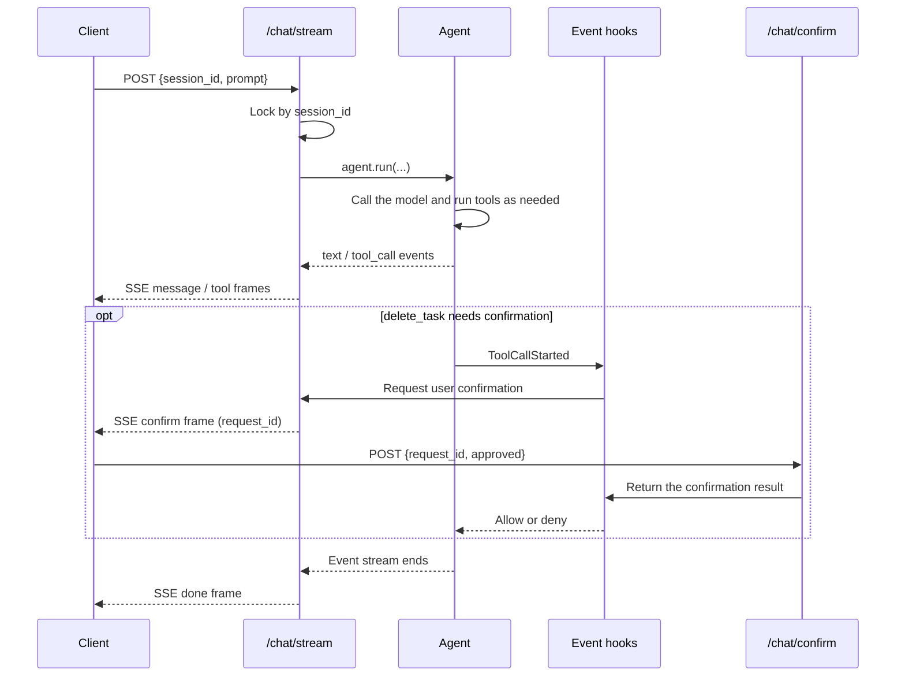

import { FileTree, Steps } from '@astrojs/starlight/components';

With the basics of the Bub SDK behind us, this section introduces no new concepts. Instead, it ties everything together in one complete example that builds a working Agent demo application.

:::tip[Ask when something is unclear]
This section covers only the backend logic; the frontend UI is not discussed. If you run into a concept, a piece of code, or an error you do not understand, ask Bub directly, or ask the Agent tool you are using to explain it using this tutorial and the current code.
:::

The complete example lives in [bub-todo-agent](https://github.com/bubbuild/bub/blob/main/website/public/examples/bub-todo-agent/). You can download it and modify it yourself, or build along with the tutorial. The core files are laid out like this:

<FileTree>

- bub-todo-agent/
  - main.py # the focus of this chapter
  - index.html # demo UI, not covered here
  - static/
    - uno.global.js
    - alpine.min.js
  - sessions/ # created automatically at runtime

</FileTree>


:::caution
This project is for demonstration and teaching only. It is not production-ready; do not expose it to the public internet.
:::

## 1. Configure the Agent and start the FastAPI service {#lifespan}

First, let's set up the application skeleton: configure the Bub Agent and create it when FastAPI starts. That means:

1. Import the dependencies and load configuration into variables.
2. Customize FastAPI's [lifespan](https://fastapi.tiangolo.com/advanced/events/#lifespan) logic so the Bub Agent is configured at startup.

```python
#!/usr/bin/env -S uv run --script
# /// script
# requires-python = ">=3.12"
# dependencies = [
#   "bub @ git+https://github.com/bubbuild/bub@main",
#   "fastapi>=0.135",
#   "python-dotenv",
#   "uvicorn",
# ]
# ///

import asyncio
import logging
import os
from collections import defaultdict
from collections.abc import AsyncIterable, Awaitable, Callable
from contextlib import asynccontextmanager, suppress
from itertools import count
from pathlib import Path
from typing import Literal
from uuid import uuid4

import republic
from dotenv import load_dotenv
from fastapi import FastAPI, HTTPException, Request
from fastapi.sse import EventSourceResponse, ServerSentEvent
from pydantic import BaseModel, Field

from bub.core import Agent
from bub.core.events import ToolCallDecision, ToolCallFinished, ToolCallStarted
from bub.core.store import FileTapeStore
from bub.core.tools import tool


logger = logging.getLogger(__name__)
BASE_DIR = Path(__file__).resolve().parent

load_dotenv()

# ===== Override with environment variables or .env, or edit these defaults directly =====
MODEL = os.getenv("BUB_MODEL", "openai:gpt-4o-mini")
BASE_URL = os.getenv("BUB_API_BASE", "https://api.openai.com/v1")
API_KEY = os.getenv("BUB_API_KEY") or os.getenv("REPUBLIC_OPENAI_API_KEY")
HOST = os.getenv("BUB_HOST", "127.0.0.1")
PORT = int(os.getenv("BUB_PORT", "8000"))
# ==========================================================


@asynccontextmanager
async def lifespan(app: FastAPI):
    async with republic.get_model(MODEL, api_base=BASE_URL, api_key=API_KEY) as model:
        agent = Agent(
            store=FileTapeStore(BASE_DIR / "sessions"),
            system_prompt=(
                "You are a personal todo assistant. Always use tools to read or change todos; "
                "never guess task state. If a request is ambiguous, look it up or ask the user "
                "first, and respect tool errors and denial reasons."
            ),
            max_steps=6,
        )

        app.state.model = model
        app.state.agent = agent
        app.state.session_locks = defaultdict(asyncio.Lock)
        # request_id -> future; the delete hook waits here, and POST /chat/confirm wakes it.
        app.state.pending_confirms = {}
        yield


app = FastAPI(title="Bub Todo Agent", lifespan=lifespan)
```

Notes:

- To avoid creating the Agent repeatedly and to share one instance, mount the created Agent and its related attributes on FastAPI's state object, `app.state`.
- `max_steps` caps how many steps a single Run can take, preventing the model from looping forever.
- The `store` parameter gives the Agent Tape capabilities, so it can remember the conversation across turns.

For now this is still a very basic setup: the model can only answer. Next we'll give it the ability to do real work.

## 2. Give it business capabilities through tools {#tools}

Now that the Agent is in place, let's make it actually useful: every Todo operation becomes a Python function wrapped as a tool that the Agent can call. That means:

- Store task data in a Python dictionary.
- Provide the usual create, read, update, and delete operations so the Agent can view, add, complete, and delete tasks.

```python
# ...

from itertools import count

from pydantic import BaseModel, Field

from bub.core.tools import tool

TASKS: dict[str, dict[str, object]] = {}
TASK_IDS = count(3)


@tool
def list_tasks() -> list[dict[str, object]]:
    """List every todo with its task ID, title, and completion state."""
    return [dict(task) for task in TASKS.values()]


class AddTaskInput(BaseModel):
    title: str = Field(min_length=1, max_length=100, description="Short, specific todo title")


@tool(name="add_task", model=AddTaskInput)
def add_task(param: AddTaskInput) -> dict[str, object]:
    """Add a new incomplete todo."""
    task_id = f"task-{next(TASK_IDS)}"
    task = {"task_id": task_id, "title": param.title, "completed": False}
    TASKS[task_id] = task
    return dict(task)


@tool
def complete_task(task_id: str) -> dict[str, object]:
    """Mark a todo complete by task ID. Call list_tasks first if the ID is unknown."""
    if task := TASKS.get(task_id):
        task["completed"] = True
        return dict(task)
    return {"task_id": task_id, "error": "task_not_found"}


@tool
def delete_task(task_id: str) -> dict[str, object]:
    """Permanently delete a todo by task ID. The host must authorize it first."""
    if task := TASKS.pop(task_id, None):
        return {"task_id": task_id, "status": "deleted", "title": task["title"]}
    return {"task_id": task_id, "error": "task_not_found"}
```

The code above is fairly basic Python, so we won't go through it line by line. In short:

- The function's docstring and type annotations become the tool schema. The Agent reads them before deciding whether to call the tool.
- Return values must be JSON-serializable. Return `{"error": ...}` for business failures; don't throw exceptions and abort the whole flow for every failure.
- `delete_task` is irreversible, so we'll add an interception event later to require a second confirmation.

Now update the Agent configuration:

```python

# Code snippet..

@asynccontextmanager
async def lifespan(app: FastAPI):

    # ...

    async with republic.get_model(MODEL, api_base=BASE_URL, api_key=API_KEY) as model:
        agent = Agent(
            store=FileTapeStore(BASE_DIR / "sessions"),
            tools=[list_tasks, add_task, complete_task, delete_task],
            system_prompt=(
                "You are a personal todo assistant. Always use tools to read or change todos; "
                "never guess task state. If a request is ambiguous, look it up or ask the user "
                "first, and respect tool errors and denial reasons."
            ),
            max_steps=6,
            max_tool_concurrency=2,
        )
```

Here we pass all task tools in `tools` and set `max_tool_concurrency` to cap how many tools can run at once.

## 3. Wrap Agent calls {#tape}

The Bub Agent now has tools — its "hands and feet" — and can interact with the user.

Before calling it, we may want to do some light argument handling so each Run receives correct arguments. Our logic here is simple:

```python
ConfirmDelete = Callable[[dict[str, object]], Awaitable[bool]]


class ChatRequest(BaseModel):
    session_id: str = Field(pattern=r"^[A-Za-z0-9_-]{1,64}$")
    prompt: str = Field(min_length=1, max_length=10_000)
    think_level: Literal["auto", "low", "medium", "high"] = "auto"


def run_agent(agent: Agent, model, req: ChatRequest, confirm_delete: ConfirmDelete):
    options = None if req.think_level == "auto" else {"reasoning_effort": req.think_level}
    return agent.run(
        req.prompt,
        model=model,
        options=options,
        tape=req.session_id,
        state={"session_id": req.session_id, "confirm_delete": confirm_delete},
    )
```

Notes:

- `tape=req.session_id` shares history within one session; a new `session_id` starts a new conversation.
- `state` holds temporary per-call data shared with the event hooks that follow.

## 4. Register event hooks {#events}

Bub offers several hook points, which we can use to customize specific stages: for example, logging tool calls or intercepting delete commands that have not been confirmed.

The core logic:

1. On `ToolCallFinished`, record the tool name, status, and duration.
2. On `ToolCallStarted`, intercept `delete_task` first.
3. Read the confirmation callback from `state`; deny if there is none.
4. If the user declines, set `deny` and tell the model what to do instead.

So, after creating the Agent, add the following inside FastAPI's `lifespan`:

```python
# ...

from bub.core.events import ToolCallDecision, ToolCallFinished, ToolCallStarted


@asynccontextmanager
async def lifespan(app: FastAPI):
    async with republic.get_model(MODEL, api_base=BASE_URL, api_key=API_KEY) as model:


        # ...


        @agent.events.on(ToolCallFinished)
        def audit_tool(event: ToolCallFinished) -> None:
            logger.info(
                "tool=%s status=%s duration_ms=%s",
                event.result.tool,
                "error" if event.result.error else "ok",
                event.result.duration_ms,
            )


        @agent.events.on(ToolCallStarted)
        async def authorize_tool(event: ToolCallStarted) -> None:
            # Async handlers are awaited, so the Run can pause here until the user answers in the UI.
            # If nobody answers, denying by default is the safer failure mode.
            if event.call.tool != "delete_task":
                return
            confirm: ConfirmDelete | None = event.state.get("confirm_delete")
            if confirm is None or not await confirm(event.call.arguments):
                event.decision = ToolCallDecision.deny(
                    "The user did not approve deleting this todo. Do not retry; offer to mark "
                    "the todo complete instead."
                )
```

Notes:

- An async handler pauses the current Agent call until the user answers.
- `deny` skips only this tool call; it does not stop the whole flow. The model receives the denial reason and adjusts its answer.

## 5. Session locks and confirmations {#concurrency}

The previous section pauses the flow before deleting a task, but two pieces are still missing for that pause to actually work:

1. Requests for the same session must queue, so the Tape session is not taken over by another request while one is waiting.
2. The user's answer about the deletion must reach the paused hook.

So we need a "lock" that ensures only one request holds a given Tape record at a time. Both pieces of state are initialized in `lifespan`:

```python
app.state.session_locks = defaultdict(asyncio.Lock)
# request_id -> future; the delete hook waits here, and POST /chat/confirm wakes it.
app.state.pending_confirms = {}
```

Then, at the request entry point, take the lock by `session_id`, so requests in the same session run one after another:

```python
lock: asyncio.Lock = state.session_locks[req.session_id]
```

For the confirmation interaction, use a separate endpoint:

```python
class Confirmation(BaseModel):
    request_id: str
    approved: bool


@app.post("/chat/confirm")
async def confirm_tool_call(req: Confirmation, request: Request):
    future = request.app.state.pending_confirms.pop(req.request_id, None)
    if future is None or future.done():
        raise HTTPException(status_code=404, detail="confirmation_not_found")
    future.set_result(req.approved)
    return {"approved": req.approved}
```

Now let's do the final piece.

## 6. Build the API and stream over SSE {#sse}

With locks and confirmations in place, we can wire them into the Agent conversation:

1. The frontend makes an HTTP request to `/chat/stream`.
2. FastAPI handles the request and uses the Agent to generate content.
3. FastAPI serializes the Agent's output as [SSE](https://developer.mozilla.org/en-US/docs/Web/API/Server-sent_events/) events and returns them to the frontend.
4. The frontend handles and displays each event by type.

Here is the complete code:

```python
import asyncio
from collections.abc import AsyncIterable
from contextlib import suppress
from uuid import uuid4

from fastapi import Request
from fastapi.sse import EventSourceResponse, ServerSentEvent


@app.post("/chat/stream", response_class=EventSourceResponse)
async def chat_stream(req: ChatRequest, request: Request) -> AsyncIterable[ServerSentEvent]:
    state = request.app.state
    lock: asyncio.Lock = state.session_locks[req.session_id]
    # Advance the Run in a background task so hooks can also push frames onto the queue;
    # hooks run inside the Agent event stream, where the response generator cannot yield directly.
    queue: asyncio.Queue[ServerSentEvent | None] = asyncio.Queue()

    async def confirm_delete(arguments: dict[str, object]) -> bool:
        task_id = str(arguments.get("task_id", ""))
        request_id = uuid4().hex
        future = asyncio.get_running_loop().create_future()
        state.pending_confirms[request_id] = future
        queue.put_nowait(
            ServerSentEvent(
                data={
                    "request_id": request_id,
                    "task_id": task_id,
                    "title": (TASKS.get(task_id) or {}).get("title"),
                },
                event="confirm",
            )
        )
        try:
            # Fail closed: if there is no answer within two minutes, or the client disconnects,
            # do not delete.
            return await asyncio.wait_for(future, timeout=120)
        except TimeoutError:
            return False
        finally:
            state.pending_confirms.pop(request_id, None)

    async def chat() -> None:
        try:
            async with lock, run_agent(state.agent, state.model, req, confirm_delete) as stream:
                async for event in stream:
                    if event.kind == "text":
                        queue.put_nowait(
                            ServerSentEvent(data={"delta": event.data["delta"]}, event="message")
                        )
                    elif event.kind == "tool_call":
                        names = [call["name"] for call in event.data["tool_calls"]]
                        queue.put_nowait(ServerSentEvent(data={"names": names}, event="tool"))

                # Send done only after the whole Run ends; final marks the end of just one Step.
                queue.put_nowait(
                    ServerSentEvent(data={"last_step_usage": stream.usage}, event="done")
                )
        except asyncio.CancelledError:
            raise
        except Exception:
            logger.exception("Streaming agent run failed: session=%s", req.session_id)
            queue.put_nowait(ServerSentEvent(data={"message": "Agent run failed"}, event="error"))
        finally:
            queue.put_nowait(None)

    task = asyncio.create_task(chat())
    try:
        while (frame := await queue.get()) is not None:
            yield frame
    finally:
        task.cancel()
        with suppress(asyncio.CancelledError):
            await task
```

## Full walkthrough: one interaction {#wiring}

Let's quickly recap the chapter. A complete interaction in this demo looks like this:



In summary, the demo has three parts:

- **Configuration and integration**: configure the Bub Agent and integrate it with FastAPI.
- **Custom logic through tools and events**: wrap the actual operations as tools the Agent can call, then customize what happens at specific event stages during tool calls.
- **Interaction over HTTP**: expose an HTTP endpoint that combines these parts and completes the interaction.

## Run and try it {#run}

Your complete demo is now ready. You can run the whole service from [bub-todo-agent](https://github.com/bubbuild/bub/blob/main/website/public/examples/bub-todo-agent/) and try it in the browser:

<Steps>

1. Rename `.env.example` to `.env` and fill in the model settings or port:

    ```
    BUB_MODEL=openai:gpt-4o-mini
    BUB_API_BASE=https://api.openai.com/v1

    BUB_API_KEY=sk-...

    BUB_HOST=127.0.0.1
    BUB_PORT=8000
    ```

2. Run `main.py` with uv:

    ```shell
    uv run main.py
    ```

3. When the logs appear, click or copy the URL and open the page in your browser:

    ```
    $ uv run main.py
    INFO:     Started server process [85377]
    INFO:     Waiting for application startup.
    INFO:     Application startup complete.
    INFO:     Uvicorn running on http://127.0.0.1:8000 (Press CTRL+C to quit)
    ```

    

</Steps>


Enjoy!
