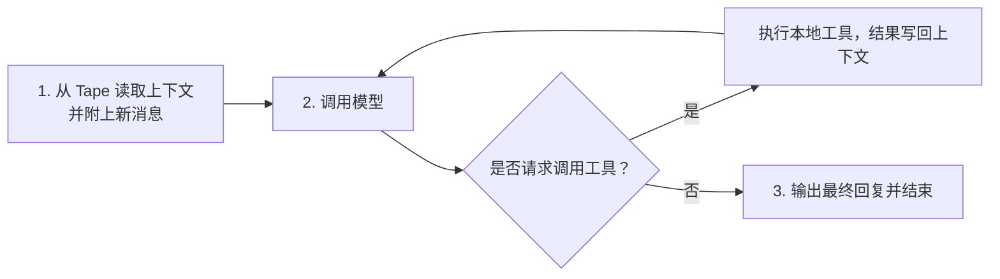

单独调用大模型时，它只能接收一段文本、返回一段回答。要让它能自己查文件、调接口、分多步解决实际问题，就需要用循环把**模型**、**工具**和**历史记录**（Tape）串起来：模型根据当前上下文决定下一步动作，工具负责实际执行，Tape 保存整个过程的历史，循环则不断推进直到得出最终答案。

## 循环是如何运转的 {#loop}

在 Bub 中，一次完整的 Agent 循环按以下三步反复推进：

1. **读取上下文并调用模型**：通过 `TapeContext` 从会话历史中提取所需记录，附上本次新消息后发给模型；
2. **按需执行工具**：如果模型决定调用工具，Bub 会校验参数并执行对应的 Python 函数，再把结果带入下一轮模型调用；
3. **给出回答并结束**：当模型认为信息已经充足、不再请求工具而是直接作答时，本次运行结束。

为了方便在代码中控制和观测这个循环，Bub 区分了两个执行粒度：

| 概念 | 含义 | 结束条件 |
| --- | --- | --- |
| **Run** | 一次完整的 Agent 执行（对应一次 `agent.run()` 调用），对外产出 `StreamEvent` 事件流 | 模型直接给出最终回复，或调用方关闭事件流 |
| **Step** | Run 内部的一步：包含一次模型调用，以及该次响应请求的全部工具执行 | 该步请求的所有工具执行完毕 |

也就是说，**一次 Run 由一个或多个 Step 组成**。如果模型一句话就能直接回答，这次 Run 就只有 1 个 Step；如果它先查了两次工具才回答，这次 Run 就经历了 3 个 Step。

在实际使用中，有三个常见的边界需要注意：

- **Run 是由消费事件流驱动的**：调用 `agent.run()` 只会准备好运行上下文，只有当你用 `async for` 消费事件流时，模型推理与工具调用才会真正往前走。如果中途退出循环并关闭流，当前 Run 也会随之停止。
- **上下文按步从 Tape 生成，而不是在 Run 里私自攒一个数组**：Run 内部不维护私有的 `messages` 列表。每进入一个新的 Step，它都会通过 `TapeContext` 从 Tape 重新生成当前所需的模型上下文（见 [Tape 与模型上下文](/zh-cn/docs/concepts/tape/)）。
- **Run 不等于 Turn**：Run 是核心层的模型与工具循环；Turn 是应用层处理一条外部消息的完整流程。逗号命令（如 `,help`）甚至可以在 Turn 内直接返回结果，根本不会启动模型 Run（见 [Turn](/zh-cn/docs/concepts/turn/)）。

## 核心层与应用层的分工 {#layers}

`bub.core.Agent` 是 Bub 的微内核，只专注于把「模型—工具—事件—Tape」这个循环跑好：**不读取配置文件或 `BUB_*` 环境变量，也不关心消息渠道与插件发现**。

而应用层（`BubFramework` 与 `BubAgent`）则是围绕这个内核搭起来的完整运行环境，在循环外围补齐了配置管理、插件 Hooks、技能发现、消息渠道和会话路由。

因此，你可以根据场景自由选择接入方式：

- **嵌入现有 Python 服务**：使用核心层 [SDK](/zh-cn/docs/sdk/)，由宿主代码显式传入模型、工具和存储；
- **需要消息管道、配置或插件**：直接运行 Bub CLI，或在代码中[复用 Bub 应用层能力](/zh-cn/docs/integrations/reuse-app/)。
