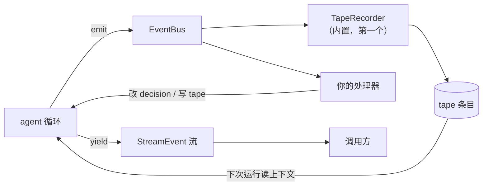

import { Aside } from '@astrojs/starlight/components';

Agent 事件能让你看到一次运行，也能让你在模型或工具调用之前做决定。每个 Agent 都会建一个 `EventBus`，并挂上一个 `TapeRecorder`。你通过 `agent.events` 添加处理器。

事件是 Bub 里唯一的横切关注点。日志、权限、预算、审计、UI 进度，全都可以只写成处理器，不用改动循环和工具。

## 三类信息 {#three-kinds}

"事件"这个词在 Bub 里指三个不同的东西，混起来最容易出 bug。先分清：

| 类型 | 用途 | 怎么读 | 谁看 |
| --- | --- | --- | --- |
| `AgentEvent` | 运行的生命周期，以及调用拦截。 | `agent.events.on(...)` | 宿主代码和插件 |
| `StreamEvent` | 给调用方的输出，比如文本和工具进度。 | 迭代 `agent.run()` 返回的流 | 直接调用 agent 的代码 |
| `TapeEntry` | 存下来的对话和部分运行记录。 | 查询 [tape](/zh-cn/docs/concepts/tape/) | 之后运行时的模型 |

三者的关系和职责：



注意箭头方向。`StreamEvent` 是**单向出口**，你只能消费它，不能借它改变运行；要改变运行，得用 `AgentEvent` 的处理器。反过来，`TapeEntry` 是**事后**的，写进去不影响当前这一步。

循环控制执行，并在固定位置调用事件处理器，然后才往下走。TapeRecorder 保存选定的往返和生命周期记录。其他你要留的事件，由自己的处理器记录。

## 处理器 {#handlers}

下面用的是 [SDK 指南](/zh-cn/docs/sdk/)里的 `agent`：

```python
from bub.core.events import StepFinished, ToolCallFinished


@agent.events.on(ToolCallFinished)
async def report_tool(event: ToolCallFinished) -> None:
    print(event.call.tool, event.result.duration_ms, "ms")


def report_step(event: StepFinished) -> None:
    print("step", event.step, event.status)


agent.events.on(StepFinished, report_step)
```

两种注册方式等价：装饰器适合新写的函数，直接传适合已有函数。要移除，调 `agent.events.off(StepFinished, report_step)`。

注册到基类上的处理器，也会收到子类事件。所有 agent 事件都继承 `AgentEvent`，所以注册到 `AgentEvent` 上的处理器会收到派发给它的全部事件——适合做统一的日志或计时，但要小心体积。

### 分发规则 {#delivery}

四条规则决定了处理器能不能指望顺序：

1. **按注册顺序执行。** 每次派发，匹配的处理器依次执行。
2. **等异步处理器做完。** 总线会 await 一个异步处理器，再调下一个。
3. **不看返回值。** 处理器返回什么，总线都忽略。要影响运行，得改事件对象的字段。
4. **异常向上抛。** 处理器抛出的异常会抛给 `emit()` 的调用方，可能让整次运行失败。

第 4 条容易踩坑。观察性质的处理器应该自己接住异常：

```python
@agent.events.on(ToolCallFinished)
async def audit_tool(event: ToolCallFinished) -> None:
    try:
        await send_to_audit_log(event.call.tool, event.result)
    except Exception:
        logger.warning("audit failed tool={}", event.call.tool)
```

另一个边界：**顺序只管一次派发**。并发的工具调用或两个运行，可能同时发事件。处理器里共享的状态，仍要自己协调。

## 调用控制 {#call-control}

要叫停一次调用，给事件的 `decision` 字段赋值。这是事件机制里唯一能改写循环行为的地方。

```python
from bub.core.events import ToolCallDecision, ToolCallStarted


@agent.events.on(ToolCallStarted)
def require_refund_permission(event: ToolCallStarted) -> None:
    if event.call.tool == "refund_order" and not event.state.get("refunds_allowed"):
        event.decision = ToolCallDecision.deny("Refunds require approval.")
```

三种决断，效果各不相同：

| 决断 | 工具跑了吗 | 模型看到什么 | 后续 |
| --- | --- | --- | --- |
| `deny(message)` | 没跑 | 一个工具错误 | 本次派发停止 |
| `replace(result)` | 没跑 | 你给的结果 | 本次派发停止 |
| 改 `event.call` | 用新参数跑 | 真实结果 | 继续派发 |

`deny()` 跳过工具，给出一个工具错误。`replace(result)` 跳过工具，直接给出结果。两者都会让这个 `ToolCallStarted` 停止往后传。执行器仍会为结果发出 `ToolCallFinished`。模型循环把这个错误当成工具结果交给模型；直接命令调用则把错误抛给调用方。

要改参数再接着跑，用 `dataclasses.replace(event.call, arguments=...)` 换掉 `event.call`。注意这是替换而不是原地修改，事件对象本身是 frozen 的。

要在模型调用之前就结束，在 `LLMCallStarted` 上设 `event.decision = LLMCallDecision.finish(text)`。这会叫停后续处理器，也不去调供应商。被跳过的供应商调用不会发 `LLMCallFinished`——**你的计时和计费逻辑不能假设两个事件一定成对出现**。

### 事件总表 {#event-reference}

以下是全部 agent 事件。签名和完整字段见 [Python API 参考](/zh-cn/docs/reference/python-api/)。

| 事件 | 什么时候发 | 你能做什么 |
| --- | --- | --- |
| `RunStarted` | 一次模型运行开始。 | 读提示词、模型和 metadata。 |
| `RunFinished` | 这次运行的流关闭。 | 读状态、步骤数、耗时和错误。 |
| `StepStarted` | 一个模型步骤开始。 | 读进度。 |
| `StepFinished` | 一个模型步骤结束。 | 读进度。`status == "continue"` 时，设 `next_prompt`，给下一步加一条用户消息。 |
| `MessagesPending` | 步骤构建模型请求时，或步骤结束时没有调工具。 | 往 `messages` 追加用户消息，排在下一个提示词之前。在步骤结束时加的消息，会让运行继续。 |
| `LLMCallStarted` | 调供应商之前。 | 换掉 `request`，或设 `LLMCallDecision.finish(text)`。 |
| `LLMCallFinished` | 供应商调用完成，或抛异常。 | 读累积的结果。取消和消费方关流，这里不报。 |
| `ToolCallStarted` | 工具执行之前。 | 换掉 `call`，拒绝调用，或换掉结果。 |
| `ToolCallFinished` | 工具成功、失败、被拒绝或被替换。 | 给 `event.result.result` 赋值，改掉返回的结果。 |
| `ChatFinished` | 这一步的往返可以记录了。 | 读这一次往返。 |
| `CommandFinished` | 直接命令完成或失败。 | 读命令、状态和输出。 |

`MessagesPending` 值得单独说一句：它是**运行中插话**的入口。`StepFinished` 的 `next_prompt` 设置下一步的用户消息，`MessagesPending` 在构建请求的最后一刻追加消息。steering 就是接到这两个点上实现的——用户在模型思考时补的那句话，不需要等下一次运行。

命令提示词直接跑工具，会发出工具事件和 `CommandFinished`。见[不经过模型调用工具](/zh-cn/docs/sdk/tools/#call-a-tool-without-a-model)。

所有 agent 事件都带本轮的 `state`。从 `TapeEvent` 派生的事件还带当前 tape。工具事件在调用有上下文时，可以从 `event.call.context` 取到。

## 记录 {#recording}

Agent 在你的处理器之前注册 TapeRecorder。它记录 `RunStarted`、`RunFinished`、`StepStarted`、`StepFinished`、`ChatFinished` 和 `CommandFinished`。

其中 `ChatFinished` 最关键：这个处理器写入消息和工具往返，后面的模型调用就靠它拿上下文。换句话说，**TapeRecorder 不是可选的日志，它是上下文的生产者**——把 tape 上的往返删掉，下一次运行就读不到之前发生了什么。

记录是正常流程的一部分。它写进你配置的存储，没另外指定就写在内存里。记录和 tracing 的配置无关：你可以关掉 tracing，记录照旧。

<Aside type="tip">
  要存自定义事件，加一个处理器把它写进 tape。要改请求或结果，用调用拦截事件。`ChatFinished` 的观察器运行时，默认记录器已经把这次往返存好了——顺序是注册顺序，而它排在你前面。
</Aside>

## 自定义事件 {#custom-events}

定义一个继承 `AgentEvent` 的 dataclass。处理器需要 tape 时，就继承 `TapeEvent`。

```python
from dataclasses import dataclass

from bub.core.events import TapeEvent


@dataclass(kw_only=True)
class OrderReviewed(TapeEvent):
    order_id: str


@agent.events.on(OrderReviewed)
async def record_review(event: OrderReviewed) -> None:
    await event.tape.append_event("order.reviewed", {"order_id": event.order_id})


async def mark_reviewed() -> None:
    tape = agent.tape("customer-42")
    await agent.events.emit(
        OrderReviewed(state=tape.context.state, tape=tape, order_id="A123")
    )
```

自定义事件继承了三个能力：走同一套分发规则、拿到本轮的 state 和 tape、可以被拦截。

`emit()` 在处理器跑完后返回事件。自定义的可变事件可以把结果带回发出方。结果一确定就该停止派发时，覆写它的 `stopped` 属性——内置的 `ToolCallStarted` 就是这么实现 `deny` 和 `replace` 提前终止的。

工具可以通过 `context.events` 发事件，用的是同一份本轮状态。

## 应用插件 {#app-plugins}

内核用事件，应用用 hook。两者之间的桥是 `AgentPlugins`。

它把四个 hook 接到调用事件上：`before_llm_call`、`after_llm_call`、`before_tool_call`、`after_tool_call`。它把 `continue_prompt` 接到 `StepFinished`，把 steering inbox 接到 `MessagesPending`。插件按 hook 的要求返回值，适配器去改对应的事件。

`BubAgent` 用的就是这个适配器，核心 Agent [也可以这么用](/zh-cn/docs/sdk/reuse-plugins/#other-hooks)。

这个适配器遵循插件 hook 的顺序。单个拦截 hook 抛异常时，它接住、记日志、跳过——**和直接注册到 EventBus 的处理器相反**，那里异常会向上传播。这个差异是有意的：插件来自第三方，不该让一个坏插件中断整次运行。

要拒绝一次调用，就返回对应的 decision。其他应用 hooks 按各自的出错规则处理。

插件示例见 [Hooks](/zh-cn/docs/app/hooks/)。顺序和签名见 [Hooks 参考](/zh-cn/docs/reference/hooks/#interception-through-pluginagenthooks)。EventBus 在基础 SDK 安装里就有。

`framework.events` 是另一个总线，发布应用层的事件：命令、渠道工作和用户输入，用 `bub.application` 里的 `CommandChanged`、`WorkChanged` 和 `PromptChanged`。订阅和取消订阅，还是 `on()` 和 `off()`。它和 agent 事件总线互相独立——`framework.events` 不知道模型调用的细节，`agent.events` 不知道渠道的存在。
