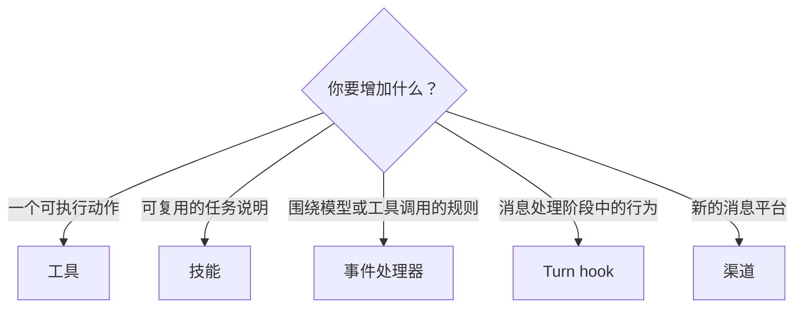

新需求难以落地，很少是因为 Bub 没有容纳它的位置。更常见的问题是选错了家：把策略藏进工具，把可执行脚本埋进技能，或把传输关注点混入模型循环。

先判断职责，再选择机制，而不是从你最熟悉的机制出发。Bub 的扩展点彼此正交，一项功能可以组合多个扩展点，同时不让任何一个组件承担多份无关工作。

## 五个正交维度 {#dimensions}

| 维度 | 扩展点 | 回答的问题 |
| --- | --- | --- |
| **动作** | [工具](/zh-cn/docs/sdk/tools/) | Agent 可以执行什么操作？ |
| **指令** | [技能](/zh-cn/docs/app/skills/) | 模型应该阅读什么流程或专业知识，才能把任务做好？ |
| **策略** | [Agent 事件](/zh-cn/docs/concepts/events/) | 哪些调用应该被观察、拒绝、替换或改写？ |
| **生命周期** | [插件与 Turn hooks](/zh-cn/docs/app/plugins/) | 消息经过各处理阶段时，应该发生什么？ |
| **传输** | [渠道](/zh-cn/docs/app/gateway/) | 消息如何进入和离开外部系统？ |

这些维度回答不同问题。工具不必知道请求来自哪个渠道，渠道不必理解模型的工具循环，技能应该描述流程，而不是变成第二套插件系统。

## 按意图选择 {#choose}

用这棵决策树找到第一个候选：

具体来说：

- 「我要调用外部系统或数据库」 → **工具**。
- 「我要教模型一套复杂业务 SOP」 → **技能**。
- 「我要在敏感工具调用前检查权限」 → **事件处理器**。
- 「我要改变入站消息进入模型前的组装方式」 → **Turn hook**。
- 「我要对接钉钉、飞书或 Telegram」 → **渠道**。

还有一些选择位于这五个维度旁边：

| 目标 | 扩展点 | 接入方式 |
| --- | --- | --- |
| 把独立子任务交给另一个 Agent | [子 Agent](/zh-cn/docs/app/subagents/) | 使用内置 `subagent` 工具，按需限制会话、模型、工具和技能 |
| 改变 Tape 历史到模型消息的转换 | [TapeContext](/zh-cn/docs/concepts/tape/#context) | `Agent(context=...)`，或应用中的 `build_tape_context()` |
| 更换历史存储 | [存储集成](/zh-cn/docs/integrations/storage/) | `Agent(store=...)`，或 `provide_tape_store()` |
| 替换模型客户端或执行环境 | 核心组件 | 构造函数参数；应用环境使用 `provide_environment()` |
| 让扩展随安装自动生效 | [插件](/zh-cn/docs/app/plugins/) | 注册到 `bub` entry point 组 |

插件是一种分发和生命周期机制，不是第六种领域逻辑。它可以打包工具、技能、hooks、渠道和 provider，同时让每份职责留在自己的扩展点上。

## 组合能力，不要抹平边界 {#compose}

考虑一个订单插件，它可以提供：

- 查询和修改订单的工具；
- 说明售后流程的技能；
- 在订单变更前检查会话权限的拦截 hook；
- 把订单事实写入 Tape 的事件处理器。

这些部分分别负责执行、指令、策略和记录。它们可以围绕同一项功能协作，而不必合成一个巨大的函数。

### 显式组装或自动发现 {#kernel-and-app}

同一组组件有两种组装方式。使用 `bub.core` 时，宿主直接把工具、存储、上下文和其他依赖传给 `Agent`。使用应用层时，`provide_tools`、`build_tape_context` 和 `provide_tape_store` 等 provider 组装同类组件，再由 `BubFramework.load_hooks()` 发现内置实现和已安装插件。

选择依据是**谁拥有组装和生命周期**：

- 已经管理依赖和资源的现有服务，通常适合显式组装内核。
- 希望安装后自动生效，或分发给其他 Bub 用户的扩展，适合应用插件。

层级边界见[内核](/zh-cn/docs/concepts/kernel/)。自行驱动核心 Agent 时，也可以按需[复用部分应用能力](/zh-cn/docs/integrations/reuse-app/)。

## 工具与技能不能互相替代 {#tools-and-skills}

工具是带类型标注、负责执行动作的 Python 函数。技能是包含 `SKILL.md` 及附属文件的目录，负责告诉模型如何处理一类任务。

| 对比项 | 工具 | 技能 |
| --- | --- | --- |
| 内容 | Python 函数和参数 schema | Markdown 指令及附属文件 |
| 用途 | 执行代码、访问外部系统 | 定义流程、约束和操作方法 |
| 加载方式 | 每次模型调用提供可用工具 | 列出名称和描述，按引用展开正文 |
| 分发方式 | 传给 Agent，或由插件注册 | 放在工作区，或随包分发 |

技能中的脚本不会因为文件存在就自动执行。代码仍要通过工具调用运行，技能可以指导模型何时以及为何调用。

同一个工具可以由模型直接调用、由 code mode 中生成的 Python 调用，或作为[文本命令](/zh-cn/docs/sdk/tools/#call-a-tool-without-a-model)调用。这些路径共用处理函数和参数验证，但输出和错误行为可能不同。

## 消息、状态与记录有不同生命周期 {#messages-and-state}

| 对象 | 职责 | 生命周期 |
| --- | --- | --- |
| `Envelope` | 传递消息内容、路由和会话信息 | 一条入站或出站消息 |
| `TurnState` | 在 hooks、工具和事件处理器之间共享临时数据 | 一次 Turn 或 Run |
| Tape | 保存对话、工具往返和显式写入的记录 | 由存储决定，可跨 Turn 和进程 |

新的消息来源通过 Channel 产生 `Envelope`。只在当前 Turn 使用的数据放进 `TurnState`，长期事实写入 Tape 或应用存储。并非每个 hook 都接收 `TurnState`，因此只在对应签名提供该参数时声明它。

## 黄金法则：单一所有权 {#one-owner}

实现扩展前，让每份职责都恰好有一个权威所有者：

- **规则只有一个事实来源**。领域不变量属于工具或领域层，共享策略可以放在事件处理器或 hook 中。不要维护两份可能逐渐分叉的权限检查。
- **每种指令只做一件事**。`AGENTS.md` 提供工作区规则，技能提供按需展开的任务说明。大量可执行行为放在工具中，不要作为不透明脚本嵌进指令。
- **每个上下文关注点只组装一次**。`TapeContext` 投影历史，`build_prompt` 准备当前输入，避免在两边重复拼接同一信息。
- **错误有明确去向**。决定异常应传播、记录后跳过，还是转换为工具结果。
- **资源有负责关闭它的所有者**。明确连接和流的生命周期，包括同一会话中并发 Run 的协调方式。

目标不是减少一项功能使用的扩展点数量，而是让每个扩展点都易于理解、测试、替换和独立推演。
