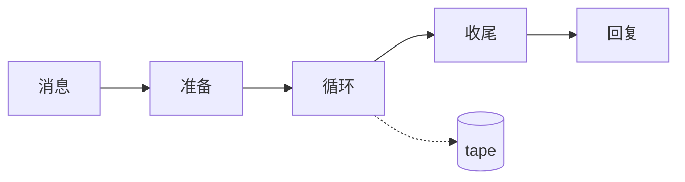

import { Aside } from '@astrojs/starlight/components';

## 背景 {#background}

Bub 的灵感源自于 OpenClaw、nanobot 那样的自我进化智能体，所以 Bub 最初把一切都堆在本体里：

- 每加一个消息渠道，就要在 `bub.channels` 里加一个类，外加一批工具或技能；
- 每加一项能力，就要多一个开关。
- ……

即便用户只用到其中一两个渠道、一两个能力，却要面对几十个开关、配置项，直接被淹没在茫茫的选项里不得要领。

于是 Bub 被重写了——额外的功能被剥离，留下的只有精心设计的轻内核以及自由组合的插件架构。

伴随着大模型的发展和进化，时至今日 Agent 早已不再是早期只会一问一答的聊天机器人，而是完全转变为和人一样对等的操作者、执行者，所以和其他 Agent 工具一样，Bub 诞生起就同样面临着如何与人协作、如何交接、如何执行时保持可见等社会化问题。

在精心设计架构基础上它应该要像艾萨克·阿西莫夫的机器人三定律一样有着明确的契约边界：明确的命令界限、可追溯的历史、运行保持中立， 最终实现从「助手行为」向「协作基础设施」的演进。

## 一次交互的旅程 {#journey}

看一次最常见的交互：你在终端里问了一句，Bub 回了一段。

**准备**负责确定这次消息属于哪个会话、把上一轮留下的东西装回来、把消息转成提示词。**循环**拿着提示词去问模型，模型要求用工具就去执行，结果回到上下文，再问一次，直到模型直接给出答案。**收尾**把结果存下来，包成一条出站消息，交给渠道发出去。

三个环节里，只有中间那个是通用的：不管消息来自终端、Telegram 还是别的什么地方，"模型 ⇄ 工具"这一段都一模一样。前后的两个环节都在处理"消息从哪来、回哪去"，而这恰恰是随部署变化的部分。

边界就画在这里。循环留在内核，两头交给应用。

## 四个概念 {#concepts}

沿着这条线，四个概念依次登场。它们的顺序不是随意的：每一个都解决上一个留下的问题。

### Turn：把两头的杂事收进有名字的阶段 {#turn}

既然两头归应用，那么"从收到消息到发出回复"这一整段就该有明确的形状。这就是 **turn**：一条进来的消息，以及它引起的全部工作。`BubFramework` 在它上面切出七个阶段，每个阶段都有名字，也都有对应的 hook。

这条设计沿用的是作者重写时定下的三条原则之一——单向依赖。应用层知道内核，内核不知道应用。内核不读配置、不认识插件；hooks 属于应用，由插件实现、由 `BubFramework` 调用。所以同一个 `core.Agent` 在两层里行为完全一致，你在 SDK 里验证过的东西，搬进 App 不会变。

**turn 里的三个词要分清**：一个 turn 可以包含一次**运行**（run，即一次 `agent.run()` 调用），一次运行可以包含多个**步骤**（step，即一次模型调用以及它要求的工具）。turn ⊃ run ⊃ step。

想改消息怎么进来、怎么出去，就改这里。[读 Turn](/zh-cn/docs/concepts/turn/)

### Tape：把历史与上下文拆成两件事 {#tape}

循环要读上下文，于是第一个问题是：上下文从哪来。

最直觉的做法是维护一个 message 数组，每次对话往里追加。Bub 没有这么做，这是第二个设计原则——**追加式上下文**：每条记录都写进 **tape**，不改已有条目；模型读的是 tape 的一个切片，而不是一个不断变长的数组。

拆开的好处很直接。历史里什么都在，事后可以查；上下文只挑该读的那几条，请求可以一直很短。也因为是只追加，中途反悔不会污染已经记下的东西。

代价是你要理解几个新词。tape 的**条目**（entry）是消息、工具调用、工具结果、事件和 anchor。**anchor** 标出上下文的起点，**handoff** 写一个新的 anchor 而**不删除**旧条目——它是遗忘的开关，不是压缩的开关。turn 的 **state** 则是另一个东西：一个本轮共享的普通字典，不落盘。

想让 agent 记得更多或更少，就改这里。[读 Tape](/zh-cn/docs/concepts/tape/)

### 事件：让循环把每一步说出来 {#events}

循环跑起来之后，宿主只剩一个问题：我怎么知道它在干什么？

Bub 的答案是第三个设计原则——**事件驱动**。模型的每次调用、每个工具的每次执行，都发出开始、结束和结果。宿主可以旁观一次运行，也可以在调用真正发生之前改写它、甚至叫停它。

这里最容易混淆的是三种"事件"：走 `EventBus` 的 `AgentEvent`（能拦、能改）、给调用方的 `StreamEvent`（只能读，改不了运行）、以及落到 tape 上的 `TapeEntry`（事后可查，不影响当前这一步）。方向搞错，行为就不对。

日志、权限、预算、审计、进度条，全都只是接在总线上的处理器，不需要动循环和工具。[读事件](/zh-cn/docs/concepts/events/)

### 扩展点：动作、做法、连接，各归各位 {#extension-points}

最后回到最初的问题：想加东西，加在哪？

这里对应的是剩下两条原则。**工具即函数**——一个有类型标注的 Python 函数就是工具，所以"加一个动作"的成本极低。**插件化**——能力都可以由插件提供，插件可以是一个工具、一个事件监听器、一个消息渠道，或一整套技能。

但正因为它什么都能装，才更需要分清职责：工具做动作，**技能**（skill）写做法（只写指令，不执行代码），**渠道**（channel）接入人的工作环境，**插件**（plugin）把前几样打包装起来。渠道之间传递的通信单元叫 **envelope**；在一轮运行进行中插话叫 **steering**。

职责不重叠，你才知道该改哪一块。反过来说，Bub 没有"什么都不用改"的万能扩展点——先想清楚你要加的是动作、知识，还是连接。[读扩展点](/zh-cn/docs/concepts/extension-points/)

## 小结 {#summary}

四个概念对应的就是[核心设计理念](/zh-cn/docs/getting-started/#core-design)里的那些原则，只是换了个讲法：

| 概念 | 它回答的问题 | 背后的原则 |
| --- | --- | --- |
| Turn | 一条消息进来后，应用依次做了什么？ | 单向依赖：应用知道内核，内核不知道应用 |
| Tape | 历史存在哪，模型读到哪一段？ | 追加式上下文：只写不改，读的是切片 |
| 事件 | 我怎么旁观、改写或叫停？ | 事件驱动：调用开始、结束、结果都发出来 |
| 扩展点 | 我要加的东西该做成什么？ | 工具即函数、插件化 |

顺序随意，但建议先读这一页：后面四页都在展开同一条旅程的不同切面。
