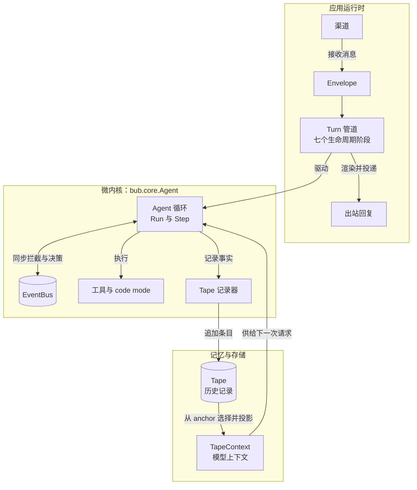

import { CardGrid, LinkCard } from '@astrojs/starlight/components';

模型可以决定下一步做什么，却无法保证应用一定如何运行。下一个 token 是概率性的，但会话边界、审计记录、权限检查和投递规则不应如此。

Bub 的回答是保持模型循环足够小，并让它周围的一切显式可见。框架不试图消除推理的不确定性，而是在推理外围建立确定性的控制、持久的记录和清晰的策略边界。

## 从助手到协作基础设施 {#background}

Bub 的灵感来自 OpenClaw、nanobot 等自我进化智能体。最初的设计遵循一种自然的直觉：把所有能力都放进本体。新增渠道意味着新的类和更多工具，新增能力意味着新的开关。很快，即使只部署一小部分功能，也要面对庞大的配置面。

重写扭转了这个方向。Bub 现在从轻量内核出发，让应用只组合自己需要的能力。

这层边界不只关乎易用性。Agent 早已不只是回答问题——它会修改文件、调用服务并与人协作。就像对阿西莫夫机器人三定律的一种工程化诠释，协作型 Agent 需要明确的命令边界、可检查的历史和中立的执行机制。Bub 把这些要求视为工程契约，而不是期待它们从模型行为中自然涌现。

## 跟随一条消息 {#journey}

理解 Bub 最简单的方式，是跟随一条入站消息。每个概念分别拥有旅程中的一段职责：

1. **渠道**把外部输入转换为 `Envelope`，应用随即启动一次 **Turn**，解析会话、准备提示词、运行模型、保存状态并路由回复。
2. **内核**驱动一次 **Run**。每个 **Step** 调用一次模型，并执行响应中请求的工具。循环持续到模型直接作答，或触及配置的上限。
3. 执行前后，**EventBus** 暴露生命周期事件。处理器既可以观察进度，也可以在副作用发生前同步拒绝、替换或改写调用。
4. **Tape 记录器**把对话和工具活动追加到 **Tape**。这份记录独立于有限的上下文窗口。
5. 发起下一次模型请求时，**TapeContext** 把存储条目投影为模型消息。**anchor** 可以移动读取起点，而不必擦除此前记录。

因此，这个循环包含两条彼此连接的流：控制流经过 Turn、Run、事件和工具；知识流则从执行进入 Tape，再以经过选择的上下文回到模型。

## 五大职责边界 {#concepts}

每个概念回答一个架构问题。组合起来，它们让你不必把 Agent 当成黑盒单体，也能推演整个系统。

<CardGrid>
  <LinkCard
    title="内核"
    description="最小的 Agent 循环是什么，哪些依赖必须由调用方显式组装？"
    href="/zh-cn/docs/concepts/kernel/"
  />
  <LinkCard
    title="Turn"
    description="一条入站消息如何沿确定性生命周期，从接收走到回复？"
    href="/zh-cn/docs/concepts/turn/"
  />
  <LinkCard
    title="Tape"
    description="如何让持久历史完整留存，同时让每次模型请求只获得聚焦的投影？"
    href="/zh-cn/docs/concepts/tape/"
  />
  <LinkCard
    title="事件"
    description="如何在不修改业务工具的前提下，让可观测性与跨切面策略介入执行？"
    href="/zh-cn/docs/concepts/events/"
  />
  <LinkCard
    title="扩展点"
    description="新的动作、指令、策略、生命周期行为或传输能力应该放在哪里？"
    href="/zh-cn/docs/concepts/extension-points/"
  />
</CardGrid>

如果你想先理解架构中心，可以从内核开始；如果想追踪完整消息流，按上面的顺序阅读即可。
