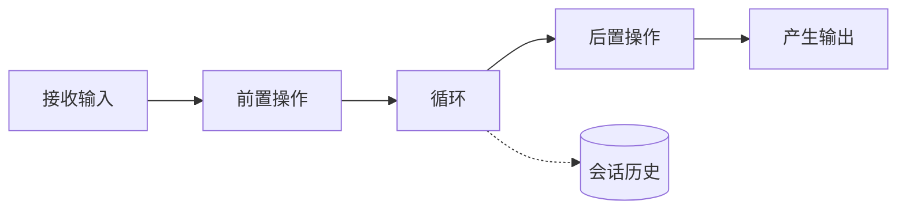

import { CardGrid, LinkCard } from '@astrojs/starlight/components';

## 背景 {#background}

Bub 的灵感源自于 OpenClaw、nanobot 那样的自我进化智能体，所以最初把一切功能都堆在本体里：

- 每加一个消息渠道，就要在 `bub.channels` 里加一个类，外加一批工具或技能；
- 每加一项能力，就要多一个开关。
- ……

这就导致即便用户只用到其中一两个渠道、一两个能力，也要面临几十个开关、配置项，直接被淹没在茫茫的选项里不得要领。

于是 Bub 被重写了——剥离额外功能，只有留下精心设计的轻内核以及自由组合的插件架构。

伴随着大模型的发展和进化，时至今日 Agent 早已不再是早期只会一问一答的聊天机器人，而是完全转变为和人一样对等的操作者、执行者，所以和其他 Agent 工具一样，Bub 诞生起就同样面临着如何与人协作、如何交接、如何执行时保持可见等社会化问题。

在精心设计架构基础上它应该要像艾萨克·阿西莫夫的机器人三定律一样有着明确的契约边界：明确的命令界限、可追溯的历史、运行保持中立， 最终实现从「助手行为」向「协作基础设施」的演进。

## 一次交互的旅程 {#journey}

纵观所有 Agent 设计，其核心交互流程都如下所示，Bub 也不例外：

整个流程仍然属于软件工程范畴，这就意味着除了接收消息和产生输出两端之外，其他过程都属于中间过程，业界所有的设计大多数都在中间过程做工程化设计。

## 职责边界 {#concepts}

沿这条链路，可以将 Bub 划分出如下职责边界，每块职责边界没有先后依赖顺序，你可以按需浏览。

<CardGrid>
  <LinkCard
    title="Turn"
    description="定义完整流程。从接收到响应的过程可以被划分多个阶段。"
    href="/zh-cn/docs/concepts/turn/"
  />
  <LinkCard
    title="Tape"
    description="补充历史和上下文。会话历史只追加，模型可按需从某个起点开始获取完整记录。"
    href="/zh-cn/docs/concepts/tape/"
  />
  <LinkCard
    title="事件"
    description="让运行过程可介入。每次模型调用和工具执行都有头有尾有结果。"
    href="/zh-cn/docs/concepts/events/"
  />
  <LinkCard
    title="扩展点"
    description="决定新逻辑如何切入。工具、技能、渠道、插件，都有可以切入的位置。"
    href="/zh-cn/docs/concepts/extension-points/"
  />
</CardGrid>
