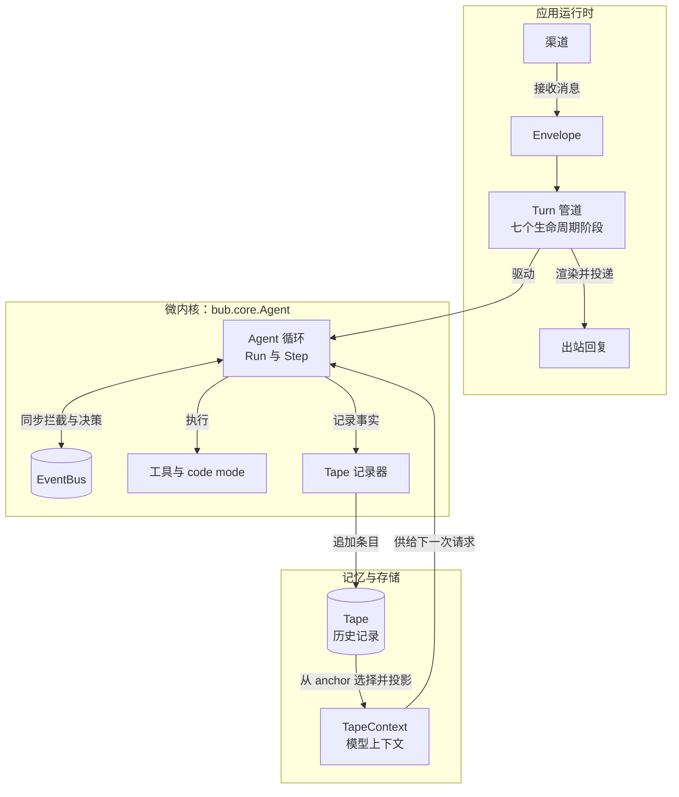

把 Agent 嵌入已有服务时，它应该像一个库，而不是第二个应用。它不应悄悄读取配置文件、发现插件、打开渠道，或假定某个进程级单例负责管理自己的资源。

`bub.core.Agent` 正是围绕这个约束设计的。它只包含模型与工具的循环，外围能力由调用方提供。这就是 Bub 的**微内核**边界。

## 小巧的中心，显式的边缘 {#mental-model}

在完整的消息流中，内核只是中心，而不是整个运行时：



应用运行时决定**何时运行**以及**消息去往何处**，内核决定**一次 Run 如何推进**。存储负责保留发生过的事情，`TapeContext` 则决定下一次模型调用可以看到什么。

## 为什么不把所有开关都放进 Agent？ {#why-microkernel}

单体 Agent 看似方便，直到不同宿主需要不同行为。全局配置会让测试相互影响，隐式发现会让启动过程难以预测，隐藏的资源所有权则会让关闭时机失去确定性。

显式组装把这些决定交还给组合根——应用本来就会在这里创建并管理依赖：

```python
from bub.core import Agent


agent = Agent(
    model=model,
    store=store,
    tools=[search_orders, update_order],
    context=context,
    sidecars=sidecars,
)
```

等号右侧的每个名字都由宿主提供。Agent 不会按全局名称查找模型，不会扫描环境来寻找存储，也不会导入已安装插件。你可以在同一进程中构造两个使用不同工具、存储和上下文策略的 Agent，而不必修改全局状态。

`bub.core.Agent` 不依赖 `os.environ`，不加载 Bub 配置，也不执行插件发现。你传入的模型客户端或其他适配器可以拥有自己的凭据策略，但那属于适配器，而不是藏在 Agent 循环里的隐式行为。

## 双层架构的边界 {#two-layers}

内核与应用是互补的两层，不是两套不同的 Agent 引擎：

| 层级 | 负责 | 有意不作的假设 |
| --- | --- | --- |
| `bub.core` | Run 与 Step 执行、模型调用、工具调度、Agent 事件、Tape 记录与上下文投影 | 会话路由、渠道生命周期、配置文件、插件发现 |
| `bub.framework` 与 `bub.builtin` | Turn 编排、设置、会话恢复、渠道网关、内置行为与已安装插件 | 每个宿主都需要 CLI、消息网关或内置存储布局 |

这种分离让同一个循环可以运行在 Web 服务、异步 worker、测试或完整 Bub 应用中，由宿主决定在外围放置多少基础设施。

包边界也遵循同样的思路：`pip install bub` 只安装内核依赖；框架、CLI、渠道、hooks 和内置应用需要 `app` extra。

## 用协议取代供应商假设 {#contracts}

内核协调的是契约，而不是指定供应商：

| 构造参数 | 提供的契约 |
| --- | --- |
| `model` | Republic chat model 或 `ModelClient` 适配器 |
| `store` | 同步或异步的 `TapeStore` 实现 |
| `tools` | 通过统一工具契约暴露的可执行函数 |
| `context` | 把存储条目投影为模型消息的 `TapeContext` |
| `sidecars` | 绑定到 Tape、拥有独立记录的附加能力 |

默认值同样局部且在代码中可见。例如，省略 `store` 会创建 `InMemoryTapeStore`，不会悄悄选择数据库，也不会让记录自动持久化。供应商中立同样意味着循环依赖模型契约，而不是凭据或供应商特定参数从此消失。

## 选择你需要的层级 {#choose-layer}

当宿主已经负责会话、依赖注入、并发和回复路由时，直接使用**内核**。你选择 Tape 名称，打开并消费 Run，再决定如何处理它的事件流。

当你希望框架提供这些关注点——完整的 Turn 管道、配置、内置会话行为、插件发现和渠道集成——就使用**应用层**。

这里选择的是所有权，而不是能力。从能让宿主保持清晰控制的最小层开始，在确实需要应用运行时的生命周期服务时再引入它。工具、技能、策略、hooks 和渠道如何围绕这两层组合，见[扩展点](/zh-cn/docs/concepts/extension-points/)。
