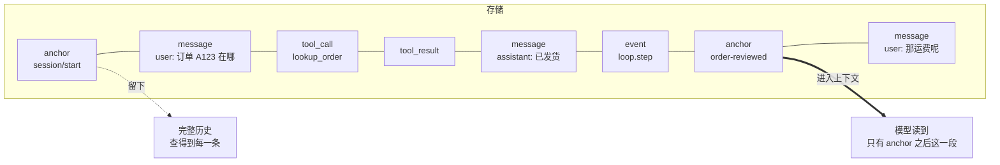
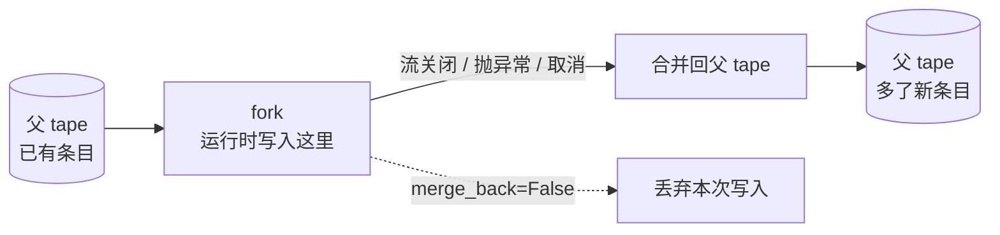

import { Aside } from '@astrojs/starlight/components';

Agent 需要两样东西。一是自己干过什么的记录，二是下一次模型调用要用的一组消息。Bub 把记录存进 tape，再用你选中的条目拼出模型上下文。

两者分开，是 Bub 里最有用的一个决定：你可以留下完整历史，同时只发一个短请求。这一页讲它们各自怎么工作，以及什么时候会碰到边界。

`core.Agent` 和 `BubAgent` 共用这套机制。两者的默认存储和会话名不一样。

## 一篇对话，两种读法 {#history-and-context}

先把这个区分立起来，后面的内容都挂在它上面：



- **历史**是全部条目，按写入顺序排列，只追加。事故复盘、审计、调试都读它。
- **上下文**是筛出来的一个切片，转成 Republic 消息后交给模型。模型看不见被筛掉的部分。

筛选规则由 `TapeContext` 决定，默认规则是"最近一个 anchor 之后的会话条目"。

## 存储 {#storage}

普通的 `Agent` 默认创建 `InMemoryTapeStore`。历史跟着这个存储一起活，存储没了就没了。要在进程之间保留，传一个文件存储：

```python
from pathlib import Path

from bub.core import Agent
from bub.core.store import FileTapeStore

agent = Agent(store=FileTapeStore(Path("sessions")))
```

每次 `agent.run(..., tape="customer-42")` 用的都是这个存储里名为 `customer-42` 的 tape。名字相同就接着上一次聊，名字不同就分开。`Agent` 原样使用你给的名字；应用有自己的工作区与会话命名规则，见[应用存储](#app-storage)。

`agent.tape(name)` 让你在一次运行之外看这个 tape。它的写入直接进存储：

```python
async def inspect_history() -> None:
    tape = agent.tape("customer-42")
    messages = await tape.read_messages()
    entries = list(await tape.query().all())
    print(len(messages), "model messages;", len(entries), "stored entries")
```

`read_messages()` 走上下文规则，`query()` 读原始条目——同一份 tape，两种读法，正是前面那张图。

要自己写存储，实现 `bub.core.store` 里的 `TapeStore` 或 `AsyncTapeStore`。存储的读写接口、`TapeQuery` 的过滤条件，见 [Python API 参考](/zh-cn/docs/reference/python-api/)。持久化和跨进程协调由你的存储和应用负责；[SQLAlchemy 指南](/zh-cn/docs/integrations/storage/)给了一个完整的替换实现。

## 上下文 {#context}

tape 的条目有消息、工具调用、工具结果、事件和 anchor。正常记录只追加；要清空历史，得显式调用 `Tape.reset()` 这类操作。

默认的 `TapeContext` 选出最近一个 anchor 之后的会话条目，再转成 Republic 消息：

| 条目 | 模型上下文 |
| --- | --- |
| `anchor` | 默认查询不含它。如果自定义查询选了 anchor，默认选择器会把它转成 assistant 消息。 |
| `message` | 保存的那条消息。 |
| `tool_call` | 一条 assistant 消息，带上这些调用。 |
| `tool_result` | 工具消息，与前面的调用配对。 |
| 其他事件 | 默认选择器跳过。 |

注意最后一行。**事件默认不进上下文**，所以你在 tape 上记什么和模型看到什么是两件事——这既是自由度也是陷阱：记了大量有用信息，模型却一条都看不到。

### 用 anchor 切上下文 {#anchors}

anchor 标出上下文的新起点。`handoff()` 写一个 anchor，前面的条目照旧保留：

```python
async def start_next_phase() -> None:
    await agent.tape("customer-42").handoff(
        name="order-reviewed",
        state={"summary": "Order A123 has shipped; the customer needs tracking details."},
    )
```

这里的 `state` 存在 anchor 上，位置在默认查询的起点之前。**要把摘要带进下一阶段，必须把它放进下一次提示词，或者在你的上下文策略里显式选它**——handoff 本身不会把摘要"传"给模型。

这就是 handoff 最常被误解的地方：它是**遗忘**的机制，不是记忆的机制。它决定旧的哪些看不见，不负责把旧的压缩成新的。

新会话会自动得到一个 `session/start` anchor，所以第一次运行也有起点。

### 换一套选择规则 {#custom-selectors}

想换一个 anchor，就给 `Agent` 传 `context=TapeContext(...)`。也可以用自己的 `select(entries, context)` 函数：

```python
from bub.core import Agent
from bub.core.context import default_tape_context
from bub.core.tape import TapeContext


def select_recent_business_events(entries, context):
    """把业务事件也交给模型，而不只是消息。"""
    return default_tape_context().select(entries, context)


agent = Agent(context=TapeContext(anchor=None, select=select_recent_business_events))
```

选择器返回 Republic 消息，或者返回它们的 awaitable。`default_tape_context()` 含工具往返；不带 `select` 的 `TapeContext` 用更简单的消息转换。带 `context=False` 的条目，在默认或自定义选择器运行之前就被剔除。

### 上下文超长时 {#context-overflow}

Agent 认出上下文长度错误时，会自动 handoff 一次，然后用更短的上下文重试。

<Aside type="caution">
  自动 handoff 只是把起点往后挪。**要保留前面历史的摘要，你得在 handoff 之前自己生成。** 如果剩下的请求还是太大，重试仍会失败。
</Aside>

需要按预算主动管理上下文时，[`bub-context-budget` 插件](/zh-cn/docs/sdk/reuse-plugins/)是一个可以直接用的例子：它在上限接近时提示模型调用 `tape.handoff`。

## 状态 {#state}

传给 `agent.run()` 的 `state` 是一个可变字典。本轮的工具、提示词片段和事件处理器共用它。

它**不是**持久化的东西。运行结束，这个字典就没有归属了。持久化由你的应用负责：长期数据放进自己的存储，或者把选定的事实写进 tape，需要时再读回来。

默认的 [TapeRecorder](/zh-cn/docs/concepts/events/#recording) 保存会话往返和一部分生命周期记录。其他变量、自定义事件和决策，要自己记录——可以写进 `state` 顺带处理，也可以 `append_event` 写进 tape 长期保留。

| 要保存的东西 | 放哪 |
| --- | --- |
| 本轮临时计算的结果 | `state`，本轮结束即弃 |
| 需要事后查询的业务事实 | tape 的 `event` 条目 |
| 需要在下一轮读回的结构化数据 | 你自己的存储，或 anchor 的 `state` + 显式加载 |
| 要有完整审计的对话 | tape 本身（TapeRecorder 已经在做） |

## 分支 {#forks}

每次 `agent.run()` 都会给它的 tape 开一个分支。流关闭时，分支把新条目追加到父 tape。

这个行为在异常路径上也成立：抛异常或提前取消，同样会合并。所以一次失败的运行，也可能留下有用的部分历史——调试时这点很有价值。



传 `merge_back=False`，退出时丢掉分支的记录。这只影响 tape 写入：工具已经产生的副作用，比如发出的请求、改过的文件，都还在。**分支是记录层的隔离，不是副作用层的事务。**

自己管一段工作时，用 `agent.session(name, merge_back=...)` 或 `tape.fork_tape(merge_back=...)`。两者默认都在退出时合并，异常退出也合并。

两个运行共用一个 tape，又要看到对方做完的结果，就把它们串起来。会话锁由你的应用提供。[FastAPI 示例](/zh-cn/docs/sdk/web-service/)演示了单进程内的加锁；多个 worker 之间要另外协调。

## Sidecar {#sidecars}

`TapeSidecar` 把相关的数据存在另一个 tape 里，语义上仍属于同一个 tape。

挂载的 sidecar 跟着主 tape 一起分支、合并和重置。它的条目不进主上下文，所以不会挤占模型请求。你的应用需要时，用 `Agent(sidecars=...)` 传进去。

Bub 应用给大型工具结果挂了一个 spill sidecar。会话里留一小段预览和一个句柄，agent 可以用 `spill.read` 分段读。这就是"历史可以很大，上下文必须很小"的另一种落地方式：把体积移到旁边，而不是删掉。

合并分支或重置 tape 时，sidecar 的失败单独记录，主 tape 的操作照样完成——sidecar 是附加能力，坏了不该拖垮主流程。spill 的上限在[应用配置](/zh-cn/docs/app/configure/)里。

## 应用存储 {#app-storage}

`BubAgent` 用的是 `BubFramework` 给的存储。内置应用用 Bub home 目录下的 `FuzzyFileTapeStore`，通常是 `~/.bub/tapes/`。

tape 名称由工作区路径和会话 ID 的哈希拼成。所以同一个会话 ID 在两个工作区里，历史是分开的——在 `~/work` 和 `~/scratch` 里用同一个会话名，看不到对方说过什么。

要换存储，应用用 `provide_tape_store`。要选上下文，用 `build_tape_context`。[SQLAlchemy 指南](/zh-cn/docs/integrations/storage/)演示了这条插件路线。直接用 SDK 的服务，按[存储](#storage)一节的说明把实现传给 `Agent(store=...)`。

内置应用会从 tape 记录里恢复部分会话设置。其他本轮状态要自己持久化。
