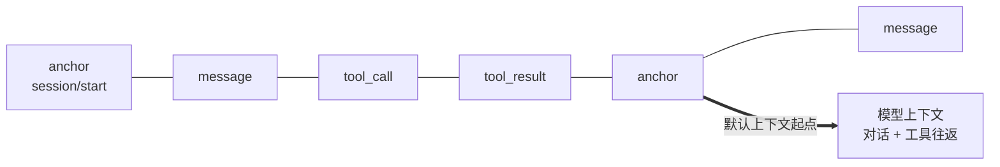

应用需要完整、可信的历史，模型却只需要有限且相关的输入。Bub 因此把两者分开：**Tape 是持久记录，模型上下文是这份记录的一次投影**。

## 一份记录，两种视图 {#history-and-context}

- **Tape（写）**：按顺序追加 `TapeEntry`，包括对话消息、工具调用、工具结果、anchor 和显式记录的业务事件。`tape.query()` 查询原始条目。
- **`TapeContext`（读）**：选择本次需要的条目并转换成模型消息。`tape.read_messages()` 返回投影，不是原始记录。

默认投影 `default_tape_context()` 读取最近一个 anchor 之后的条目，重建对话与工具往返。标记为 `context=False` 的条目会在筛选前被排除，不进入模型上下文。

:::note[追加，但不是不可变审计日志]
正常记录只追加；`tape.reset()` 会清空记录并写入新的 `session/start`。
:::

## anchor 与 handoff {#anchors}

**锚点（anchor）**标记认知阶段的切换，例如信息收集结束或新任务开始。**交接（handoff）**通过追加新的 anchor，把默认上下文的起点前移，同时保留此前的全部记录。

handoff 只改变默认读取边界：它不生成摘要、不删除历史，也不会自动把 anchor 的 `state` 注入下一次请求。需要摘要时，应显式生成并写入后续模型输入。具体用法见 [SDK：anchor 和 handoff](/zh-cn/docs/sdk/tape/#anchors-and-handoff)或应用内置的 [`tape.handoff` 命令](/zh-cn/docs/reference/tools/#tape-handoff)。

## 数据应该放在哪里 {#state}

| 位置 | 生命周期 | 放什么 |
| --- | --- | --- |
| `state` / `TurnState` | 一次 Run 或 Turn | 请求内临时共享的值 |
| `metadata` | 一次 Run | 请求标识等观测信息，不进入模型输入 |
| Tape 条目 | 由存储决定，可跨进程 | 对话、工具往返、显式写入的业务事实 |
| anchor 的 `state` | 随历史保存 | 阶段快照 |
| 应用存储 | 由应用决定 | 需要 `load_state` 恢复的会话配置 |

`core.Agent` 默认使用内存存储；持久化、分支与并发等用法见 [SDK：Tape 与记忆](/zh-cn/docs/sdk/tape/)，存储后端接入见[存储集成](/zh-cn/docs/integrations/storage/)。
