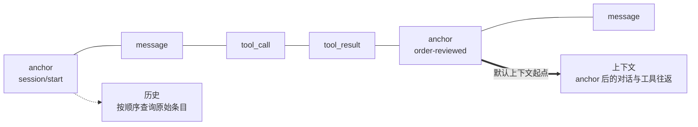

import { Aside } from '@astrojs/starlight/components';

Tape 保存 Agent 的运行记录，`TapeContext` 从这些记录中选择下一次模型调用的输入。**保存的历史不等于模型看到的上下文**：历史可以持续增长，每次请求只读取其中一部分。

`core.Agent` 和 `BubAgent` 共用这套机制，默认存储和 Tape 命名方式不同。

## 历史与上下文 {#history-and-context}



- **历史**由 Tape 条目组成，通过 `query()` 按写入顺序查询。
- **上下文**由 `TapeContext` 筛选条目并转换为 Republic 消息，通过 `read_messages()` 构建。

正常记录只追加，不修改旧条目；`reset()` 等显式操作会清空记录，因此 Tape 不是不可变的事件日志。

## 默认上下文规则 {#context}

Agent 默认使用 `default_tape_context()`，从最近的 anchor 之后选择对话和工具往返：

| 条目类型 | 内容 | 默认上下文中的处理 |
| --- | --- | --- |
| `message` | 用户、助手、系统等对话消息 | 转换为对应消息 |
| `tool_call` | 模型请求的工具调用 | 转换为带工具调用的助手消息 |
| `tool_result` | 工具执行结果 | 与前面的调用配对，转换为工具消息 |
| `anchor` | 上下文起点及可选状态 | 作为查询边界，不包含在结果中 |
| `event`、`system`、`error` | 业务事件、系统提示变化或记录错误 | 跳过 |

带 `context=False` 的条目会在选择前被过滤。普通业务 `event` 默认也不会进入模型请求；需要让模型读取时，必须自定义选择逻辑。

`default_tape_context()` 会重建工具往返。直接构造的 `TapeContext()` 没有选择器时，只转换 `message` 条目，两者不要混用。

## 用 anchor 划分阶段 {#anchors}

`handoff()` 写入一个 anchor，将默认上下文的起点移到这里，之前的记录仍然保留：

```python
async def start_next_phase() -> None:
    await agent.tape("customer-42").handoff(
        name="order-reviewed",
        state={"summary": "订单 A123 已发货，用户接下来需要物流信息。"},
    )
```

`handoff()` 不会自动生成摘要，也不会自动把 `state` 注入下一次请求。需要保留摘要时，应在 handoff 前生成，再通过下一条提示词或自定义上下文选择器显式提供。

`Agent.session()` 和 `Agent.start()` 会为新会话创建 `session/start` anchor；仅调用 `agent.tape(name)` 不会创建它。

### 选择其他起点 {#custom-selectors}

`TapeContext.anchor` 决定查询范围：

| 值 | 查询范围 |
| --- | --- |
| `LAST_ANCHOR`（默认） | 最近一个 anchor 之后 |
| `"order-reviewed"` | 指定名称的 anchor 之后 |
| `None` | 不按 anchor 过滤 |

沿用默认消息转换、只更换起点时，可以用 `dataclasses.replace()`：

```python
from dataclasses import replace

from bub.core import Agent, default_tape_context

agent = Agent(
    context=replace(default_tape_context(), anchor="order-reviewed"),
)
```

需要完全不同的投影时，向 `TapeContext(select=...)` 传入选择函数。它接收条目和上下文，返回 Republic 消息列表或其 awaitable。自定义函数会取代默认选择器，因此普通对话、工具往返和业务事件需要由你按需组合。

### 上下文超长 {#context-overflow}

Agent 识别到上下文长度错误时，会自动 handoff 一次并重试原提示词。这个操作只移动上下文起点，不生成摘要；剩余请求仍然过大时会再次失败。

需要按预算主动管理上下文时，可以使用 [`bub-context-budget` 插件](/zh-cn/docs/sdk/reuse-app/)，让模型在接近上限时调用 `tape.handoff`。

## 区分运行状态与持久化记录 {#state}

传给 `agent.run()` 的 `state` 是本轮共享的可变字典，不会自动持久化或在下轮恢复。

| 要保存的内容 | 存放位置 |
| --- | --- |
| 只在本次运行使用的临时值 | `state` |
| 需要事后查询的业务事实 | 通过 `append_event()` 写入 Tape |
| 下次运行要恢复的结构化状态 | 应用存储，或 anchor 的 `state` + 显式加载 |
| 对话和工具往返 | 由 `TapeRecorder` 写入 Tape |

`TapeRecorder` 只记录对话、工具往返和选定的生命周期事件，不是完整审计器。自定义业务事件需要显式写入，是否进入模型上下文仍由 `TapeContext` 决定。

## 运行分支 {#forks}

每次 `agent.run()` 都在 Tape 的分支（fork）上记录新条目。流关闭时，分支默认合并回父 Tape；正常结束、异常、取消和提前停止消费都会执行合并。

```python
async with agent.run("继续处理订单", tape="customer-42") as stream:
    async for event in stream:
        ...
```

传 `merge_back=False` 可以在退出时丢弃本次分支的记录。也可以用 `agent.session(name, merge_back=...)` 或 `tape.fork_tape(merge_back=...)` 自行管理作用域。

<Aside type="caution">
  分支只隔离 Tape 记录，不是副作用事务。即使 `merge_back=False`，工具已经修改的文件、发送的请求或外部写入也不会回滚。
</Aside>

多个运行需要读取彼此已完成的结果时，由应用协调执行顺序。`FileTapeStore` 不提供跨 worker 的会话锁；[FastAPI 示例](/zh-cn/docs/sdk/web-service/)演示了单进程内的锁。

## Sidecar {#sidecars}

`TapeSidecar` 把关联数据存入与主 Tape 配套的另一个 Tape。通过 `Agent(sidecars=...)` 挂载后，sidecar 随主 Tape 分支、合并和重置，但其条目不进入主上下文。

Bub 应用用 spill sidecar 保存大型工具结果。主会话只保留预览和句柄，Agent 再通过 `spill.read` 分段读取。触发阈值由 [`BUB_SPILL_THRESHOLD`](/zh-cn/docs/reference/settings/#spill-settings) 配置。

## 媒体记录边界 {#media}

模型请求可以包含图片、音频和视频，但 Tape 不是媒体文件存储。Run 的分支写入记录时，会剔除提示词中的非文本内容块，只保留文本，避免把内联媒体复制进 JSONL 历史。

需要事后重放或审计媒体时，由宿主把文件保存到对象存储或文件系统，再在文本中记录可解析的引用。工具需要把媒体交回当前模型调用时，使用 [`content_result()`](/zh-cn/docs/sdk/tools/#media-results)。

## 选择存储 {#storage}

普通 `Agent` 默认使用 `InMemoryTapeStore`，记录只保存在当前进程中。需要跨进程保留时，传入文件存储：

```python
from pathlib import Path

from bub.core import Agent
from bub.core.store import FileTapeStore

agent = Agent(store=FileTapeStore(Path("sessions")))
```

`agent.run(..., tape="customer-42")` 使用同名 Tape。相同名称延续已有记录，不同名称相互独立。

在 Run 之外，可以通过 `agent.tape(name)` 读取历史：

```python
async def inspect_history() -> None:
    tape = agent.tape("customer-42")
    messages = await tape.read_messages()
    entries = list(await tape.query().all())
    print(f"模型消息：{len(messages)}，存储条目：{len(entries)}")
```

`read_messages()` 应用上下文规则，`query()` 返回原始条目。自定义后端需要实现 `bub.core.store.TapeStore` 或 `AsyncTapeStore`；完整替换示例见[存储集成](/zh-cn/docs/integrations/storage/)。

## 应用存储 {#app-storage}

内置应用通过 `provide_tape_store` 提供 `FuzzyFileTapeStore`，默认目录为 `~/.bub/tapes/`。Tape 名称由工作区路径和会话 ID 共同生成，因此不同工作区中的同名会话不共享历史。

`BubAgent` 按以下顺序选择存储：

1. 显式传入的 `tape_store`；
2. 创建 Agent 时 `framework.get_tape_store()` 返回的存储；
3. 两者都没有时，使用内存存储。

要使用 `framework.running()` 提供的存储，应在该作用域内创建 `BubAgent`。替换存储使用 `provide_tape_store`，替换上下文策略使用 `build_tape_context`。

内置应用会从 Tape 恢复模型、推理力度和 code mode 等会话设置，其他应用状态需要自行持久化。
