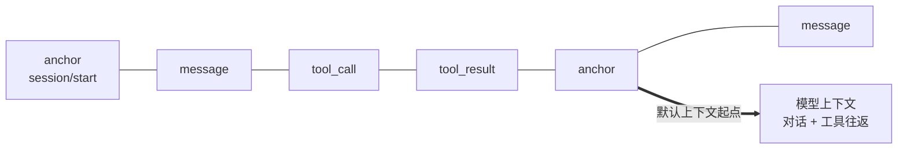

在开发长对话或多步骤 Agent 时，我们经常会遇到一个矛盾：

- **对应用和开发者来说**，我们需要一份完整、不可篡改的历史记录，清楚记下用户说过什么、模型调了哪些工具、传了什么参数、返回了什么结果，以便排查问题、审计行为或恢复会话；
- **对大模型来说**，它的上下文窗口有限，过多陈旧的中间过程会干扰当前推理，因此每次调用只需要一份精简、相关的消息列表。

如果把这两件事混在同一个 `messages` 列表里，你就会陷入两难：不裁剪，上下文迟早溢出；一旦裁剪或改写，原本的历史记录就被永久破坏了。

Bub 的做法是把「存历史」和「读上下文」彻底分开：**Tape 负责持久化完整的追加式记录，而模型上下文则是每次调用前通过 `TapeContext` 从中筛选并生成的视图**。

## 一份记录，两种视图 {#history-and-context}

你可以把 Tape 和 `TapeContext` 分别看作同一份会话数据的「写入端」与「读取端」：

- **Tape**（写）：按时间顺序追加 `TapeEntry` 条目，类型包括对话消息（`message`）、工具调用（`tool_call`）、工具结果（`tool_result`）、分界锚点（`anchor`）和自定义事件（`event`）。调用 `tape.query()` 可查询完整原始条目。
- **`TapeContext`**（读）：每次请求模型前，按规则挑选条目并转换为模型消息列表。调用 `tape.read_messages()` 返回转换后的模型上下文。

默认情况下，Agent 使用 `default_tape_context()`：它定位到**最近一个 `anchor`**，只将该锚点之后的条目还原为对话与工具消息。写入时带有 `context=False` 的条目会被自动排除，不进入模型上下文。

:::note[只追加，可显式重置]
正常运行时 Tape 只追加新条目、不修改旧记录。调用 `tape.reset()` 会清空当前记录，并写入新的 `session/start` 锚点。
:::

## 用 anchor 与 handoff 切换阶段 {#anchors}

随着对话不断变长，或者当一个复杂任务从「收集信息」进入「执行修改」阶段时，我们往往希望让模型放下前面的冗长过程、轻装上阵，同时又不想把之前的历史记录删掉。

Bub 用 **anchor**（锚点）和 **handoff**（阶段交接）来解决这个问题：

- **anchor** 是插在 Tape 上的一个路标，用来标记会话进入了一个新阶段（例如会话刚开始时的 `session/start`，或代码审查完成后的 `reviewed`）。
- **handoff** 则是往 Tape 末尾追加一个新 anchor 的操作。因为默认的 `TapeContext` 只从最近一个 anchor 往后读，一旦执行了 handoff，**模型上下文的起点就会立刻前移到这个新路标处**，而此前的所有记录依然完好地保存在 Tape 中，随时可以通过 `tape.query()` 检索。

需要注意，handoff 只负责**前移默认读取起点**：它不会自动调用模型生成摘要，不会删除旧记录，也不会自动把 anchor 里的 `state` 注入提示词。如果你需要在切换阶段时保留前情提要，可以先整理出摘要再显式传入。代码用法见 [SDK：anchor 与 handoff](/zh-cn/docs/sdk/tape/#anchors-and-handoff)，终端用法见内置的 [`tape.handoff` 工具](/zh-cn/docs/reference/tools/#tape-handoff)。

## 数据应该放在哪里 {#state}

在 Bub 中，不同生命周期的数据有各自对应的存放位置，切勿把所有东西都塞进同一个地方：

| 位置 | 生命周期 | 用途 |
| --- | --- | --- |
| `state` / `TurnState` | 单次 Run 或 Turn | 请求内的临时共享变量（如请求 ID、权限标志、确认回调） |
| `metadata` | 单次 Run | 供日志和事件处理器读取的调用元数据，不进入模型上下文 |
| `TapeEntry` | 由存储后端决定，可跨进程持久化 | 对话消息、工具调用往返及显式写入的业务事件 |
| anchor 的 `state` | 随 Tape 持久保存 | 阶段切换时的结构化快照或摘要 |
| 应用外部存储 | 由应用自行管理 | 通过 `load_state` / `save_state` 跨 Turn 读写的业务状态 |

`core.Agent` 默认使用内存存储（`InMemoryTapeStore`）。想在代码中配置文件持久化、自定义上下文筛选或管理分支，请阅读 [SDK：Tape 与记忆](/zh-cn/docs/sdk/tape/)；想接入 SQLite 或 PostgreSQL，请阅读[使用数据库存储会话历史](/zh-cn/docs/integrations/storage/)。
